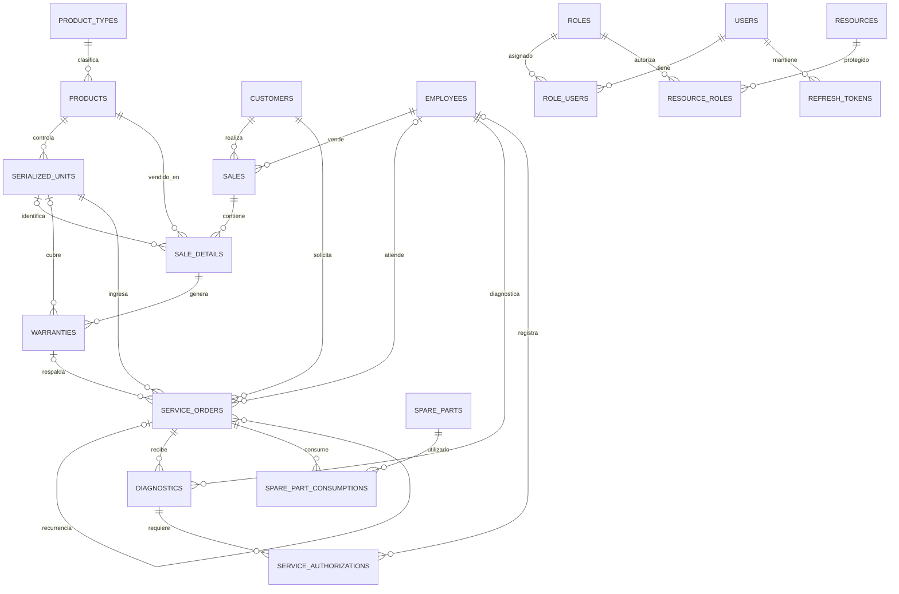

# Resumen del proyecto MovilCare

## 1. Propósito

MovilCare es un sistema para administrar operaciones de un negocio de equipos y
reparaciones: clientes, productos e inventario, ventas, garantías, órdenes de
servicio y repuestos. El backend principal también incluye inicio de sesión y
autorización basada en roles y recursos (RBAC).

## 2. Componentes encontrados

### Backend principal: `app-movilcare-express`

- API REST construida con Node.js, TypeScript y Express.
- Persistencia con Sequelize y MySQL.
- Las rutas de la API se montan bajo `/api`; el puerto predeterminado es `4000`.
- Swagger está configurado para documentar la API.
- El arranque autentica la conexión, sincroniza los modelos y ejecuta una
  migración para asociar productos con tipos de producto.
- La configuración de la base de datos se lee de variables como
  `MYSQL_HOST`, `MYSQL_PORT`, `MYSQL_NAME`, `MYSQL_USER` y `MYSQL_PASSWORD`.
  No se incluyen valores de archivos `.env` en este resumen.

Código relacionado: `app-movilcare-express/src/server.ts`,
`app-movilcare-express/src/config/index.ts`,
`app-movilcare-express/src/databases/db.ts` y
`app-movilcare-express/src/routes/index.ts`.

### Backend adicional: `backend_manual`

Es una implementación aparte basada en NestJS y Sequelize con TypeScript. En
los modelos visibles actualmente aparecen `ClientModel`, `ProductModel` y
`ProductTypeModel`, que usan las tablas `clients`, `products` y
`product_types`. No debe asumirse que este backend comparte exactamente el
esquema del backend Express: por ejemplo, Express usa `customers` y un modelo
de cliente con campos diferentes.

### Frontend: `app-movilcare-frontend`

En la carpeta revisada se encontraron documentación y capturas, pero no código
fuente de la aplicación. Por ello, este resumen no atribuye pantallas ni
funcionalidades de interfaz que no se puedan verificar.

## 3. Entidades y tablas del backend Express

Los modelos de negocio usan marcas de tiempo (`created_at` y `updated_at`) y
nombres de columnas en snake_case, según la configuración de Sequelize.

| Entidad | Tabla | Propósito y datos principales |
|---|---|---|
| Cliente (`Customer`) | `customers` | Persona o empresa: tipo y número de documento, nombres, contacto, dirección y estado. El documento es único por tipo; el correo, si se informa, también es único. |
| Empleado (`Employee`) | `employees` | Personal con nombre, documento, correo, rol operativo (`SELLER`, `TECHNICIAN`, `ADMIN`) y estado. |
| Tipo de producto (`ProductType`) | `product_types` | Clasifica productos mediante nombre, descripción y estado. |
| Producto (`Product`) | `products` | Catálogo e inventario: SKU, nombre, tipo, precio, costo, impuesto, marca/modelo, stock y configuración de serialización y garantía. |
| Unidad serializada (`SerializedUnit`) | `serialized_units` | Unidad individual de un producto que requiere trazabilidad: seriales, fecha de recepción y estado (`IN_STOCK`, `SOLD`, `IN_SERVICE`, `RETIRED`). |
| Venta (`Sale`) | `sales` | Encabezado de venta asociado a cliente y vendedor: número, fecha, subtotal, descuento, impuestos, total y estado. |
| Detalle de venta (`SaleDetail`) | `sale_details` | Líneas de venta con producto, cantidad, precio, descuento, impuesto y total; puede referenciar una unidad serializada. |
| Pago (`Payment`) | `payments` | Registro de pagos con tipo e identificador de referencia, método, monto, fecha y estado. Puede referirse a una venta o a una orden de servicio. |
| Garantía (`Warranty`) | `warranties` | Cobertura de una línea vendida y, opcionalmente, de una unidad serializada: tipo, descripción, vigencia y estado. |
| Orden de servicio (`ServiceOrder`) | `service_orders` | Recepción y seguimiento de un equipo: cliente, unidad serializada, técnico, tipo, problema reportado, fechas, valor y estado. Permite indicar garantía y orden de origen para recurrencias. |
| Diagnóstico (`Diagnostic`) | `diagnostics` | Evaluación técnica de una orden: técnico, descripción, causa, cobertura por garantía, mano de obra, estimado y fecha. |
| Autorización de servicio (`ServiceAuthorization`) | `service_authorizations` | Respuesta del cliente a un diagnóstico: estado, monto autorizado, canal, fecha, notas y empleado que la registra. |
| Repuesto (`SparePart`) | `spare_parts` | Catálogo e inventario de repuestos: SKU, compatibilidad, costo, precio y existencias actuales/mínimas. |
| Consumo de repuesto (`SparePartConsumption`) | `spare_part_consumptions` | Repuesto utilizado en una orden: cantidad, costo unitario, costo total y observaciones. |

### Tablas de autenticación y permisos

| Entidad | Tabla | Propósito y datos principales |
|---|---|---|
| Usuario (`User`) | `users` | Credenciales, nombre de usuario, correo, avatar y estado. La contraseña se procesa con un hook de hash. |
| Rol (`Role`) | `roles` | Nombre, descripción y estado de un rol. |
| Recurso (`Resource`) | `resources` | Recurso protegible identificado por método HTTP y ruta, con descripción y estado. |
| Usuario–rol (`RoleUser`) | `role_users` | Asignación de roles a usuarios, con estado; tiene unicidad para el par usuario/rol. |
| Rol–recurso (`ResourceRole`) | `resource_roles` | Permisos que conectan roles con recursos, con estado; tiene unicidad para el par rol/recurso. |
| Token de actualización (`RefreshToken`) | `refresh_tokens` | Hash del token, familia, dispositivo, vencimiento, estado y usuario asociado. |

## 4. Relaciones principales

- Un tipo de producto agrupa muchos productos; un producto puede tener muchas
  unidades serializadas y aparecer en muchos detalles de venta.
- Un cliente puede tener muchas ventas y órdenes de servicio. Una venta puede
  tener muchos detalles; cada detalle puede vincularse con una unidad
  serializada y tener garantías.
- Una orden de servicio corresponde a un cliente y una unidad serializada;
  puede tener un técnico, una garantía, diagnósticos y consumos de repuestos.
  También puede apuntar a otra orden como origen de una recurrencia.
- Un diagnóstico puede tener autorizaciones; estas pueden registrar al
  empleado que las capturó.
- Usuarios y roles se conectan mediante `role_users`; roles y recursos, mediante
  `resource_roles`. Un usuario puede tener varios tokens de actualización.
- `payments` utiliza `reference_type` y `reference_id` para representar pagos
  de ventas u órdenes de servicio. Es una referencia polimórfica y no una
  relación convencional con una única clave foránea.

### Diagrama de relaciones

`PAYMENTS` no aparece como relación física en el diagrama: utiliza los campos
`reference_type` y `reference_id` para apuntar a una venta o una orden de
servicio.

### Roles y permisos configurados

El backend Express inicializa estos roles y les asigna permisos por método y
ruta:

| Rol | Responsabilidad |
|---|---|
| `ADMIN` | Acceso completo a los recursos definidos en el sistema. |
| `RECEPCIONISTA` | Atención a clientes y creación de órdenes de servicio. |
| `TECNICO` | Órdenes de servicio, diagnósticos, autorizaciones y consumos de repuestos. |
| `INVENTARIO` | Productos, tipos de producto, repuestos y unidades serializadas. |
| `VENTAS` | Clientes, ventas, pagos, detalles y unidades vendidas. |

El middleware valida que el usuario y la asignación del rol estén activos, y
después busca un permiso activo que coincida con el método HTTP y la ruta. Los
permisos se registran en `resources` y se vinculan con roles mediante
`resource_roles`. El inicializador se puede ejecutar más de una vez sin crear
duplicados con `npm run db:init-rbac`.

## 5. Reglas de negocio relevantes en los modelos

- El total de una venta debe corresponder a subtotal menos descuento más
  impuestos; el total de una línea se valida a partir de cantidad, precio,
  descuento e impuesto.
- Una línea que referencia una unidad serializada debe tener cantidad uno.
- Los productos serializados no deben almacenar unidades en `stock_quantity`:
  su inventario se controla unidad por unidad en `serialized_units`.
- Las órdenes de tipo `RECURRENCE` requieren una orden de origen; las de tipo
  `COMMERCIAL_WARRANTY` requieren una garantía.
- El consumo de repuestos valida que `total_cost` coincida con cantidad por
  costo unitario. Las fechas y montos también tienen validaciones en los
  modelos correspondientes.
- Los estados disponibles están definidos en los modelos y varían por entidad;
  por ejemplo, una venta contempla `DRAFT`, `CONFIRMED`, `PAID` y `CANCELLED`,
  mientras que una orden de servicio contempla estados desde `RECEIVED` hasta
  `DELIVERED`.

## 6. Rutas y operación

El router Express registra rutas de autenticación, usuarios, roles, clientes,
empleados, productos, tipos de producto, ventas, detalles, unidades
serializadas, repuestos, garantías, órdenes de servicio y pagos. Las rutas de
negocio se encadenan con middleware de autenticación y autorización RBAC.

Las rutas de sesión (`/api/auth/login`, `/api/auth/refresh` y
`/api/auth/logout`) se registran antes de ese middleware. Las demás rutas
requieren autenticación y permiso RBAC; la API incluye, entre otras:

- `/api/users`: consultar, crear, actualizar, asignar roles y desactivar usuarios.
- `/api/roles` y `/api/concesiones-rol`: consultar/crear roles y conceder
  recursos a roles.
- `/api/customers`, `/api/products`, `/api/sales` y sus respectivos detalles.
- `/api/service-orders`, `/api/diagnostics` y `/api/service-authorizations`.

Scripts definidos en `app-movilcare-express/package.json`:

- `npm run dev`: inicia el servidor en modo de desarrollo.
- `npm run build`: compila TypeScript.
- `npm run db:seed`: ejecuta los seeders.
- `npm run db:init-rbac`: inicializa datos de roles y permisos.

## 7. Referencias de código

- Modelos Express: `app-movilcare-express/src/features/`.
- Registro central de modelos: `app-movilcare-express/src/databases/models.ts`.
- Configuración y sincronización de base de datos:
  `app-movilcare-express/src/databases/db.ts` y
  `app-movilcare-express/src/config/index.ts`.
- Rutas de API: `app-movilcare-express/src/routes/index.ts`.
- Modelos del backend Nest visible:
  `backend_manual/src/features/business/`.
