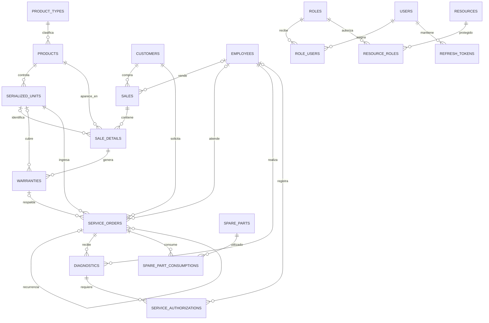

# Resumen técnico — MovilCare Express

## Alcance

Este documento describe el backend que vive en `app-movilcare-express`, de
acuerdo con los modelos y rutas registrados actualmente en `src/`. No incluye
como parte de este esquema otros proyectos o servicios que puedan existir en
carpetas hermanas.

## 1. Propósito y tecnologías

API REST para la operación de un negocio de venta y reparación de equipos:
clientes, empleados, productos e inventario, ventas y pagos, garantías, órdenes
de servicio, diagnósticos y repuestos. También incorpora inicio de sesión y
autorización basada en roles y recursos (RBAC).

- Node.js y TypeScript; compilación CommonJS a `dist/`.
- Express 5 para HTTP, middlewares y rutas.
- Sequelize 6 con MySQL 2 como ORM y driver.
- JWT para tokens de acceso, tokens opacos renovables almacenados como hash,
  bcryptjs para contraseñas y Swagger UI/OpenAPI para la documentación.
- Morgan registra solicitudes; CORS está habilitado.

## 2. Componentes y flujo de ejecución

```text
src/server.ts
  └─ App (src/config/index.ts)
       ├─ middlewares: Morgan, CORS, JSON y URL-encoded
       ├─ Swagger: /api/docs y /api/docs.json
       ├─ API: /api → src/routes/index.ts
       │    ├─ /auth/* (antes de autenticación)
       │    └─ authenticate → authorizeResource → rutas protegidas
       └─ MySQL: Sequelize → modelos → sync → migración de compatibilidad
```

Los modelos se cargan desde `src/databases/models.ts`. Al arrancar, el servidor
autentica la conexión MySQL, ejecuta `sequelize.sync()`, aplica
`associateProductsWithProductTypes()` y finalmente escucha en el puerto
configurado. La configuración de modelos usa `timestamps: true` y
`underscored: true`: normalmente se crean `created_at` y `updated_at`, y los
nombres de columnas son `snake_case`.

### Conexión a MySQL y variables de entorno

La conexión Sequelize se configura en `src/databases/db.ts`. Las variables
documentadas en `.env.example` son:

| Variable | Uso | Valor de ejemplo |
|---|---|---|
| `PORT` | Puerto HTTP | `4000` |
| `DB_ENGINE` | Motor indicado en el ejemplo de entorno | `mysql` |
| `MYSQL_HOST` | Host MySQL | `127.0.0.1` |
| `MYSQL_PORT` | Puerto MySQL | `3306` |
| `MYSQL_NAME` | Nombre de la base | `movilcare_dev` |
| `MYSQL_USER` | Usuario MySQL | `root` |
| `MYSQL_PASSWORD` | Contraseña MySQL | Debe configurarse localmente |
| `NODE_ENV` | Entorno; habilita logging SQL en `development` | `development` |
| `JWT_ACCESS_SECRET` | Secreto de firma; se exige un mínimo de 32 caracteres | Configurar un secreto propio |
| `JWT_ACCESS_EXPIRES_IN` | Vigencia del JWT de acceso | `15m` |
| `JWT_REFRESH_EXPIRES_IN` | Vigencia del refresh token | `7d` |

No se deben guardar secretos reales en el repositorio. `DB_ENGINE` aparece en
el ejemplo de entorno, pero el código de conexión configura directamente el
dialecto `mysql`.

## 3. Entidades y tablas

Los siguientes son los 20 modelos registrados por la aplicación: 14 de negocio
y 6 de autenticación/autorización. La lista de campos resume los atributos de
dominio definidos en cada modelo; no repite `id`, `created_at` ni `updated_at`.
Las propiedades TypeScript camelCase se guardan generalmente como columnas
snake_case.

### 3.1 Negocio

| Entidad | Tabla | Atributos principales |
|---|---|---|
| Cliente (`Customer`) | `customers` | `document_type`, `document_number`, `first_name`, `last_name`, `company_name`, `phone`, `email`, `address`, `is_active`. Documento único por tipo y número; correo único si se informa. |
| Empleado (`Employee`) | `employees` | `name`, `document`, `role`, `email`, `is_active`. `role`: `SELLER`, `TECHNICIAN` o `ADMIN`. |
| Tipo de producto (`ProductType`) | `product_types` | `name`, `description`, `status` (`active`/`inactive`). |
| Producto (`Product`) | `products` | `sku`, `name`, `description`, `type` heredado (`EQUIPMENT`/`ACCESSORY`), `product_type_id`, `stock_quantity`, `brand`, `model`, `requires_serial`, `cost`, `price`, `tax_percentage`, `default_warranty_months`, `is_active`. SKU único; tipo de producto obligatorio. |
| Unidad serializada (`SerializedUnit`) | `serialized_units` | `product_id`, `serial`, `secondary_serial`, `state`, `received_at`, `is_active`. Serial principal y secundario (cuando existe) son únicos; estado: `IN_STOCK`, `SOLD`, `IN_SERVICE` o `RETIRED`. |
| Venta (`Sale`) | `sales` | `number`, `customer_id`, `seller_id`, `sold_at`, `subtotal`, `taxes`, `total`, `discount`, `state`. Estado: `DRAFT`, `CONFIRMED`, `PAID` o `CANCELLED`. |
| Detalle de venta (`SaleDetail`) | `sale_details` | `sale_id`, `product_id`, `serialized_unit_id`, `quantity`, `unit_price`, `discount`, `tax_percentage`, `total`, `notes`, `is_active`. |
| Pago (`Payment`) | `payments` | `reference_type`, `reference_id`, `method`, `amount`, `date`, `status`. Referencias a `SALE` o `SERVICE_ORDER`; métodos `CASH`, `CARD`, `TRANSFER`, `OTHER`; estados `PENDING`, `COMPLETED`, `CANCELLED`. |
| Garantía (`Warranty`) | `warranties` | `sale_detail_id`, `serialized_unit_id`, `type`, `coverage_description`, `start_date`, `end_date`, `state`, `is_active`. Tipo: `COMMERCIAL`, `EXTENDED`, `SUPPLIER`; estado: `VALID`, `EXPIRED`, `CANCELLED`, `CONSUMED`. |
| Orden de servicio (`ServiceOrder`) | `service_orders` | `number`, `customer_id`, `serialized_unit_id`, `technician_id`, `service_type`, `warranty_id`, `origin_order_id`, `reported_issue`, `intake_condition`, `received_accessories`, `opened_at`, `estimated_delivery_date`, `closed_at`, `total`, `state`. |
| Diagnóstico (`Diagnostic`) | `diagnostics` | `service_order_id`, `technician_id`, `description`, `cause`, `warranty_covered`, `labor_cost`, `estimated_total`, `diagnosed_at`. Causas: `FACTORY_DEFECT`, `WEAR`, `MISUSE`, `MOISTURE`, `IMPACT` u `OTHER`. |
| Autorización (`ServiceAuthorization`) | `service_authorizations` | `diagnostic_id`, `state`, `authorized_amount`, `channel`, `responded_at`, `notes`, `recorded_by`. Estado: `PENDING`, `APPROVED`, `REJECTED`; canal: `IN_PERSON`, `PHONE`, `WHATSAPP`, `EMAIL`, `DIGITAL_SIGNATURE`. |
| Repuesto (`SparePart`) | `spare_parts` | `sku`, `name`, `description`, `compatibility`, `cost`, `price`, `current_stock`, `minimum_stock`, `is_active`. SKU único. |
| Consumo de repuesto (`SparePartConsumption`) | `spare_part_consumptions` | `service_order_id`, `spare_part_id`, `quantity`, `unit_cost`, `total_cost`, `observations`. |

En las órdenes, `service_type` puede ser `COMMERCIAL_WARRANTY`,
`PAID_REPAIR` o `RECURRENCE`. El estado puede ser `RECEIVED`, `DIAGNOSING`,
`AWAITING_AUTHORIZATION`, `IN_REPAIR`, `READY`, `DELIVERED`, `REJECTED` o
`CANCELLED`.

### 3.2 Autenticación y permisos

| Entidad | Tabla | Atributos principales |
|---|---|---|
| Usuario (`User`) | `users` | `username`, `email`, `password`, `avatar`, `status`. Usuario y correo únicos; el modelo normaliza ambos y aplica hash a la contraseña en hooks. |
| Rol (`Role`) | `roles` | `name`, `description`, `status`. Nombre único; se normaliza a mayúsculas. |
| Recurso (`Resource`) | `resources` | `method`, `path`, `description`, `status`. Método HTTP y ruta identifican de forma única un recurso. |
| Asignación usuario–rol (`RoleUser`) | `role_users` | `user_id`, `role_id`, `status`. Unicidad por par usuario/rol. |
| Asignación rol–recurso (`ResourceRole`) | `resource_roles` | `role_id`, `resource_id`, `status`. Unicidad por par rol/recurso. |
| Refresh token (`RefreshToken`) | `refresh_tokens` | `user_id`, `token_hash`, `family_id`, `device_info`, `expires_at`, `status`. Se guarda el hash del refresh token, no el token sin procesar. |

Los estados de estas entidades RBAC son `active`/`inactive`; `users`, `roles`,
`resources` y las asignaciones parten inactivas por defecto, mientras que los
refresh tokens parten activos.

## 4. Relaciones entre entidades



`PAYMENTS` es una relación polimórfica implementada mediante
`reference_type`/`reference_id`; no tiene una clave foránea única que apunte
simultáneamente a `sales` o `service_orders`. `role_users` y `resource_roles`
son tablas de unión del RBAC. Las asociaciones de Sequelize están definidas en
los modelos de negocio y `src/features/auth/rbac.associations.ts`.

## 5. Reglas de negocio relevantes

- Los productos que requieren serial no pueden manejar existencias mediante
  `stock_quantity`; sus unidades se registran individualmente en
  `serialized_units`.
- La migración de compatibilidad crea `product_type_id` y `stock_quantity`
  cuando hacen falta, clasifica productos antiguos según el campo `type`,
  requiere que todos los productos tengan tipo válido y agrega la clave
  foránea de producto a tipo (`RESTRICT` al borrar y `CASCADE` al actualizar).
- `sale_details.quantity` debe ser uno cuando se informa
  `serialized_unit_id`. El total de una línea se valida como cantidad por
  precio menos descuento más impuestos; el total de una venta como subtotal
  menos descuento más impuestos.
- Una orden `RECURRENCE` exige `origin_order_id`; una orden
  `COMMERCIAL_WARRANTY` exige `warranty_id`. La fecha de cierre no puede
  anteceder a la fecha de apertura.
- El total de un consumo debe coincidir con `quantity * unit_cost`, con
  tolerancia de un centavo. Una garantía no puede finalizar antes de comenzar.
- Los permisos dependen del método HTTP, la ruta y las asignaciones activas.
  Los roles semilla son `ADMIN`, `RECEPCIONISTA`, `TECNICO`, `INVENTARIO` y
  `VENTAS`; el inicializador registra recursos por módulo y los asocia a esos
  roles.

## 6. API y autenticación

El router principal está en `src/routes/index.ts` y se monta en `/api`.

| Grupo | Rutas principales | Operaciones |
|---|---|---|
| Sesión (públicas) | `/api/auth/login`, `/api/auth/refresh`, `/api/auth/logout` | Inicio, rotación y cierre de sesión. |
| Usuarios | `/api/users`, `/api/users/:id` | Consultar, crear, actualizar y desactivar. |
| Roles y permisos | `/api/roles`, `/api/roles/:id`, `/api/concesiones-rol` | Consultar/crear roles y conceder recursos a roles. |
| Clientes y empleados | `/api/customers`, `/api/employees` | CRUD según las operaciones registradas por cada router. |
| Catálogo e inventario | `/api/products`, `/api/product-types`, `/api/serialized-units`, `/api/spare-parts` | CRUD y acciones específicas de desactivación, venta o cambio a servicio. |
| Ventas y pagos | `/api/sales`, `/api/sale-details`, `/api/payments` | CRUD, confirmación/cancelación de ventas y manejo de líneas y pagos. |
| Posventa | `/api/warranties`, `/api/service-orders`, `/api/diagnostics`, `/api/service-authorizations`, `/api/spare-part-consumptions` | Garantías, órdenes y cambios de estado, diagnósticos, autorizaciones y consumos. |

Las rutas de sesión se registran antes de `authenticate` y `authorizeResource`.
Las demás rutas que están montadas después de esos middlewares requieren un
`Bearer` token válido y un permiso activo coincidente con el método y la ruta.
La interfaz Swagger está en `/api/docs`; el JSON OpenAPI, en
`/api/docs.json`.

**Nota sobre documentación API:** algunos esquemas Swagger actuales describen
operaciones CRUD con `security: []` y texto de endpoint sin autenticación,
pero el router real aplica autenticación y RBAC a las rutas de negocio. Para
el comportamiento efectivo, prevalece el orden de middlewares de
`src/routes/index.ts`.

## 7. Scripts y datos de prueba

| Comando | Función |
|---|---|
| `npm run dev` | Ejecuta `src/server.ts` con recarga mediante Nodemon y ts-node. |
| `npm run build` | Compila TypeScript a `dist/`. |
| `npm run db:seed` | Sincroniza modelos y genera datos de clientes, tipos de producto, productos, ventas y detalles. |
| `npm run db:init-rbac` | Inicializa roles, recursos y asignaciones RBAC. |

Los conteos iniciales del seeder son 10 clientes, 25 tipos de producto,
15 productos, 5 ventas y 12 detalles. Se pueden ajustar mediante las variables
`SEED_CUSTOMERS`, `SEED_PRODUCT_TYPES`, `SEED_PRODUCTS`, `SEED_SALES` y
`SEED_SALE_DETAILS`, o argumentos `--customers=`, `--product_types=`,
`--products=`, `--sales=` y `--sale_details=`.

## 8. Mapa de código

| Ruta | Responsabilidad |
|---|---|
| `src/server.ts`, `src/config/index.ts` | Punto de entrada, configuración Express y ciclo de arranque. |
| `src/databases/db.ts`, `src/databases/models.ts` | Conexión Sequelize y carga central de modelos. |
| `src/databases/migrations/` | Migraciones de compatibilidad de datos/esquema ejecutadas por el arranque. |
| `src/features/businesses/` | Modelos, controladores y rutas de negocio por módulo. |
| `src/features/auth/` | Autenticación, tokens, usuarios, roles, recursos y middleware RBAC. |
| `src/routes/index.ts` | Montaje y orden de las rutas principales. |
| `src/swagger/` y archivos `*.swagger.ts` | Composición del documento OpenAPI y Swagger UI. |
| `src/database/seeders/` | Generación de datos de prueba. |
| `src/scripts/` | Scripts operativos adicionales, como creación de administrador. |

