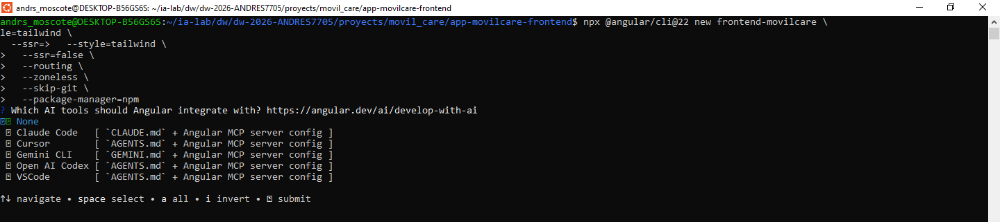
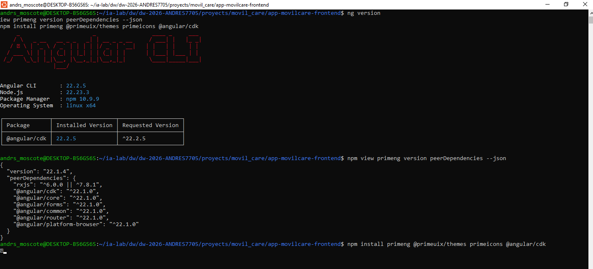
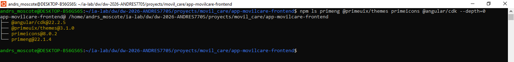
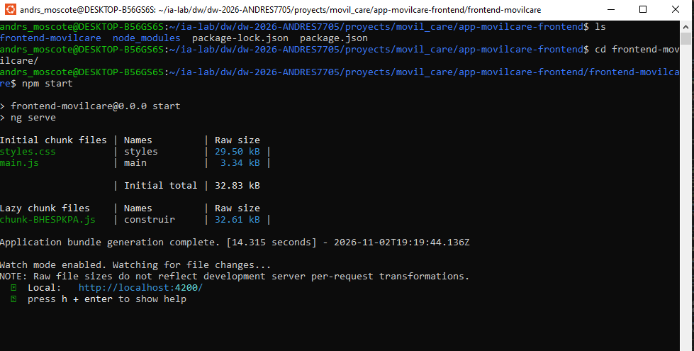
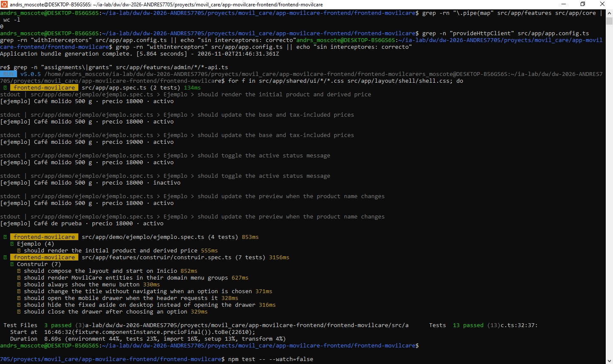

# Bitacora de creación del frontned en Angular


## ISS-01 · Bootstrap del frontend MovilCare Express con Angular 22

**Objetivo**

- Preparar la base del frontend administrativo de MovilCare Express con Angular 22, Tailwind CSS 4 y PrimeNG 22/Aura. La aplicación servirá como cliente de la API Express descrita en [RESUMEN_TECNICO.md](./RESUMEN_TECNICO.md), para gestionar ventas y reparación de equipos móviles.

### Alcance adaptado a MovilCare

El resumen técnico define los módulos que la interfaz deberá cubrir:

- **Gestión comercial:** clientes, empleados, ventas, detalles de venta, pagos y garantías.
- **Inventario:** tipos de producto, productos, unidades serializadas y repuestos.
- **Servicio técnico:** órdenes de servicio, diagnósticos, autorizaciones y consumos de repuestos.
- **Seguridad y acceso:** inicio/renovación/cierre de sesión, usuarios, roles, recursos y asignaciones RBAC.

La API se monta bajo `/api`. Las rutas de sesión son públicas; las operaciones de negocio requieren un token `Bearer` y permisos RBAC. ISS-01 prepara únicamente la aplicación y sus dependencias: no implementa CRUD, autenticación ni llamadas HTTP. Esos comportamientos se incorporan en sus entregas correspondientes. El menú y la pantalla de ejemplo de esta fase son navegación/maqueta, no datos reales ni una simulación de autorización.

**Criterios de aceptación del issue**

- [X] El frontend conserva Angular standalone, routing y ejecución zoneless.
- [X] Tailwind CSS 4 y PrimeNG 22 con el preset Aura quedan configurados.
- [X] La estructura permite incorporar los módulos de negocio y seguridad listados arriba.
- [X] La aplicación inicia y compila sin depender de que la API esté disponible.
- [X] No se incluyen credenciales, tokens ni datos reales del negocio en la maqueta.

### 1.1 Crear el proyecto en la carpeta actual

Desde la carpeta del proyecto:

```bash

npx @angular/cli@22 new frontend-movilcare \
  --style=tailwind \
  --ssr=false \
  --routing \
  --zoneless \
  --skip-git \
  --package-manager=npm
```



### 1.2 Instalar PrimeNG compatible con Angular

**Criterios de este sub-ítem**

- [X] primeng, @primeuix/themes, primeicons y @angular/cdk instalados
- [X] Las versiones instaladas declaran compatibilidad con Angular 22
- [X] package-lock.json actualizado y conservado

El tema moderno no se importa desde `primeng/resources/themes`. El preset Aura vive en `@primeuix/themes`.

Consulta primero las peer dependencies:

```bash
ng version
npm view primeng version peerDependencies --json
npm install primeng @primeuix/themes primeicons @angular/cdk
```



Verifica versiones:

```bash
npm ls primeng @primeuix/themes primeicons @angular/cdk --depth=0
```



### 1.3 Estilos globales

**Criterios de este sub-ítem**

- [X] src/styles.css declara @layer theme, base, primeng, utilities;
- [X] Importa tailwindcss
- [X] Importa primeicons/primeicons.css
- [X] No contiene selectores .p-*, ::ng-deep ni clases de aplicación

**Crea/reemplaza src/styles.css:**

```bash
cat > src/styles.css <<'EOF'
@layer theme, base, primeng, utilities;
@import 'tailwindcss';
@import 'primeicons/primeicons.css';
EOF
```

El orden de capas es lo que permite que las utilidades de Tailwind ganen sobre el tema de PrimeNG sin !important. Es la única hoja global del proyecto.

### 1.4 Configurar PrimeNG en app.config.ts

**Criterios de este sub-ítem**

- [X] providePrimeNG registra preset: Aura
- [X] darkModeSelector: '.app-dark'
- [X] cssLayer declara name: 'primeng' y order: 'theme, base, primeng, utilities'
- [X] MessageService y ConfirmationService registrados
- [X] provideRouter incluye withComponentInputBinding() y withInMemoryScrolling

**Reemplaza src/app/app.config.ts:**

```bash
cat > src/app/app.config.ts <<'EOF'
import {
  ApplicationConfig,
  provideBrowserGlobalErrorListeners,
} from '@angular/core';
import {
  provideRouter,
  withComponentInputBinding,
  withInMemoryScrolling,
} from '@angular/router';
import { ConfirmationService, MessageService } from 'primeng/api';
import { providePrimeNG } from 'primeng/config';
import Aura from '@primeuix/themes/aura';
import { environment } from '../environments/environment';

import { routes } from './app.routes';

export const appConfig: ApplicationConfig = {
  providers: [
    provideBrowserGlobalErrorListeners(),

    provideRouter(
      routes,
      withComponentInputBinding(),
      withInMemoryScrolling({ scrollPositionRestoration: 'top' }),
    ),

    // PrimeNG 22: tema Aura. El modo oscuro se activa con la clase .app-dark.
    providePrimeNG({
      license: environment.primeUiLicense || undefined,
      ripple: true,
      inputVariant: 'outlined',
      theme: {
        preset: Aura,
        options: {
          darkModeSelector: '.app-dark',
          cssLayer: { name: 'primeng', order: 'theme, base, primeng, utilities' },
        },
      },
    }),

    MessageService,
    ConfirmationService,
  ],
};
EOF
```

En ISS-02 se añade `provideHttpClient()`. Los interceptores se incorporarán en el issue posterior de autenticación, cuando sus servicios ya existen.

### 1.4.1 Licencia de PrimeNG 22 (obligatoria para la entrega limpia)

**Criterios de este sub-ítem**

- [X] Se identifica [PrimeUI] No license key configured en la consola como aviso de licencia, no un error de código
- [X] La clave Community se pega en primeUiLicense (environment*.ts, ISS-02 §2.1) y el aviso desaparece
- [X] La clave no se publica en el repositorio si es comercial

Desde la versión 22, PrimeNG es parte de PrimeUI, una familia comercial. El paquete incluye @primeui/license-manager, que verifica la clave sin conexión al arrancar (providePrimeNG). Si no hay clave o no es válida:

|Dónde|	Qué aparece|
|-----|------------|
|Consola|	[PrimeUI] No license key configured for primeui.|
|Consola|	[PrimeUI] PrimeUI license is not configured.|
|Esquina inferior derecha|	Banda roja Invalid PrimeUI License (Shadow DOM, pointer-events: none)|


**La aplicación funciona igual:** los componentes se dibujan y el tema Aura se aplica. El aviso es de licencia, no un fallo de Angular. Para una entrega profesional y para capturas de evidencia limpias hay que registrar la clave.

Cómo obtenerla (gratuita para el laboratorio):

1. Entra a https://primeui.dev/licenses y revisa los requisitos de la Community License: menos de 1 M USD de ingresos anuales, menos de 5 desarrolladores, menos de 10 empleados y menos de 3 M USD de financiación. Los estudiantes y el uso académico califican.

2. Solicítala en https://primeui.dev con tu correo.

3. Recibes la clave por correo. Pégala en src/environments/environment.development.ts (primeUiLicense) para ng serve, y en environment.ts para ng build (misma clave en ambos en el laboratorio).

4. Recarga: el aviso desaparece y la consola no vuelve a registrar el mensaje.

```
// src/environments/environment.development.ts (y el mismo valor en environment.ts)
export const environment = {
  // ...
  primeUiLicense: '', // clave personal; no uses una cadena de ejemplo del manual
};
```

`app.config.ts` ya enlaza la licencia: `license: environment.primeUiLicense || undefined`. Los pasos detallados del campo están en ISS-02 §2.1.

### 1.5 Pantalla inicial de aprendizaje: App compone demo/ejemplo

**Criterios de este sub-ítem**

- [X] src/app/app.ts importa el componente Ejemplo y lo declara en imports
- [X] src/app/app.html contiene <app-ejemplo /> dentro de un <main> con utilidades Tailwind
- [X] src/app/app.css queda vacío: el aspecto viene de Tailwind y del tema Aura
- [X] src/app/app.spec.ts prueba que app-ejemplo se pinta, en lugar del `<h1>` por defecto
- [X] src/app/app.routes.ts sigue vacío: en ISS-01 no hay rutas
- [X] Existe src/app/demo/ejemplo/ con ejemplo.ts, ejemplo.html, ejemplo.css y ejemplo.spec.ts
- [X] Al abrir http://localhost:4000 se ve una tarjeta ilustrativa con datos ficticios, sin conexión a la API

La plantilla que genera el CLI es una página de bienvenida de Angular llena de enlaces. Se reemplaza por una pantalla didáctica mínima para explicar los componentes y signals de la sección 1.9. La tarjeta es solo un ejemplo de interfaz: no representa el catálogo ni los precios reales de MovilCare, no persiste cambios y no consume endpoints.

La pantalla vive en un componente aparte, `demo/ejemplo`, para que la explicación no se mezcle con App. App se queda con una sola responsabilidad: poner la etiqueta. No se usa el router todavía: en ISS-01 el objetivo es entender qué es un componente, y eso se ve con una etiqueta en la plantilla. El router aparece en ISS-01B, cuando hay una pantalla de negocio que mostrar.

```
index.html → <app-root> → App (composición) → <app-ejemplo /> → demo/ejemplo
```

La regla mental que queda de esta sección: un componente es una etiqueta HTML que se escribe en la plantilla de otro componente. La etiqueta es el selector de su @Component.

`src/app/app.ts`

```bash
cat > src/app/app.ts <<'EOF'
import { Component } from '@angular/core';
import { Ejemplo } from './demo/ejemplo/ejemplo';

/**
 * Componente principal (`<app-root>`).
 *
 * Es el primero que Angular dibuja. En ISS-01 solo compone el componente de
 * ejemplo, para que se vea en pantalla con una etiqueta. Las rutas llegan en
 * ISS-01B, cuando existe una pantalla de negocio que mostrar.
 */
@Component({
  host: { class: 'block' },
  selector: 'app-root',
  imports: [Ejemplo],
  templateUrl: './app.html',
  styleUrl: './app.css',
})
export class App {}
EOF
```

`src/app/app.html`

```bash
cat > src/app/app.html <<'EOF'
<!-- Marco de la aplicación: fondo, ancho máximo y padding con utilidades Tailwind. -->
<main class="min-h-dvh bg-slate-50 p-6 text-slate-900">
  <div class="mx-auto w-full max-w-4xl">
    <!-- Composición: una etiqueta en la plantilla pinta el componente Ejemplo. -->
    <app-ejemplo />
  </div>
</main>
EOF
```

`<app-ejemplo />` es una etiqueta normal de HTML: Angular la reconoce porque Ejemplo declara selector: 'app-ejemplo' y está en el imports de App. No hay nada más. Si quitáramos Ejemplo de imports, la etiqueta no se pintaría.

`src/app/app.routes.ts`

```bash
cat > src/app/app.routes.ts <<'EOF'
import { Routes } from '@angular/router';

/**
 * Rutas de la aplicación.
 *
 * Vacío a propósito: en ISS-01 la pantalla se compone con etiquetas en `app.html`
 * (`<app-ejemplo />`). El router se presenta en ISS-01B, con una pantalla real.
 */
export const routes: Routes = [];
EOF
```

`provideRouter(routes)` ya está en app.config.ts desde que el CLI creó el proyecto; el arreglo vacío es válido y no impide arrancar. No se rellena hasta ISS-01B.

`src/app/app.css`

```bash
cat > src/app/app.css <<'EOF'
/*
 * Estilos propios del componente App.
 *
 * Queda VACÍO a propósito: el aspecto se resuelve con utilidades Tailwind en el
 * HTML y con el tema Aura de PrimeNG (PATRON-VISUAL). Angular mantiene el archivo
 * porque `styleUrl` lo referencia y solo afecta a `<app-root>`.
 */
EOF
```


**PARCHE** — prueba del componente. La prueba generada por el CLI busca el `<h1>` de la plantilla por defecto y falla después de reemplazar app.html. Reemplázala por pruebas de la composición. El componente `demo/ejemplo` tiene su propia prueba (`ejemplo.spec.ts`), que se explica en 1.9.

```bash
import { TestBed } from '@angular/core/testing';
import { App } from './app';

describe('App', () => {
  beforeEach(async () => {
    await TestBed.configureTestingModule({
      imports: [App],
    }).compileComponents();
  });

  it('should create the app', () => {
    const fixture = TestBed.createComponent(App);
    expect(fixture.componentInstance).toBeTruthy();
  });

  it('should render the example component', async () => {
    const fixture = TestBed.createComponent(App);
    await fixture.whenStable();
    const compiled = fixture.nativeElement as HTMLElement;
    expect(compiled.querySelector('app-ejemplo')).toBeTruthy();
  });

  it('should show the product loaded by the example component', async () => {
    const fixture = TestBed.createComponent(App);
    await fixture.whenStable();
    const compiled = fixture.nativeElement as HTMLElement;
    expect(compiled.textContent).toContain('Café molido 500 g');
  });
});
```

### 1.6 Personalizar index.html
Criterios de este sub-ítem

- [X] lang="es"
- [X] `<title>StoreLab Express II · Angular 22</title>`
- [X] `<body class="m-0 bg-slate-100 font-sans text-slate-900">`
- [X] `meta description` presente

```bash
cat > src/index.html <<'EOF'
<!doctype html>
<html lang="es">
<head>
  <meta charset="utf-8">
  <title>StoreLab Express II · Angular 22</title>
  <base href="/">
  <meta name="viewport" content="width=device-width, initial-scale=1">
  <meta name="description" content="Frontend Angular 22 con Signals, PrimeNG y Tailwind para StoreLab Express.">
  <link rel="icon" type="image/x-icon" href="favicon.ico">
</head>
<body class="m-0 bg-slate-100 font-sans text-slate-900">
  <app-root></app-root>
</body>
</html>
EOF
```


Las clases del `<body>` son utilidades Tailwind: fondo, fuente y color de texto. No se redefinen fuentes ni colores del tema con CSS propio.

### 1.7 Ajustar el presupuesto de build

**Criterios de este sub-ítem**

- [ ] En projects → … → architect → build → configurations → production → budgets, el presupuesto initial es maximumWarning: "750kB" y maximumError: "1MB"

El bundle inicial con PrimeNG supera los 500 kB por defecto. En angular.json, dentro de projects → ... → architect → build → configurations → production → budgets, cambia el primer presupuesto:

```json
{
  "type": "initial",
  "maximumWarning": "750kB",
  "maximumError": "1MB"
}
```

### 1.8 Primera ejecución

**Criterios de este sub-ítem**

- [X] npm start compila sin errores
- [X] http://localhost:4200 responde 200 y muestra el componente de ejemplo
- [X] Se ve la tarjeta del producto con nombre, precio, estado y botones
- [X] Pulsar +1000 cambia el precio y el «Precio final con IVA» sin recargar la página
- [X] Cambiar estado cambia la etiqueta (Activo/Inactivo) y el mensaje inferior
- [X] Escribir en Nombre actualiza el texto «Vista previa»
- [X] Console muestra [ejemplo] … en cada cambio (lo escribe effect())
- [X] Network carga styles.css, main.js y los chunks con estado 200
- [X] El `<title>` de la pestaña es StoreLab Express II · Angular 22

```bash
npm start
```


Abre http://localhost:4200. Debe verse la pantalla de 1.5: la tarjeta Objeto producto, las dos tarjetas de explicación y las utilidades Tailwind que lo centran. Al pulsar +1000 el precio base sube y el valor con IVA se recalcula; Cambiar estado alterna la etiqueta y el aviso; Reiniciar vuelve al objeto inicial.

No hay URL por pantalla: en ISS-01 el router está configurado pero sin rutas, así que cualquier dirección muestra la misma composición.

Sin este ajuste, ng build termina con un warning (no error). El límite debe mantenerse alineado con el presupuesto acordado para el bundle inicial; no se debe elevar solo para ocultar dependencias o carga innecesaria.

### 1.9 Anatomía del componente demo/ejemplo y signals

**Criterios de este sub-ítem**

- [X] Explica en qué orden arranca la aplicación y qué archivo hace cada paso
- [X] Identifica los cuatro archivos de un componente y la función de cada uno
- [X] Relaciona cada parte de la pantalla con la línea de ejemplo.ts o ejemplo.html que la produce
- [X] Distingue signal (estado), computed (valor derivado) y effect (efecto secundario)
- [X] Explica cómo se actualiza un objeto guardado en un signal sin mutarlo
- [X] Explica por qué no hace falta Zone.js ni llamar a ChangeDetectorRef
- [X] Explica cómo el selector: 'app-ejemplo' produce la etiqueta `<app-ejemplo />` de app.html

Esta sección explica el mismo código que ya está en pantalla: `src/app/demo/ejemplo/`. Es un componente pequeño y completo: un objeto, cuatro operaciones y tres tarjetas. No hay un ejemplo aparte que borrar después.

```
src/app/demo/ejemplo/
├── ejemplo.ts       ← la clase: estado, derivados, efecto y métodos
├── ejemplo.html     ← la plantilla: tarjetas, campos y botones
├── ejemplo.css      ← la excepción: una clase para explicar el aislamiento
└── ejemplo.spec.ts  ← la prueba: crea el componente y comprueba el cambio de estado
```

### 1.9.1 De index.html a la pantalla

Cuando el navegador carga http://localhost:4200, Angular recorre siempre estos pasos:

```
index.html
   └─ <app-root></app-root>                  ← el HTML solo tiene esta etiqueta
         │
         ├─ src/main.ts                      bootstrapApplication(App, appConfig)
         ├─ src/app/app.config.ts            providers globales (router, PrimeNG, …)
         └─ src/app/app.ts                    clase App + @Component(...)
               ├─ app.html                    plantilla: <main> + <app-ejemplo />
               ├─ app.css                     estilos propios (vacío)
               ├─ app.spec.ts                 pruebas de App
               └─ app.routes.ts               rutas (vacío en ISS-01)
                     │
                     │  <app-ejemplo />  ← la etiqueta de app.html encuentra este componente
                     ▼
               src/app/demo/ejemplo/
                     ├─ ejemplo.ts            clase Ejemplo + @Component(...)
                     ├─ ejemplo.html          plantilla: las tres tarjetas
                     ├─ ejemplo.css           una clase de demostración
                     └─ ejemplo.spec.ts       4 pruebas
```

**La idea central:** index.html solo tiene una etiqueta. Angular la sustituye por App, y App pinta demo/ejemplo porque escribió su etiqueta en la plantilla. El componente de ejemplo declara su estado en ejemplo.ts y lo dibuja con ejemplo.html. Todo lo demás del curso son componentes dentro de componentes.

De selector a etiqueta: por qué `<app-ejemplo />` funciona
app.html contiene una sola referencia al componente:

```html
<main class="min-h-dvh bg-slate-50 p-6 text-slate-900">
  <div class="mx-auto w-full max-w-4xl">
    <app-ejemplo />
  </div>
</main>
```

Si el selector es 'app-ejemplo', la etiqueta es <app-ejemplo>. Si se quita Ejemplo de imports, Angular no reconoce la etiqueta y la deja como un elemento HTML inerte (sin error de compilación, porque el nombre es válido). Ese es el primer error del curso: el componente «no se ve» porque falta el import.

En el DOM, el elemento conserva su etiqueta y recibe las clases de host:

```
div.mx-auto.w-full.max-w-4xl
└── <app-ejemplo class="block" _ngcontent-…>   ← la etiqueta que escribiste en app.html
      └── <div class="flex flex-col gap-6">     ← ejemplo.html
```
Ese `class="block"` no está escrito en app.html: sale de host: { class: 'block' } en la metadata de Ejemplo. Es la forma de dar clases al elemento anfitrión sin envolverlo en otro div.

> El router llega después. Preguntar «¿y si quiero que la URL decida qué componente se pinta?» es correcto, pero es otra lección: ISS-01B introduce RouterOutlet cuando ya hay una pantalla de negocio. En ISS-01 el router está configurado (provideRouter) pero sin rutas.

### 1.9.2 Los cuatro archivos de un componente
Un componente Angular es una clase TypeScript + una plantilla + unos estilos + una prueba:

```
src/app/demo/ejemplo/
├── ejemplo.ts        ← la clase (estado y lógica) + @Component(...)
├── ejemplo.html      ← la plantilla (lo que se ve)
├── ejemplo.css       ← los estilos de ESTE componente
└── ejemplo.spec.ts   ← la prueba
```

La metadata es lo que convierte una clase normal en un componente:

```typescript
@Component({
  host: { class: 'block' },              // clases del elemento anfitrión <app-ejemplo>
  selector: 'app-ejemplo',               // etiqueta HTML que lo representa
  imports: [ButtonModule, CardModule, InputTextModule, MessageModule, TagModule],
  templateUrl: './ejemplo.html',         // vista externa
  styleUrl: './ejemplo.css',             // estilos externos
})
export class Ejemplo {}
```

> Nombres en Angular 22: el CLI ya no genera app.component.ts ni AppComponent. Genera app.ts con la clase App. Ambos estilos funcionan, pero el material usa el actual: el sufijo .component se omite porque la carpeta y el @Component ya lo dicen.

### 1.9.3 Leer ejemplo.ts línea a línea

```typescript
// 1. Se importan solo las piezas que se usan.
import { Component, computed, effect, signal } from '@angular/core';
import { ButtonModule } from 'primeng/button';
import { CardModule } from 'primeng/card';
import { InputTextModule } from 'primeng/inputtext';
import { MessageModule } from 'primeng/message';
import { TagModule } from 'primeng/tag';

// 2. El objeto que se muestra y se modifica.
export interface Producto {
  nombre: string;
  precio: number;
  activo: boolean;
}

// 3. @Component describe CÓMO se pinta la clase.
@Component({
  host: { class: 'block' },              // <app-ejemplo> se comporta como bloque
  selector: 'app-ejemplo',               // se usa como <app-ejemplo></app-ejemplo>
  imports: [ButtonModule, CardModule, InputTextModule, MessageModule, TagModule],
  templateUrl: './ejemplo.html',
  styleUrl: './ejemplo.css',
})
export class Ejemplo {
  // 4. ESTADO: el signal guarda un objeto completo.
  protected readonly producto = signal<Producto>(productoInicial());

  // 5. DERIVADOS: se calculan desde `producto()`, nunca se asignan.
  protected readonly precioFinal = computed(() =>
    Math.round(this.producto().precio * 1.19),
  );
  protected readonly estadoTexto = computed(() =>
    this.producto().activo ? 'Activo' : 'Inactivo',
  );

  // 6. EFECTO: se ejecuta al crear y en cada cambio del objeto.
  private readonly registro = effect(() => {
    const { nombre, precio, activo } = this.producto();
    console.log(`[ejemplo] ${nombre} · precio ${precio} · ${activo ? 'activo' : 'inactivo'}`);
  });

  // 7. Métodos que la plantilla llama desde los eventos.
  protected cambiarNombre(event: Event): void {
    const nombre = (event.target as HTMLInputElement).value;
    this.producto.update((actual) => ({ ...actual, nombre }));
  }

  protected variarPrecio(delta: number): void {
    this.producto.update((actual) => ({
      ...actual,
      precio: Math.max(0, actual.precio + delta),
    }));
  }

  protected alternarEstado(): void {
    this.producto.update((actual) => ({ ...actual, activo: !actual.activo }));
  }

  protected reiniciar(): void {
    this.producto.set(productoInicial());
  }
}
```

La función auxiliar evita compartir el mismo objeto entre el estado inicial y el reinicio:

```typescript
function productoInicial(): Producto {
  return { nombre: 'Café molido 500 g', precio: 18000, activo: true };
}
```

Las piezas de la plantilla que producen lo que se ve:

```html
<!-- 1. Interpolación: muestra un campo del objeto. -->
<p class="text-2xl font-bold text-slate-900">{{ producto().precio }}</p>

<!-- 2. Property binding + event binding sobre un campo editable. -->
<input pInputText [value]="producto().nombre" (input)="cambiarNombre($event)" />

<!-- 3. Event binding con argumento: el botón llama al método con 1000. -->
<button pButton type="button" (click)="variarPrecio(1000)">
  <span pButtonLabel>+1000</span>
</button>

<!-- 4. Property binding booleano: el tag cambia de color según `activo`. -->
<p-tag [value]="estadoTexto()" [severity]="producto().activo ? 'success' : 'danger'" />
```

`{{ producto().precio }}` no es una función de la plantilla: es la lectura del signal (producto()) y, sobre el objeto, la propiedad (precio). Sin el primer paréntesis Angular mostraría la función en lugar del valor.

> Qué pasa con app.routes.ts. Sigue vacío (export const routes: Routes = [];). provideRouter(routes) está configurado, pero sin rutas no hay navegación: la pantalla se compone con etiquetas. El router se presenta en ISS-01B con una pantalla real.

### 1.9.4 Las cuatro formas de conectar la clase con el HTML

> [(ngModel)] requiere FormsModule y se usa en formularios sencillos. En este curso los formularios de negocio usan Reactive Forms (FormGroup y formControlName), que se presentan en ISS-03. El ejemplo escribe el binding a mano ([value] + (input)) para que se vea de dónde sale el valor nuevo.

Y el flujo de control moderno, que reemplaza a *ngIf y *ngFor. El ejemplo lo usa para elegir el mensaje según el estado del producto:

```typescript
@if (producto().activo) {
  <p-message severity="success" variant="simple">
    Producto activo: la API lo devolvería en <code>GET /api/productos</code>.
  </p-message>
} @else {
  <p-message severity="warn" variant="simple">
    Producto inactivo: el borrado lógico lo oculta de las listas.
  </p-message>
}

<!-- El mismo bloque aplica a una lista del negocio. -->
@if (clients().length === 0) {
  <p>No hay clientes activos.</p>
} @else {
  <ul>
    @for (client of clients(); track client.id) {
      <li>{{ client.name }}</li>
    }
  </ul>
}
```

track le dice a Angular cómo identificar cada elemento de la lista; con él evita volver a dibujar filas que no cambiaron. @for exige track en Angular 22.

### 1.9.5 Signals: el estado que avisa a la vista

Un signal es una caja con un valor que notifica a quien lo lee cuando cambia. Se crea con signal(valorInicial), se lee con () y se modifica con .set() o .update().

Dónde está en Ejemplo. El estado es un objeto Producto; la plantilla lee sus campos y los botones lo cambian:

```typescript
// ejemplo.ts — declaración y cambios del estado
protected readonly producto = signal<Producto>(productoInicial());

protected variarPrecio(delta: number): void {
  this.producto.update((actual) => ({
    ...actual,                              // conserva nombre y activo
    precio: Math.max(0, actual.precio + delta),
  }));
}

protected reiniciar(): void {
  this.producto.set(productoInicial());     // valor nuevo, no depende del anterior
}
```

```html
<!-- ejemplo.html — lectura del signal: siempre con paréntesis -->
<p class="text-2xl font-bold text-slate-900">{{ producto().precio }}</p>
<p class="text-sm text-slate-500">
  Precio final con IVA (19 %): <strong>{{ precioFinal() }}</strong>
</p>
<p-tag [value]="estadoTexto()" [severity]="producto().activo ? 'success' : 'danger'" />
```

**Actualizar un objeto dentro de un signal**

Este es el punto que más se equivoca al empezar. Un signal compara referencias, no campos: si se modifica el objeto en el sitio, el signal sigue apuntando al mismo objeto y la vista no se entera.

```typescript
// MAL: muta el objeto y conserva la misma referencia.
const actual = this.producto();
actual.precio = actual.precio + 1000;   // el signal no notifica: nadie llamó a set/update

// BIEN: crea un objeto nuevo y entrégaselo al signal.
this.producto.update((actual) => ({ ...actual, precio: actual.precio + 1000 }));
```

Al pulsar +1000, el signal cambia, Angular repinta el precio base y el valor con IVA, y la etiqueta de estado sigue igual porque producto().activo no cambió. Nadie llamó a ChangeDetectorRef.

> Comprobado en este workspace: la pantalla arranca con 18000 y IVA 21420; +1000 deja 19000 y 22610, -1000 vuelve a 18000, y Reiniciar restaura el objeto completo. Esas cuatro transiciones están en ejemplo.spec.ts y se ejecutan con npm test -- --watch=false.

Si el número no cambia, revisa que leíste producto() con paréntesis y que el método devuelve un objeto nuevo dentro de .update(), no una mutación.

### 1.9.6 computed y effect: derivar y reaccionar

- computed calcula un valor a partir de otros signals. No guarda estado propio: se recalcula cuando cambia una dependencia y solo se recalcula si alguien lo lee.

- effect ejecuta un efecto secundario (guardar, registrar, enfocar) cuando cambian los signals que lee. No se usa para calcular estado.

```typescript
// ejemplo.ts — dos valores derivados y un efecto secundario
protected readonly precioFinal = computed(() =>
  Math.round(this.producto().precio * 1.19),
);

protected readonly estadoTexto = computed(() =>
  this.producto().activo ? 'Activo' : 'Inactivo',
);

private readonly registro = effect(() => {
  const { nombre, precio, activo } = this.producto();
  console.log(`[ejemplo] ${nombre} · precio ${precio} · ${activo ? 'activo' : 'inactivo'}`);
});
```

```html
<!-- ejemplo.html — los derivados se leen igual que un signal -->
<p class="text-sm text-slate-500">
  Precio final con IVA (19 %): <strong>{{ precioFinal() }}</strong>
</p>
<p-tag [value]="estadoTexto()" [severity]="producto().activo ? 'success' : 'danger'" />
```

**Regla del curso:** si un valor se puede calcular a partir de otros signals, es computed. Si hay que hacer algo cuando cambia, es effect. Guardar en un signal lo que ya se deduce de otro signal crea dos fuentes de verdad que se desincronizan. Aquí precioFinal no existe como signal propio: se deriva de producto().precio. Si se guardara el IVA en el objeto, habría que acordarse de recalcularlo en cada cambio de precio.

### 1.9.7 Zoneless: por qué la vista se actualiza sin Zone.js

Angular 22 arranca sin Zone.js por defecto. Antes, Angular parcheaba todas las APIs asíncronas para saber cuándo revisar la vista; ahora el propio código avisa:

Por eso el estado del curso se declara con signal. Una propiedad public total = 0 funciona al inicio, pero al cambiarla desde una promesa el HTML puede quedarse con el valor viejo. Con signal, el cambio siempre llega a la vista.

### 1.9.8 Estilos globales y estilos del componente

**Regla del curso:** el aspecto de la aplicación se construye con PrimeNG (controles) y Tailwind (espaciado, tipografía, color). No se escribe CSS de negocio. La única excepción es la caja de la tarjeta «Estilos» del ejemplo, porque su propósito es explicar cómo funciona el CSS del componente:

```css
/* src/app/demo/ejemplo/ejemplo.css — únicamente demostrativo. */
.ejemplo-alcance {
  border: 2px dashed #0f766e;
  border-radius: 0.75rem;
  padding: 0.75rem 1rem;
  background-color: #f0fdfa;
}
```

```html
<!-- La misma caja, con el resto del contenido en Tailwind. -->
<div class="ejemplo-alcance mt-4 text-sm text-slate-700">…</div>
```

**Qué es el encapsulamiento**: Angular compila el CSS del componente con `ViewEncapsulation.Emulated`: agrega un atributo como `_ngcontent-ng-c4132172110` a los elementos de la plantilla y escribe la regla calificada (`.ejemplo-alcance[_ngcontent-…]`). Por eso una clase definida en ejemplo.css no afecta a otro componente, aunque se llame igual. El atributo se ve al inspeccionar el DOM y es normal.

```html
<div class="ejemplo-alcance mt-4 …" _ngcontent-ng-c4132172110>…</div>
```

**Consecuencia práctica:** si dos componentes necesitan el mismo borde, no se copia la clase en los dos `.css`; se resuelve con una utilidad Tailwind o con un componente compartido. En el curso ganan Tailwind y PrimeNG porque el estilo queda en el HTML, junto a la estructura, y el tema Aura mantiene la coherencia entre controles.

## Verificación del ISS

```bash
# 1. El servidor debe compilar
ng build

# 2. Debe imprimir la configuración de Tailwind/PrimeNG
grep -R "providePrimeNG\|@import 'tailwindcss'" src | head

# 3. Versiones compatibles
npm ls primeng @primeuix/themes primeicons @angular/cdk --depth=0

# 4. Presupuesto y estilos
node -e "const a=require('./angular.json');const p=a.projects[Object.keys(a.projects)[0]];console.log(p.architect.build.configurations.production.budgets[0])"
cat src/styles.css

# 5. La composición y el componente de ejemplo declaran signals
grep -n "imports: \[Ejemplo\]" src/app/app.ts
grep -n "app-ejemplo" src/app/app.html
grep -n "signal(\|computed(\|effect(" src/app/demo/ejemplo/ejemplo.ts
```

```bash
# 6. Pruebas de App y del componente de ejemplo
npm test -- --watch=false
```


## Fase I: Frontend — ISS-01A — Esqueleto Header / Aside / contenido / Footer

**Objetivo:** construir primero la pantalla. Al terminar, http://localhost:4200 muestra Header arriba, Aside a la izquierda del contenido y Footer abajo a todo el ancho, con datos fijos y sin llamadas a la API.

**Bloqueado por:** ISS-01.

**Criterios de aceptación (ISS-01A) — consolidados**

- [X] 1.1 Explica por qué un componente generado no aparece hasta que el padre lo declara en imports y usa su selector
- [X] 1.2 Existen src/app/layout/header/, src/app/layout/aside/ y src/app/layout/footer/, cada una con .ts, .html y .css
- [X] 1.3 header.ts declara title y header.html lo muestra con {{ title }}
- [X] 1.3 Los tres .css de layout/ no contienen reglas: solo un comentario que explica por qué están vacíos
- [X] 1.4 app.ts importa Header, Aside y Footer y los declara en imports
- [X] 1.4 app.html compone las cuatro regiones: `<app-header />`, `<aside>`con `<app-aside />`, `<main>` con el contenido y `<app-footer />`
- [X] 1.4 app.html ya no contiene `<app-ejemplo />`: demo/ejemplo no forma parte de la aplicación
- [X] 1.5 Se ven las cuatro regiones, el Footer queda abajo y no hay desplazamiento horizontal
- [X] 1.5 En Network no aparece ninguna petición /api
- [X] ng build termina con código 0 y las pruebas pasan

> **demo/ejemplo** no se usa en ningún ISS posterior. Fue la introducción a Angular de ISS-01. No está en el menú, no tiene ruta, no se compone en el layout y no se reutiliza. Al reemplazar app.html en 1.4 deja de verse; el componente y su prueba siguen en el proyecto solo como material de consulta de ISS-01.

### 1.1 Qué es un componente y por qué el padre debe importarlo

Un componente reúne una clase TypeScript (datos y lógica), una plantilla HTML (lo que se ve) y un archivo de estilos. `@Component` relaciona esos archivos:

|Campo	|Pregunta que responde	|Ejemplo en este ISS|
|-------|-----------------------|-------------------|
|selector	|¿Con qué etiqueta se usa en otra plantilla?	|selector: 'app-header' → <app-header />|
|imports|	¿Qué usa su plantilla?|	[] en Header de ISS-01A|
|templateUrl	|¿Dónde está el HTML?|	./header.html|
|styleUrl|	¿Dónde están los estilos privados?	|./header.css|
|host|	¿Qué clases lleva el elemento anfitrión?	|host: { class: |'block' }|

**Regla que resuelve el error más común:** un componente generado existe, pero no se ve hasta que otro componente lo declara en su imports y escribe su etiqueta en su plantilla. Son dos pasos, no uno:

```typescript
// app.ts — paso 1: declarar el componente para que la plantilla lo reconozca
imports: [Header, Aside, Footer],
```

```html
<!-- app.html — paso 2: usar su selector como etiqueta -->
<app-header />
```

**PARCHE** — standalone: true ya no hace falta. El CLI de Angular 22 genera componentes standalone por defecto. Escribir standalone: true es válido y no rompe nada, pero la plantilla del proyecto lo omite. Si copias ejemplos antiguos que lo incluyen, no hay conflicto: simplemente es redundante.

Usamos `layout/` para conservar la organización del curso. El Header de la aplicación es distinto de `shared/ui/page-header`, que titula una pantalla de negocio.

### 1.2 Generar las tres piezas de layout/
Criterios de este sub-ítem


```bash
ng generate component layout/header --skip-tests --defaults
ng generate component layout/aside --skip-tests --defaults
ng generate component layout/footer --skip-tests --defaults
```

En una reconstrucción desde cero, el CLI crea además un `header.spec.ts` si no usas `--skip-tests`. En este curso esas pruebas no se necesitan: el comportamiento de la pantalla se comprueba desde `app.spec.ts`.

### 1.3 Contenido de cada componente
Criterios de este sub-ítem


Los tres componentes son de presentación: no inyectan servicios, no consultan la API y no conocen permisos. Esa frontera es la que permite reutilizar el layout en ISS-02 sin duplicarlo.

**Header**

`src/app/layout/header/header.ts`

```typescript
import { Component } from '@angular/core';

/**
 * Barra superior de la aplicación.
 *
 * ISS-01A: solo muestra el nombre. En ISS-01B recibe datos por `input()`, emite
 * `menuRequested` y añade el menú de usuario. No consulta la API.
 */
@Component({
  host: { class: 'block' },
  selector: 'app-header',
  templateUrl: './header.html',
  styleUrl: './header.css',
})
export class Header {
  readonly title = 'EnlaceExpress';
}
```

`src/app/layout/header/header.html`

```html
<header
  class="flex h-16 items-center border-b border-slate-200 bg-white px-6 font-semibold"
>
  <!-- Interpolación: `title` es una propiedad de la clase Header. -->
  <p class="truncate text-sm font-semibold text-slate-900">{{ title }}</p>
</header>
```

`{{ title }}` es interpolación: Angular lee la propiedad de la clase y escribe su texto. Cambia el valor en header.ts y comprueba que cambia el encabezado sin tocar el HTML. Ese es el primer enlace entre clase y plantilla.

h-16 fija la altura, border-b dibuja la separación y truncate evita que un texto largo rompa la barra. Todo es Tailwind: no hay CSS propio.

**Aside**

`src/app/layout/aside/aside.ts`

```typescript
import { Component } from '@angular/core';

/**
 * Menú lateral de la aplicación.
 *
 * ISS-01A: solo el contenedor. En ISS-01B recibe `items` por `input()` y pinta
 * `p-panelmenu`. No conoce rutas ni permisos: eso llega en ISS-02 y en el issue posterior de autenticación.
 */
@Component({
  host: { class: 'block h-full' },
  selector: 'app-aside',
  templateUrl: './aside.html',
  styleUrl: './aside.css',
})
export class Aside {}
```

`src/app/layout/aside/aside.html`

```html
<nav aria-label="Navegación principal" class="h-full bg-slate-950 p-6 text-white">
  <p class="text-xs font-medium uppercase tracking-wider text-slate-400">Navegación</p>
  <p class="mt-2 text-sm">Menú de EnlaceExpress</p>
  <p class="mt-4 text-xs text-slate-400">
    En ISS-01B este bloque pasa a ser un <code>p-panelmenu</code>.
  </p>
</nav>
```

`aria-label` no es decorativo: nombra la región de navegación para lectores de pantalla y permite localizarla en las pruebas. El ancho no se decide aquí: lo fija el padre en app.html, porque el Aside debe poder ocultarse en móvil (ISS-01B) sin cambiar el componente.

**Footer**

`src/app/layout/footer/footer.ts`

```typescript
import { Component } from '@angular/core';

/**
 * Pie de página de la aplicación.
 *
 * Presentación pura: no tiene estado ni depende de servicios.
 */
@Component({
  host: { class: 'block' },
  selector: 'app-footer',
  templateUrl: './footer.html',
  styleUrl: './footer.css',
})
export class Footer {}
```

`src/app/layout/footer/footer.html`

```html
<footer
  class="border-t border-slate-200 bg-white px-4 py-4 text-center text-xs text-slate-500 sm:px-6"
>
  EnlaceExpress · Gestión de clientes, productos y ventas
</footer>
```

**Los tres** `.css`

Cada archivo contiene solo un comentario. No hay reglas:

```
/*
 * Estilos del Header.
 *
 * Vacío a propósito: la apariencia se resuelve con utilidades Tailwind en
 * `header.html` y con el tema Aura de PrimeNG (PATRON-VISUAL).
 */
```

`aside.css` y `footer.css` siguen el mismo criterio. El archivo existe porque styleUrl lo referencia y Angular lo necesita para el encapsulamiento (ISS-01, 1.9.8); si algún día se escribe una regla, solo afectará a ese componente.

### 1.4 Componer las cuatro regiones en App
Criterios de este sub-ítem


`src/app/app.ts`

```typescript
import { Component } from '@angular/core';
import { Header } from './layout/header/header';
import { Aside } from './layout/aside/aside';
import { Footer } from './layout/footer/footer';

/**
 * Componente principal (`<app-root>`).
 *
 * Es el primero que Angular dibuja. Compone las cuatro regiones de la pantalla:
 * Header arriba, Aside a la izquierda, el contenido del centro y Footer abajo.
 * El contenido del centro todavía es fijo; en ISS-01B pasa a cambiar con el menú
 * y en ISS-02 llega el router.
 */
@Component({
  host: { class: 'block' },
  selector: 'app-root',
  imports: [Header, Aside, Footer],
  templateUrl: './app.html',
  styleUrl: './app.css',
})
export class App {
  /** Título de la pantalla inicial. En ISS-01B cambia al elegir el menú. */
  protected readonly title = 'Inicio';
}
```

`src/app/app.html`

```html
<!-- Contenedor de las cuatro regiones: Tailwind para el alto y la dirección. -->
<div class="flex min-h-screen flex-col bg-slate-100">
  <app-header />

  <div class="flex flex-1">
    <!-- Aside fijo de 16rem; en ISS-01B se oculta en pantallas pequeñas. -->
    <aside class="w-64 shrink-0">
      <app-aside />
    </aside>

    <!-- min-w-0 evita que un contenido ancho desborde el flex y cree scroll. -->
    <main id="contenido" class="min-w-0 flex-1 p-6">
      <h1 class="text-2xl font-semibold text-slate-900">{{ title }}</h1>
      <p class="mt-2 text-slate-600">Bienvenido a EnlaceExpress.</p>
    </main>
  </div>

  <app-footer />
</div>
```

**Prueba de la composición**

`src/app/app.spec.ts` no busca el `<h1>` de la plantilla por defecto: comprueba las regiones y el texto inicial.

```typescript
import { TestBed } from '@angular/core/testing';
import { App } from './app';

describe('App', () => {
  beforeEach(async () => {
    await TestBed.configureTestingModule({
      imports: [App],
    }).compileComponents();
  });

  async function crearApp() {
    const fixture = TestBed.createComponent(App);
    await fixture.whenStable();
    return fixture.nativeElement as HTMLElement;
  }

  it('should create the app', () => {
    const fixture = TestBed.createComponent(App);
    expect(fixture.componentInstance).toBeTruthy();
  });

  it('should compose the three layout regions', async () => {
    const compilado = await crearApp();
    expect(compilado.querySelector('app-header')).toBeTruthy();
    expect(compilado.querySelector('aside app-aside')).toBeTruthy();
    expect(compilado.querySelector('app-footer')).toBeTruthy();
  });

  it('should render the application name in the header', async () => {
    const compilado = await crearApp();
    const header = compilado.querySelector('app-header') as HTMLElement;
    expect(header.textContent).toContain('EnlaceExpress');
  });

  it('should render the initial title in the content', async () => {
    const compilado = await crearApp();
    const main = compilado.querySelector('main') as HTMLElement;
    expect(main.textContent).toContain('Inicio');
    expect(main.textContent).toContain('Bienvenido a EnlaceExpress.');
  });
});
```

La consulta `aside app-aside` verifica dos cosas a la vez: que el Aside está dentro del elemento que fija su ancho y que el componente se pintó.

### 1.5 Comprobar antes de avanzar
Criterios de este sub-ítem


```bash
npm start
```

Abre http://localhost:4200 y comprueba:

|Comprobación visual |Resultado esperado|
|--------------------|------------------|
|Header|	Barra blanca de 64 px con StoreLab Express II|
|Aside|	Columna oscura de 256 px con Menú de StoreLab|
|Contenido|	Inicio y Bienvenido a StoreLab.|
|Footer	|Franja inferior a todo el ancho con StoreLab · Gestión de clientes, productos y ventas|
|Con poco contenido	|El Footer queda pegado al borde inferior de la ventana|
|Con mucho contenido|	El Footer baja; aparece scroll vertical, nunca horizontal|
|Network	|Sin peticiones /api: aún no hay servicios|

Para provocar el caso de contenido largo, añade párrafos dentro de `<main>` y observa que solo el Footer se desplaza: el Header y el Aside no se mueven porque están en el flujo normal del `flex` vertical.


## Fase I: Frontend — ISS-01B — Menú PrimeNG y primera interacción

**Objetivo:** pasar de una maqueta a una pantalla que responde. Al terminar: PanelMenu en el Aside, botón de menú en el Header, Drawer en pantalla pequeña y selección que cambia el contenido local. Sin rutas de negocio y sin API.

**Bloqueado por:** ISS-01A.

**Criterios de aceptación (ISS-01B) — consolidados**

- [X] 1.1 Explica la diferencia entre input() (dato del padre al hijo), output() (aviso del hijo al padre) y signal() (estado propio)
- [X] 1.2 aside.ts declara `items = input<MenuItem[]>([])` y aside.html lo pinta con `<p-panelmenu [model]="items()" [multiple]="true" />`
- [X] 1.2 aside.css sigue sin reglas: la apariencia es de Aura y Tailwind
- [X] 1.3 El Header emite menuRequested y su botón está siempre visible: por debajo de lg abre el Drawer, desde lg alterna el Aside fijo
- [X] 1.4 Existe src/app/features/construir/ con construir.ts, construir.html, construir.css y construir.spec.ts
- [X] 1.4 mobileOpen, sidebarCollapsed y title son signal; elegir una opción cambia el título y cierra el Drawer
- [X] 1.4 El layout se compone una sola vez en construir.html y se reutiliza en el Drawer
- [X] 1.5 app.ts importa RouterOutlet y app.html contiene solo `<router-outlet />`
- [X] 1.5 app.routes.ts declara construir con loadComponent, redirige '' y ** a construir
- [X] 1.6 A 1280 px se ve Inicio, 11 opciones de Operación y 6 de Administración; a 390 px se oculta y el botón abre el Drawer
- [X] 1.6 A 1280 px el botón de menú se ve y oculta/muestra el Aside sin abrir el Drawer
- [X] 1.6 La URL no cambia al elegir una opción y Network no registra llamadas /api
- [X] ng build termina con código 0, construir se empaqueta como chunk diferido y las pruebas pasan

> demo/ejemplo no participa. La introducción a Angular quedó en ISS-01. No tiene ruta, no está en el menú y no se compone en este ISS.

### 1.1 Los conceptos que se agregan, uno por vez

`Criterios de este sub-ítem`

- [X] Distingue los tres canales de datos: entrada, salida y estado
- [X] Reconoce `MenuItem[]` como el contrato del menú de PrimeNG
- [X] Explica `[(visible)]` como ida y vuelta en un solo atributo

|Concepto	|Qué resuelve	|Dónde se ve en este ISS|
|--------|-------------|-----------------------|
|input()	|Dato que el padre entrega al hijo; el hijo no lo modifica|	items en Aside, appName en Header|
|output()	|Aviso del hijo al padre; el hijo no navega ni cierra nada por su cuenta	|menuRequested, |navigated
|signal()|	Estado propio del componente, observado por la plantilla|	title, mobileOpen en Construir|
|[propiedad]|	Enlace de la clase a la plantilla|	[model]="items()" en PanelMenu|
|(evento)|	Acción al recibir un aviso	|(menuRequested)="mobileOpen.set(true)"|
|[(visible)]|	Ida y vuelta: el Drawer abre y también actualiza el estado al cerrarse|	[(visible)]|="mobileOpen"
|MenuItem[]	|Forma tipada del menú de PrimeNG: label, icon, command|	items en Construir|

**La frontera del ISS**. Los tres componentes de `layout/` son presentación: reciben datos y avisan. El único con estado es Construir. Esa separación es la que permite reutilizar el layout en `ISS-02` sin duplicar `Header`, `Aside` ni `Footer`, y la que evita inyectar servicios de autenticación en componentes visuales.

**PARCHE** — standalone: true sobra. Angular 22 genera componentes standalone por defecto. Los ejemplos de material antiguo lo incluyen; es válido, pero redundante. Este curso no lo escribe.

### 1.2 El Aside recibe el menú con input()
Criterios de este sub-ítem

- [X] Aside declara `items = input<MenuItem[]>([])`
- [X] La plantilla usa `[model]="items()":` se lee el signal con paréntesis
- [X] El Aside no construye el menú ni conoce rutas: solo lo pinta
- [X] aside.css no contiene reglas

`src/app/layout/aside/aside.ts`

```typescript
import { Component, input, output } from '@angular/core';
import { MenuItem } from 'primeng/api';
import { ButtonModule } from 'primeng/button';
import { PanelMenuModule } from 'primeng/panelmenu';

/**
 * Menú lateral de la aplicación.
 *
 * Presentación pura: recibe el menú ya construido por `input()` y avisa de la
 * navegación con `output()`. No conoce rutas, permisos ni la API.
 */
@Component({
  host: { class: 'block h-full' },
  selector: 'app-aside',
  imports: [ButtonModule, PanelMenuModule],
  templateUrl: './aside.html',
  styleUrl: './aside.css',
})
export class Aside {
  readonly appName = input('EnlaceExpress');

  /** Opciones del menú, en el formato `MenuItem` de PrimeNG. */
  readonly items = input<MenuItem[]>([]);

  /** Datos de sesión con valores por defecto: se completan en el issue posterior de autenticación. */
  readonly showSession = input(false);
  readonly username = input('');
  readonly roleLabel = input('Sin rol');
  readonly permissionCount = input(0);

  /** Aviso al padre: se seleccionó una opción (lo usa el Drawer en móvil). */
  readonly navigated = output<void>();

  /** Aviso al padre: se pidió cerrar sesión. */
  readonly logoutRequested = output<void>();

  /**
   * Un clic dentro del menú puede caer en el propio ítem o en un hijo suyo.
   * `closest` resuelve ambos casos con un solo listener en el `<nav>`.
   */
  onNavigationClick(event: Event): void {
    const target = event.target;
    if (target instanceof Element && target.closest('.p-panelmenu-item-link')) {
      this.navigated.emit();
    }
  }
}
```

`src/app/layout/aside/aside.html`

```html
<div class="flex h-full flex-col border-r border-slate-200 bg-white text-slate-900">
  <div class="flex h-16 items-center gap-3 border-b border-slate-200 px-5">
    <i class="pi pi-link text-lg text-teal-700" aria-hidden="true"></i>
    <div class="min-w-0">
      <p class="truncate text-sm font-semibold text-slate-900">{{ appName() }}</p>
      <p class="text-[11px] uppercase tracking-wider text-slate-400">
        Panel administrativo
      </p>
    </div>
  </div>

  <div class="flex-1 overflow-y-auto p-3">
    <nav aria-label="Navegación principal" (click)="onNavigationClick($event)">
      <p-panelmenu [model]="items()" [multiple]="true" />
    </nav>
  </div>

  @if (showSession()) {
    <div class="border-t border-slate-200 p-4">
      <p class="text-sm font-medium text-slate-900">{{ username() || 'Invitado' }}</p>
      <p class="text-xs text-slate-400">{{ roleLabel() }}</p>
      <div class="mt-3 flex items-center justify-between text-xs text-slate-400">
        <span>{{ permissionCount() }} permisos</span>
        <button
          pButton
          type="button"
          text
          rounded
          aria-label="Cerrar sesión"
          (click)="logoutRequested.emit()"
        >
          <i pButtonIcon class="pi pi-sign-out"></i>
        </button>
      </div>
    </div>
  }
</div>
```

### 1.3 El Header avisa al padre con output()
Criterios de este sub-ítem

- [X] El botón de menú lleva `aria-label="Mostrar u ocultar el menú"` y no lleva `lg:hidden`
- [X] Al pulsarlo emite menuRequested; el Header no abre nada ni consulta el ancho
- [X] showSession sigue en false: no hay datos de sesión hasta implementar autenticación
- [X] header.css no contiene reglas

`src/app/layout/header/header.ts`

```typescript
import { Component, input, output } from '@angular/core';
import { MenuItem } from 'primeng/api';
import { AvatarModule } from 'primeng/avatar';
import { ButtonModule } from 'primeng/button';
import { MenuModule } from 'primeng/menu';
import { TagModule } from 'primeng/tag';

/**
 * Barra superior de la aplicación.
 *
 * Es presentación pura: recibe los datos por `input()` y avisa al padre con
 * `output()`. No inyecta servicios, no consulta la API y no conoce permisos.
 */
@Component({
  host: { class: 'block' },
  selector: 'app-header',
  imports: [AvatarModule, ButtonModule, MenuModule, TagModule],
  templateUrl: './header.html',
  styleUrl: './header.css',
})
export class Header {
  /** Nombre visible de la aplicación. */
  readonly appName = input('EnlaceExpress');

  /** Datos de sesión con valores por defecto: se completan en el issue posterior de autenticación. */
  readonly username = input('');
  readonly initials = input('IN');
  readonly roleLabel = input('Sin rol');
  readonly authEnabled = input(true);
  readonly showSession = input(false);
  readonly userItems = input<MenuItem[]>([]);

  /** Aviso al padre: el botón de menú se pulsó (solo visible en móvil). */
  readonly menuRequested = output<void>();
}
```

`src/app/layout/header/header.html`

```html
<header
  class="sticky top-0 z-30 flex h-16 items-center gap-3 border-b border-slate-200 bg-white px-4 sm:px-6"
>
  <!-- Botón de menú: siempre visible; el padre decide qué hacer (aside fijo o Drawer). -->
  <button
    pButton
    type="button"
    text
    rounded
    aria-label="Mostrar u ocultar el menú"
    (click)="menuRequested.emit()"
  >
    <i pButtonIcon class="pi pi-bars"></i>
  </button>

  <div class="min-w-0 flex-1">
    <p class="truncate text-sm font-semibold text-slate-900">{{ appName() }}</p>
    <p class="truncate text-xs text-slate-500">
      Gestión logística de envíos
    </p>
  </div>

  @if (showSession() && !authEnabled()) {
    <p-tag value="Fase I · sin auth" severity="warn" [rounded]="true" />
  }
  @if (username()) {
    <p-tag
      [value]="roleLabel()"
      severity="info"
      [rounded]="true"
      class="hidden sm:inline-flex"
    />
  }

  @if (showSession()) {
    <button
      pButton
      type="button"
      severity="secondary"
      outlined
      (click)="userMenuPanel.toggle($event)"
      aria-label="Menú de usuario"
    >
      <p-avatar [label]="initials()" shape="circle" size="normal" />
      <span class="hidden max-w-32 truncate text-sm font-medium text-slate-700 sm:block">
        {{ username() }}
      </span>
      <i class="pi pi-chevron-down pr-1 text-[10px] text-slate-400"></i>
    </button>
    <p-menu #userMenuPanel [model]="userItems()" [popup]="true" appendTo="body" />
  }
</header>
```

**Por qué el hijo no abre el Drawer**. El Drawer vive en Construir. Si el Header lo abriera, tendría que conocer el estado de otra pantalla. Con `output()` el Header solo dice «se pulsó el botón»; quien decide qué hacer es el padre:

```html
<app-header (menuRequested)="onMenuToggle()" />
```

Esa es la diferencia entre un componente reutilizable y uno acoplado.

> **PARCHE** — `<class="lg:hidden">` era un error de diseño. La primera versión ocultaba el botón con `lg:hidden`, así que desaparecía justo desde 1024 px, que es donde el Aside fijo ya se ve. Resultado: en escritorio el menú no se podía ocultar y en pantallas anchas el usuario no encontraba el botón. El botón debe estar siempre; lo que cambia es qué hace según el ancho. El Header no consulta el ancho (sigue siendo presentación pura): quien decide es el padre, con `onMenuToggle()`.

`sticky top-0 z-30` mantiene la barra visible al hacer scroll y por encima del contenido. El `@if (showSession())` deja el bloque de usuario fuera del DOM hasta implementar autenticación: no se pinta un avatar vacío que luego haya que ocultar.

### 1.4 features/construir: estado local y Drawer móvil
Criterios de este sub-ítem

- [X] mobileOpen, sidebarCollapsed y title son signal, no propiedades normales
- [X] Todas las opciones seleccionables del menú llaman a un único método seleccionar
- [X] seleccionar cambia el título y cierra el Drawer
- [X] onMenuToggle alterna el Aside fijo en escritorio y abre el Drawer en móvil
- [X] El Aside aparece una vez en el layout de escritorio y otra en el Drawer, con el mismo items
- [X] construir.css no contiene reglas

```bash
ng generate component features/construir --skip-tests --defaults
```

El `--skip-tests` no es para evitar pruebas: la prueba de esta pantalla se escribe completa en este ISS (más abajo) y sustituye a la plantilla vacía del CLI.

`src/app/features/construir/construir.ts`

```typescript
import { Component, signal } from '@angular/core';
import { MenuItem } from 'primeng/api';
import { ButtonModule } from 'primeng/button';
import { CardModule } from 'primeng/card';
import { DrawerModule } from 'primeng/drawer';
import { watchMediaQuery } from '../../core/utils/media-query';
import { Aside } from '../../layout/aside/aside';
import { Footer } from '../../layout/footer/footer';
import { Header } from '../../layout/header/header';

/**
 * Pantalla del prototipo.
 *
 * Es el único componente con estado en ISS-01B: guarda el título elegido y el
 * estado del menú. El layout solo recibe datos por `input()`; así en ISS-02 se
 * puede reutilizar sin duplicar Header, Aside ni Footer.
 */
@Component({
  host: { class: 'block' },
  selector: 'app-construir',
  imports: [Aside, ButtonModule, CardModule, DrawerModule, Footer, Header],
  templateUrl: './construir.html',
  styleUrl: './construir.css',
})
export class Construir {
  /** `lg` de Tailwind: desde aquí el Aside es fijo y el botón lo alterna. */
  private readonly isDesktop = watchMediaQuery('(min-width: 1024px)');

  /** Escritorio: el Aside fijo se oculta y el contenido se ensancha. */
  readonly sidebarCollapsed = signal(false);

  /** Móvil: el Drawer se abre desde el botón y se cierra al elegir una opción. */
  readonly mobileOpen = signal(false);

  /** Título del contenido. Cambia al elegir una opción del menú, sin HTTP. */
  readonly title = signal('Inicio');

  /**
   * Menú en el formato `MenuItem` de PrimeNG.
   *
   * `command` ejecuta una función al elegir la opción. Todavía no navega: solo
   * cambia el título. En ISS-02 cada comando apuntará a una ruta real.
   */
  readonly items: MenuItem[] = [
    {
      label: 'Operación',
      icon: 'pi pi-truck',
      items: [
        { label: 'Empresas', icon: 'pi pi-building', command: () => this.seleccionar('Empresas') },
        { label: 'Contactos', icon: 'pi pi-id-card', command: () => this.seleccionar('Contactos') },
        { label: 'Direcciones', icon: 'pi pi-map-marker', command: () => this.seleccionar('Direcciones') },
        { label: 'Mensajeros', icon: 'pi pi-send', command: () => this.seleccionar('Mensajeros') },
        { label: 'Tarifas', icon: 'pi pi-dollar', command: () => this.seleccionar('Tarifas') },
        { label: 'Rutas', icon: 'pi pi-map', command: () => this.seleccionar('Rutas') },
        { label: 'Envíos', icon: 'pi pi-box', command: () => this.seleccionar('Envíos') },
        { label: 'Paquetes', icon: 'pi pi-inbox', command: () => this.seleccionar('Paquetes') },
        {
          label: 'Eventos de seguimiento',
          icon: 'pi pi-history',
          command: () => this.seleccionar('Eventos de seguimiento'),
        },
        {
          label: 'Comprobantes de entrega',
          icon: 'pi pi-check-square',
          command: () => this.seleccionar('Comprobantes de entrega'),
        },
        { label: 'Facturas', icon: 'pi pi-file', command: () => this.seleccionar('Facturas') },
      ],
    },
    {
      label: 'Administración',
      icon: 'pi pi-shield',
      items: [
        { label: 'Usuarios', icon: 'pi pi-users', command: () => this.seleccionar('Usuarios') },
        { label: 'Roles', icon: 'pi pi-key', command: () => this.seleccionar('Roles') },
        { label: 'Recursos', icon: 'pi pi-list', command: () => this.seleccionar('Recursos') },
        {
          label: 'Asignaciones de rol',
          icon: 'pi pi-user-plus',
          command: () => this.seleccionar('Asignaciones de rol'),
        },
        {
          label: 'Concesiones de recursos',
          icon: 'pi pi-lock',
          command: () => this.seleccionar('Concesiones de recursos'),
        },
        { label: 'Sesiones', icon: 'pi pi-history', command: () => this.seleccionar('Sesiones') },
      ],
    },
  ];

  /**
   * Un solo botón, dos disposiciones: en escritorio alterna el Aside fijo; por
   * debajo de `lg` abre el Drawer (donde el Aside fijo no cabe).
   */
  protected onMenuToggle(): void {
    if (this.isDesktop()) {
      this.sidebarCollapsed.update((collapsed) => !collapsed);
      return;
    }
    this.mobileOpen.set(true);
  }

  /** Una sola puerta de entrada al estado: la usan las opciones seleccionables. */
  protected seleccionar(titulo: string): void {
    this.title.set(titulo);
    this.mobileOpen.set(false);
  }
}
```

**El helper que decide el ancho**

`src/app/core/utils/media-query.ts`

```typescript
import { DestroyRef, Signal, inject, signal } from '@angular/core';

/**
 * Observa una media query CSS y la expone como signal de solo lectura.
 */
export function watchMediaQuery(query: string): Signal<boolean> {
  const destroyRef = inject(DestroyRef);

  const media =
    typeof window !== 'undefined' && typeof window.matchMedia === 'function'
      ? window.matchMedia(query)
      : null;

  const matches = signal(media?.matches ?? false);

  if (media) {
    const listener = (event: MediaQueryListEvent): void => matches.set(event.matches);
    media.addEventListener('change', listener);
    destroyRef.onDestroy(() => media.removeEventListener('change', listener));
  }

  return matches.asReadonly();
}
```

`src/app/features/construir/construir.html`

```html
<div class="flex min-h-screen flex-col bg-slate-100">
  <app-header (menuRequested)="onMenuToggle()" />

  <div class="flex flex-1">
    <!--
      Escritorio: Aside fijo que el botón del Header puede ocultar.
      Por debajo de lg no se pinta: el menú vive en el Drawer.
    -->
    @if (!sidebarCollapsed()) {
      <aside class="hidden w-72 shrink-0 lg:block">
        <app-aside [items]="items" (navigated)="mobileOpen.set(false)" />
      </aside>
    }

    <main id="contenido" class="min-w-0 flex-1 p-4 sm:p-6">
      <p-card class="block">
        <h1 class="text-2xl font-semibold text-slate-900">{{ title() }}</h1>
        <p class="mt-3 text-slate-600">
          Bienvenido a EnlaceExpress. Elige una opción del menú para explorar la estructura.
        </p>
        <p class="mt-2 text-sm text-slate-500">
          Esta primera pantalla usa datos locales. Los formularios y la conexión con
          Express se incorporan después.
        </p>
      </p-card>
    </main>
  </div>

  <app-footer />
</div>

<!-- Móvil: el mismo Aside, otra disposición. -->
<p-drawer [(visible)]="mobileOpen" header="Menú" position="left" styleClass="w-72">
  <app-aside [items]="items" (navigated)="mobileOpen.set(false)" />
</p-drawer>
```

**El flujo de un clic, de principio a fin**

```
clic en «Envíos» (dentro del Aside)
  ├─ PanelMenu ejecuta item.command()
  │     └─ seleccionar('Envíos') → title.set('Envíos') y mobileOpen.set(false)
  └─ el clic burbujea al <nav>, que emite navigated
        └─ Construir: (navigated)="mobileOpen.set(false)"   ← idempotente
```

Dos caminos que terminan en el mismo estado. No es redundancia inútil: el `command` funciona también con teclado, y `navigated` cubre el caso en que el Aside se reutilice con enlaces reales en ISS-02. Ambos llaman a .`set(false)`, así que no puede quedar desincronizado.

**El flujo del botón de menú, según el ancho**

        └─ Construir: (navigated)="mobileOpen.set(false)"   ← idempotente
```
clic en el botón del Header
  ├─ Header: (click)="menuRequested.emit()"        ← no sabe dónde está
  └─ Construir: onMenuToggle()
        ├─ ancho ≥ 1024px  → sidebarCollapsed.update(v => !v)   ← aside fijo
        └─ ancho < 1024px  → mobileOpen.set(true)               ← Drawer
        └─ Construir: (navigated)="mobileOpen.set(false)"   ← idempotente
```

`@if (!sidebarCollapsed())` envuelve el `<aside>:` en escritorio desaparece del DOM, no se oculta con una clase. Así el contenido recupera el ancho real y no queda un hueco de 288 px.

**Prueba de la pantalla**

`src/app/features/construir/construir.spec.ts`

```typescript
import { TestBed } from '@angular/core/testing';
import { Construir } from './construir';

/**
 * jsdom no implementa `matchMedia`, así que `watchMediaQuery` devuelve `false`
 * y el componente se comporta como móvil. El caso de escritorio se prueba aquí
 * sustituyendo la función antes de crear el componente.
 */
function stubDesktopMedia(matches: boolean): () => void {
  const original = window.matchMedia;

  Object.defineProperty(window, 'matchMedia', {
    configurable: true,
    writable: true,
    value: (query: string) =>
      ({
        matches,
        media: query,
        addEventListener: () => undefined,
        removeEventListener: () => undefined,
      }) as unknown as MediaQueryList,
  });

  return () => {
    Object.defineProperty(window, 'matchMedia', {
      configurable: true,
      writable: true,
      value: original,
    });
  };
}

describe('Construir', () => {
  beforeEach(async () => {
    await TestBed.configureTestingModule({
      imports: [Construir],
    }).compileComponents();
  });

  async function crearPantalla() {
    const fixture = TestBed.createComponent(Construir);
    await fixture.whenStable();
    return { fixture, compilado: fixture.nativeElement as HTMLElement };
  }

  function botonMenu(compilado: HTMLElement): HTMLButtonElement {
    const boton = compilado.querySelector(
      'app-header button[aria-label="Mostrar u ocultar el menú"]',
    );
    expect(boton).toBeTruthy();
    return boton as HTMLButtonElement;
  }

  function opcionDelMenu(compilado: HTMLElement, etiqueta: string): HTMLElement {
    const opcion = [...compilado.querySelectorAll('a, button')].find(
      (elemento) => elemento.textContent?.trim() === etiqueta,
    );
    expect(opcion).toBeTruthy();
    return opcion as HTMLElement;
  }

  it('should compose the layout and start on Inicio', async () => {
    const { compilado } = await crearPantalla();

    expect(compilado.querySelector('app-header')).toBeTruthy();
    expect(compilado.querySelector('aside app-aside')).toBeTruthy();
    expect(compilado.querySelector('app-footer')).toBeTruthy();
    expect(compilado.querySelector('main h1')?.textContent).toContain('Inicio');
  });

  it('should render backend entity options in their menu groups', async () => {
    const { fixture, compilado } = await crearPantalla();

    for (const etiqueta of ['Inicio', 'Operación', 'Administración']) {
      expect(compilado.textContent).toContain(etiqueta);
    }

    opcionDelMenu(compilado, 'Operación').click();
    fixture.detectChanges();
    await fixture.whenStable();
    for (const etiqueta of [
      'Empresas',
      'Contactos',
      'Direcciones',
      'Mensajeros',
      'Tarifas',
      'Rutas',
      'Envíos',
      'Paquetes',
      'Eventos de seguimiento',
      'Comprobantes de entrega',
      'Facturas',
    ]) {
      expect(compilado.textContent).toContain(etiqueta);
    }

    opcionDelMenu(compilado, 'Administración').click();
    fixture.detectChanges();
    await fixture.whenStable();
    for (const etiqueta of [
      'Usuarios',
      'Roles',
      'Recursos',
      'Asignaciones de rol',
      'Concesiones de recursos',
      'Sesiones',
    ]) {
      expect(compilado.textContent).toContain(etiqueta);
    }
  });

  it('should always show the menu button, not only on small screens', async () => {
    const { compilado } = await crearPantalla();

    // `lg:hidden` ocultaba el botón justo cuando el Aside ya era visible.
    expect(botonMenu(compilado).classList.contains('lg:hidden')).toBe(false);
  });

  it('should change the title without navigating when an option is chosen', async () => {
    const { fixture, compilado } = await crearPantalla();

    opcionDelMenu(compilado, 'Operación').click();
    fixture.detectChanges();
    await fixture.whenStable();
    opcionDelMenu(compilado, 'Empresas').click();
    fixture.detectChanges();
    await fixture.whenStable();

    expect(compilado.querySelector('main h1')?.textContent).toContain('Empresas');
    // Sigue en la misma pantalla: no hay recarga ni petición HTTP.
    expect(compilado.querySelector('app-construir, main')).toBeTruthy();
  });

  it('should open the mobile drawer when the header requests it', async () => {
    const { fixture, compilado } = await crearPantalla();
    const componente = fixture.componentInstance as unknown as {
      mobileOpen: () => boolean;
    };

    expect(componente.mobileOpen()).toBe(false);

    const botonMenu = compilado.querySelector(
      'app-header button[aria-label="Mostrar u ocultar el menú"]',
    ) as HTMLButtonElement;
    expect(botonMenu).toBeTruthy();

    botonMenu.click();
    fixture.detectChanges();
    await fixture.whenStable();

    expect(componente.mobileOpen()).toBe(true);
  });

  it('should hide the fixed aside on desktop instead of opening the drawer', async () => {
    const restaurar = stubDesktopMedia(true);

    try {
      const { fixture, compilado } = await crearPantalla();
      expect(compilado.querySelector('aside app-aside')).toBeTruthy();

      botonMenu(compilado).click();
      fixture.detectChanges();
      await fixture.whenStable();

      expect(fixture.componentInstance.sidebarCollapsed()).toBe(true);
      expect(compilado.querySelector('aside')).toBeNull();
      expect(fixture.componentInstance.mobileOpen()).toBe(false);
    } finally {
      restaurar();
    }
  });

  it('should close the drawer after choosing an option', async () => {
    const { fixture, compilado } = await crearPantalla();
    const componente = fixture.componentInstance as unknown as {
      mobileOpen: () => boolean;
    };

    const botonMenu = compilado.querySelector(
      'app-header button[aria-label="Mostrar u ocultar el menú"]',
    ) as HTMLButtonElement;
    botonMenu.click();
    fixture.detectChanges();
    await fixture.whenStable();
    expect(componente.mobileOpen()).toBe(true);

    opcionDelMenu(compilado, 'Operación').click();
    fixture.detectChanges();
    await fixture.whenStable();
    expect(componente.mobileOpen()).toBe(true);

    opcionDelMenu(compilado, 'Envíos').click();
    fixture.detectChanges();
    await fixture.whenStable();

    expect(componente.mobileOpen()).toBe(false);
    expect(compilado.querySelector('main h1')?.textContent).toContain('Envíos');
  });
});
```

La prueba del Drawer lee el signal desde la instancia (mobileOpen()), no del DOM: el Drawer de PrimeNG se monta en un overlay y comprobar su visibilidad con selectores es frágil. Se verifica el estado, que es lo que el componente controla.

La prueba de escritorio sustituye window.matchMedia antes de crear el componente, porque watchMediaQuery lee la media query al construirse. Así se comprueban las dos ramas del mismo botón: Drawer en móvil, Aside alternado en escritorio.

### 1.5 App pasa a ser punto de entrada con router-outlet

**Criterios de este sub-ítem**

- [X] app.ts importa solo RouterOutlet
- [X] app.html contiene únicamente <router-outlet />
- [X] app.routes.ts usa loadComponent para construir
- [X] '' y ** redirigen a construir

Este es el momento de presentar RouterOutlet, no ISS-01: ahora existe una pantalla real que mostrar por URL. La idea en una frase: `<router-outlet />` es un ancla; el router inserta a su lado el componente de la ruta activa.

`src/app/app.ts`

```typescript
import { Component } from '@angular/core';
import { RouterOutlet } from '@angular/router';

/**
 * Componente principal (`<app-root>`).
 *
 * Desde ISS-01B es solo el punto de entrada: el router elige qué componente se
 * dibuja dentro de `<router-outlet />` según la URL.
 */
@Component({
  host: { class: 'block' },
  selector: 'app-root',
  imports: [RouterOutlet],
  templateUrl: './app.html',
  styleUrl: './app.css',
})
export class App {}
```

`src/app/app.html`

```html
<!-- El router dibuja aquí el componente de la ruta activa (app.routes.ts). -->
<router-outlet />
```

`src/app/app.routes.ts`

```typescript
import { Routes } from '@angular/router';

/**
 * Rutas de la aplicación.
 *
 * ISS-01B presenta el router con una pantalla real. `loadComponent` descarga
 * `Construir` solo cuando se visita su URL: el bundle inicial no lo incluye.
 */
export const routes: Routes = [
  {
    path: 'construir',
    loadComponent: () =>
      import('./features/construir/construir').then((m) => m.Construir),
  },
  { path: '', pathMatch: 'full', redirectTo: 'construir' },
  { path: '**', redirectTo: 'construir' },
];
```

El enlace a `/login` todavía no existe. La pantalla de login pertenece a un issue posterior de autenticación. Este ISS no importa RouterLink ni escribe `<a routerLink="/login">`: el prototipo no ofrece una ruta que llevaría a un 404. El texto de bienvenida lo anuncia («los formularios y la conexión con Express se incorporan después»).

**Prueba del punto de entrada**

`src/app/app.spec.ts`

```typescript
import { TestBed } from '@angular/core/testing';
import { provideRouter } from '@angular/router';
import { App } from './app';

describe('App', () => {
  beforeEach(async () => {
    await TestBed.configureTestingModule({
      imports: [App],
      // Sin rutas: esta prueba comprueba el punto de entrada, no las pantallas.
      providers: [provideRouter([])],
    }).compileComponents();
  });

  it('should create the app', () => {
    const fixture = TestBed.createComponent(App);
    expect(fixture.componentInstance).toBeTruthy();
  });

  it('should render the router outlet', async () => {
    const fixture = TestBed.createComponent(App);
    await fixture.whenStable();
    const compilado = fixture.nativeElement as HTMLElement;
    expect(compilado.querySelector('router-outlet')).toBeTruthy();
  });
});
```

### 1.6 Comprobar antes de avanzar

**Criterios de este sub-ítem**

- [X] A 1280 px se ven las entidades agrupadas de Operación y Administración y no hay scroll horizontal
- [X] A 1280 px el botón de menú se ve y al pulsarlo oculta el Aside (sin abrir el Drawer)
- [X] A 390 px el Aside no se ve y el botón del Header abre el Drawer
- [X] Elegir una opción cambia el título y cierra el Drawer
- [X] La URL no cambia y Network no registra /api
- [X] Con teclado se recorre el menú y se activa con Enter
- [X] ng build termina con código 0

```
npm start
```


## Fase I: Frontend — ISS-02 — Núcleo: environment, modelos, servicios y layout (MovilCare)

**Objetivo:** dejar lista la capa de infraestructura del frontend para MovilCare antes de tocar las pantallas de negocio:

1. environment con la URL del backend y el switch de autenticación.
2. Interfaces TypeScript que reflejan el contrato REST del backend documentado en `RESUMEN_TECNICO.md`.
3. Servicios HTTP que devuelven `Observable<T>` ya desenvuelto.
4. Utilidades transversales (`toApiMessage`, `NotificationService`).
5. Componentes de UI reutilizables y el layout `Shell` del sistema de ventas y servicios técnicos.

**Bloqueado por:** ISS-01B.

**Criterios de aceptación (ISS-02) — adaptados a MovilCare**

- [X] 2.1 `environment.apiUrl === 'http://localhost:4000/api'`, sin slash final.
- [X] 2.1 `environment.ts` y `environment.development.ts` existen y `angular.json` aplica `fileReplacements`.
- [X] 2.2 Los modelos de negocio y RBAC reflejan los 20 contratos descritos en `RESUMEN_TECNICO.md`.
- [X] 2.2 `Money` acepta `number | string` y `toNumber()` normaliza `DECIMAL`.
- [X] 2.2 Se distinguen `is_active`, `status` de RBAC y los enums del dominio (`state`, `role`, `service_type`, etc.).
- [X] 2.3 Cada servicio usa `this.base` construido desde `environment.apiUrl`.
- [X] 2.3 `list()/get()/create()` devuelven la entidad real y no el envelope del JSON.
- [X] 2.3 Cada servicio expone endpoints reales de los dominios integrados. Para autenticación/RBAC, la API disponible incluye login, refresh, logout, usuarios, roles y concesiones de recursos a roles; no expone una matriz de permisos efectivos.
- [X] 2.4 `toApiMessage` distingue `status === 0` (backend caído) de un `403`.
- [X] 2.4 `NotificationService` traduce a `MessageService` con duraciones por severidad.
- [X] 2.5 `PageHeader`, `EmptyState` y `StatusTag` compilan como standalone y no añaden CSS.
- [X] 2.5 `StatusTag` se repinta al cambiar el `input` gracias a `computed`.
- [X] 2.6 `Shell` compone `Header` / `Aside` / `router-outlet` / `Footer` una sola vez; el botón del `Header` alterna el `Aside` en escritorio y abre el `Drawer` en móvil.
- [X] 2.6 `app.routes.ts` carga `Shell` con `loadComponent` y conserva el prototipo de la aplicación.
- [X] 2.7 `provideHttpClient()` está registrado y aún no hay interceptores de sesión.
- [X] 2.8 `ng build` termina con código 0 y el shell aparece como chunk diferido.
- [X] 2.8 Las pruebas pasan para la base del proyecto y los elementos del layout.

> `demo/ejemplo` queda fuera. La introducción a Angular quedó en ISS-01; aquí no se incorporan rutas ni pantallas de negocio aún.

### 2.1 environment: una sola URL para todo el frente

**Criterios de este sub-ítem**

- [X] apiUrl termina en /api, nunca en /
- [X] Existen environment.ts (build) y environment.development.ts (ng serve)
- [X] angular.json sustituye el archivo en la configuración development
- [X] primeUiLicense está documentado en ambos archivos (clave Community PrimeUI; ISS-01 §1.4.1)

```bash
ng generate environments
```

Crea los dos archivos y registra el reemplazo. Si ya existen, edítalos sin repetir el generador.

`src/environments/environment.ts` — lo usa ng build, es el base:

```typescript
 /**
 * Entorno de producción (`ng build`).
 *
 * `apiUrl` termina en `/api` SIN slash final: con uno, las llamadas saldrían
 * como `//auth/login` y Express las trataría como otra ruta.
 * Antes del build de producción, reemplazar el dominio de ejemplo por el host real del API.
 *
 * Las rutas no públicas del API requieren autenticación y permisos RBAC.
 * La autenticación no se habilita mediante un interruptor del frontend.
 *
 * `primeUiLicense`: clave **Community** de PrimeUI (PrimeNG 22). Solicítala en
 * https://primeui.dev · requisitos en https://primeui.dev/licenses. Déjala en `''`
 * si aún no la tienes (aviso en consola; la app funciona). No subas claves
 * comerciales al repo.
 */
export const environment = {
  production: true,
  appName: 'MovilCare Express',
  apiUrl: 'https://<dominio-del-api>/api',
  primeUiLicense: '',
};
```

`src/environments/environment.development.ts` — lo usa ng serve y npm test:

```typescript
/**
 * En el día a día del laboratorio es **este** archivo el que importa Angular
 * (vía `fileReplacements`). Pega aquí la misma `primeUiLicense` que en producción.
 */
export const environment = {
  production: false,
  appName: 'MovilCare Express',
  apiUrl: 'http://localhost:4000/api',
  primeUiLicense: '',
};
```

### 2.1.1 Licencia PrimeUI (primeUiLicense)

Tras ISS-01, `app.config.ts` registra PrimeNG así:

```typescript
providePrimeNG({
  license: environment.primeUiLicense || undefined,
  // ...
});
```

Pasos:

1. Solicita la Community License (gratuita para estudiantes) en https://primeui.dev.
2. Copia la clave del correo (cadena larga, suele empezar por eyJ…).
3. Pégala en primeUiLicense de environment.development.ts (para ng serve).
4. Repite el mismo valor en environment.ts (para ng build / entrega).
5. Reinicia ng serve y recarga el navegador: desaparecen [PrimeUI] No license key configured y la banda Invalid PrimeUI License.

Si trabajas sin clave, mantén primeUiLicense: '' y documenta el aviso en la evidencia (ISS-01 §1.4.1).

`angular.json` → `projects.<proyecto>.architect.build.configurations.development:`

```json
"development": {
  "optimization": false,
  "extractLicenses": false,
  "sourceMap": true,
  "fileReplacements": [
    {
      "replace": "src/environments/environment.ts",
      "with": "src/environments/environment.development.ts"
    }
  ]
}
```

### 2.2 Modelos: reflejar el backend, no inventarlo
Criterios de este sub-ítem

- [X] Cada entidad tiene su interfaz y su Payload de escritura
- [X] Los modelos de lectura no exponen password
- [X] Money cubre number | string; toNumber() normaliza
- [X] Los campos son los del backend, en snake_case

```bash
ng generate interface core/models/api --type=model --defaults
ng generate interface core/models/company --type=model --defaults
ng generate interface core/models/contact --type=model --defaults
ng generate interface core/models/address --type=model --defaults
ng generate interface core/models/rate --type=model --defaults
ng generate interface core/models/route --type=model --defaults
ng generate interface core/models/shipment --type=model --defaults
ng generate interface core/models/package --type=model --defaults
ng generate interface core/models/tracking-event --type=model --defaults
ng generate interface core/models/delivery-proof --type=model --defaults
ng generate interface core/models/invoice --type=model --defaults
ng generate interface core/models/user --type=model --defaults
ng generate interface core/models/role --type=model --defaults
ng generate interface core/models/resource --type=model --defaults
ng generate interface core/models/role-user --type=model --defaults
ng generate interface core/models/resource-role --type=model --defaults
ng generate interface core/models/auth --type=model --defaults
```

Cada comando crea un `*.model.ts` con una interfaz vacía. Se declaran 14 entidades de negocio y 6 de autenticación/autorización. `auth.model.ts` contiene los contratos de autenticación; las sesiones internas no exponen el hash del refresh token.

`api.model.ts`— los tipos que comparten todos

```typescript
/** Solo para entidades de usuarios/RBAC que usan el campo `status`. */
export type Status = 'active' | 'inactive';
export type Money = number | string;

export interface ApiError {
  error: string;
  detail?: string;
}

/** Firma mínima de los objetos Sequelize que devuelve el backend. */
export interface Timestamps {
  createdAt?: string;
  updatedAt?: string;
}

export interface ActiveRecord extends Timestamps {
  id: number;
  is_active: boolean;
}

export function toNumber(value: Money | null | undefined): number {
  const parsed = Number(value ?? 0);
  return Number.isFinite(parsed) ? parsed : 0;
}
```

**Por qué Money es una unión**. Sequelize define `valor_base`, `peso_total_kg`, `costo_calculado`, `subtotal` y `total` como DECIMAL. Según el motor y el driver, esos valores pueden llegar como number o string ("12.50"). `toNumber()` los normaliza antes de cálculos o formato; no sumes valores de respuesta sin convertirlos.


### Las entidades

`src/app/core/models/company.model.ts`, `contact.model.ts` y `address.model.ts`

```typescript
import { ActiveRecord, Money } from './api.model';

/** Tabla `companies` — GET /api/companies devuelve { companies }. */
export interface Company extends ActiveRecord {
  nit: string;
  razon_social: string;
  contacto_principal_id: number | null;
  direccion_facturacion_id: number | null;
}

export interface CompanyPayload {
  nit: string;
  razon_social: string;
  contacto_principal_id?: number | null;
  direccion_facturacion_id?: number | null;
  is_active?: boolean;
}

export interface Contact extends ActiveRecord {
  empresa_id: number;
  nombre: string;
  cargo: string | null;
  telefono: string | null;
  email: string | null;
  is_principal: boolean;
}

export interface ContactPayload {
  empresa_id: number;
  nombre: string;
  cargo?: string | null;
  telefono?: string | null;
  email?: string | null;
  is_principal?: boolean;
  is_active?: boolean;
}

export type AddressType = 'recogida' | 'entrega' | 'mixta';

export interface Address extends ActiveRecord {
  empresa_id: number;
  alias: string;
  linea1: string;
  linea2: string | null;
  ciudad: string;
  departamento: string | null;
  pais: string | null;
  codigo_postal: string | null;
  latitud: Money | null;
  longitud: Money | null;
  tipo: AddressType;
}

export interface AddressPayload {
  empresa_id: number;
  alias: string;
  linea1: string;
  linea2?: string | null;
  ciudad: string;
  departamento?: string | null;
  pais?: string | null;
  codigo_postal?: string | null;
  latitud?: number | null;
  longitud?: number | null;
  tipo: AddressType;
  is_active?: boolean;
}
```

La relación es logística: un `Company` agrupa `Contact` y `Address`. Los campos opcionales del DTO se envían solo cuando se editan; las respuestas reflejan nullable del modelo.

`rate.model.ts`, `route.model.ts`, `package.model.ts` y `tracking-event.model.ts`

```typescript
import { ActiveRecord, Money } from './api.model';

export type CalculationRule = 'por_peso' | 'por_zona' | 'plana';
export interface Rate extends ActiveRecord {
  nombre: string;
  zona: string;
  regla_calculo: CalculationRule;
  valor_base: Money;
  valor_por_kg_adicional: Money | null;
  recargo_urgente_pct: Money | null;
  vigencia_desde: string;
  vigencia_hasta: string | null;
}
export interface RatePayload {
  nombre: string;
  zona: string;
  regla_calculo: CalculationRule;
  valor_base: number;
  valor_por_kg_adicional?: number | null;
  recargo_urgente_pct?: number | null;
  vigencia_desde: string;
  vigencia_hasta?: string | null;
  is_active?: boolean;
}

export type RouteStatus = 'planificada' | 'en_curso' | 'finalizada';
export interface Route extends ActiveRecord {
  nombre: string;
  mensajero_id: number;
  zona_cobertura: string | null;
  fecha: string;
  hora_inicio: string | null;
  hora_fin: string | null;
  estado: RouteStatus;
}
export interface RoutePayload {
  nombre: string;
  mensajero_id: number;
  zona_cobertura?: string | null;
  fecha: string;
  hora_inicio?: string | null;
  hora_fin?: string | null;
  estado: RouteStatus;
  is_active?: boolean;
}

export interface Package extends ActiveRecord {
  envio_id: number;
  descripcion_contenido: string | null;
  peso_kg: Money;
  alto_cm: Money | null;
  ancho_cm: Money | null;
  largo_cm: Money | null;
  valor_declarado: Money | null;
  es_fragil: boolean;
}
export interface PackagePayload {
  envio_id: number;
  descripcion_contenido?: string | null;
  peso_kg: number;
  alto_cm?: number | null;
  ancho_cm?: number | null;
  largo_cm?: number | null;
  valor_declarado?: number | null;
  es_fragil?: boolean;
  is_active?: boolean;
}

export type TrackingEventType =
  | 'recogido'
  | 'en_transito'
  | 'en_reparto'
  | 'novedad'
  | 'entregado'
  | 'devuelto';
export type TrackingEventStatus = 'informativo' | 'novedad_leve' | 'novedad_critica';
export interface TrackingEvent extends ActiveRecord {
  envio_id: number;
  tipo: TrackingEventType;
  fecha: string;
  ubicacion: string | null;
  observaciones: string | null;
  estado: TrackingEventStatus;
  registrado_por_id: number | null;
}
export interface TrackingEventPayload {
  envio_id: number;
  tipo: TrackingEventType;
  fecha: string;
  ubicacion?: string | null;
  observaciones?: string | null;
  estado: TrackingEventStatus;
  registrado_por_id?: number | null;
  is_active?: boolean;
}
```

`shipment.model.ts`, `delivery-proof.model.ts` e `invoice.model.ts`

```typescript
import { ActiveRecord, Money } from './api.model';

export type ShipmentPriority = 'normal' | 'urgente' | 'express';
export type ShipmentStatus =
  | 'creado'
  | 'cotizado'
  | 'asignado'
  | 'en_ruta'
  | 'entregado'
  | 'con_novedad'
  | 'cancelado';

export interface Shipment extends ActiveRecord {
  numero_guia: string;
  empresa_id: number;
  contacto_origen_id: number;
  direccion_origen_id: number;
  contacto_destino_id: number;
  direccion_destino_id: number;
  mensajero_id: number | null;
  ruta_id: number | null;
  tarifa_id: number;
  factura_id: number | null;
  prioridad: ShipmentPriority;
  peso_total_kg: Money;
  valor_declarado: Money | null;
  costo_calculado: Money | null;
  estado: ShipmentStatus;
  fecha_solicitud: string;
  fecha_entrega_estimada: string | null;
  fecha_entrega_real: string | null;
}
export interface ShipmentPayload {
  numero_guia: string;
  empresa_id: number;
  contacto_origen_id: number;
  direccion_origen_id: number;
  contacto_destino_id: number;
  direccion_destino_id: number;
  mensajero_id?: number | null;
  ruta_id?: number | null;
  tarifa_id: number;
  factura_id?: number | null;
  prioridad: ShipmentPriority;
  peso_total_kg: number;
  valor_declarado?: number | null;
  costo_calculado?: number | null;
  estado: ShipmentStatus;
  fecha_solicitud: string;
  fecha_entrega_estimada?: string | null;
  fecha_entrega_real?: string | null;
  is_active?: boolean;
}

export type DeliveryProofStatus = 'valida' | 'observada' | 'rechazada';
export interface DeliveryProof extends ActiveRecord {
  envio_id: number;
  fecha_hora: string;
  receptor_nombre: string;
  receptor_documento: string | null;
  firma_url: string | null;
  foto_url: string | null;
  geolocalizacion_lat: Money | null;
  geolocalizacion_lng: Money | null;
  observaciones: string | null;
  estado: DeliveryProofStatus;
}
export interface DeliveryProofPayload {
  envio_id: number;
  fecha_hora: string;
  receptor_nombre: string;
  receptor_documento?: string | null;
  firma_url?: string | null;
  foto_url?: string | null;
  geolocalizacion_lat?: number | null;
  geolocalizacion_lng?: number | null;
  observaciones?: string | null;
  estado: DeliveryProofStatus;
  is_active?: boolean;
}

export type InvoiceStatus = 'pendiente' | 'pagada' | 'vencida' | 'anulada';
export interface Invoice extends ActiveRecord {
  numero: string;
  empresa_id: number;
  periodo_desde: string;
  periodo_hasta: string;
  fecha: string;
  subtotal: Money;
  impuestos: Money | null;
  total: Money;
  estado: InvoiceStatus;
  fecha_pago: string | null;
}
export interface InvoicePayload {
  numero: string;
  empresa_id: number;
  periodo_desde: string;
  periodo_hasta: string;
  fecha: string;
  subtotal: number;
  impuestos?: number | null;
  total: number;
  estado: InvoiceStatus;
  fecha_pago?: string | null;
  is_active?: boolean;
}
```

`Shipment`, `DeliveryProof` e `Invoice` son entidades distintas: los costos y estados siguen el ciclo logístico y de facturación del backend; no existe un flujo de carrito. Antes de fijar cada `Payload`, contrástalo con el DTO/controlador de esa ruta; `api-backend.md` resume campos de dominio, no sustituye los contratos de escritura.

`user.model.ts, role.model.ts, resource.model.ts.`

```typescript
import { Status, Timestamps } from './api.model';

/** Tabla `users` — API /api/users. Las respuestas omiten `password`. */
export interface User extends Timestamps {
  id: number;
  username: string;
  email: string;
  avatar: string | null;
  status: Status;
  roles: Pick<Role, 'id' | 'name' | 'description'>[];
}

export interface CreateUserPayload {
  username: string;
  email: string;
  password: string;
  roleIds: number[];
  avatar?: string | null;
  status?: Status;
}

export interface UpdateUserPayload {
  username?: string;
  email?: string;
  password?: string;
  avatar?: string | null;
  status?: Status;
  roleIds?: number[];
}

export interface Role extends Timestamps {
  id: number;
  name: string;          // el backend lo normaliza a MAYÚSCULAS
  description: string | null;
  status: Status;
}

export interface RolePayload {
  name: string;
  description?: string | null;
  status?: Status;
}

export type HttpMethod = 'GET' | 'POST' | 'PUT' | 'PATCH' | 'DELETE';

export const HTTP_METHODS: HttpMethod[] = ['GET', 'POST', 'PUT', 'PATCH', 'DELETE'];

/** Modelo del catálogo RBAC en backend; no existe endpoint HTTP de recursos. */
export interface Resource extends Timestamps {
  id: number;
  path: string;
  method: HttpMethod;
  description: string | null;
  status: Status;
}

export interface ResourcePayload {
  path: string;
  method: HttpMethod;
  description?: string | null;
  status?: Status;
}
```

`role-user.model.ts` y `resource-role.model.ts` — los dos pivotes RBAC.

```typescript
import { Status, Timestamps } from './api.model';

/** Pivote interno `role_users`; no hay ruta HTTP montada para este recurso. */
export interface RoleUser extends Timestamps {
  id: number;
  user_id: number;
  role_id: number;
  status: Status;
}
export type RoleUserPayload = Pick<RoleUser, 'user_id' | 'role_id'>;

/** Modelo pivote RBAC; frontend no puede listar concesiones, solo POST /api/concesiones-rol. */
export interface ResourceRole extends Timestamps {
  id: number;
  resource_id: number;
  role_id: number;
  status: Status;
}
export type ResourceRolePayload = Pick<ResourceRole, 'role_id' | 'resource_id'>;
```

`auth.model.ts` — respuesta de sesión e identidad básica. El backend no expone permisos efectivos ni sesiones RefreshToken al frontend.

```typescript
export interface LoginRequest {
  identifier: string;
  password: string;
}

export interface SessionUser {
  id: number;
  username: string;
  email: string;
}

export interface SessionResponse {
  message: string;
  accessToken: string;
  tokenType: 'Bearer';
  expiresIn: string;
  refreshToken: string;
  refreshTokenExpiresAt: string;
  user: SessionUser;
}
```

No se declara un `DashboardData` ni un endpoint agregado: `RESUMEN_TECNICO.md` no documenta una API de dashboard. Si se planifica un dashboard en otro issue, deberá usar consultas MovilCare existentes, acotadas y permitidas, o esperar un contrato agregado del backend.

`is_active` es el indicador lógico de las entidades de operación y usa `PATCH /:id/deactivate`. `status` pertenece a usuarios/RBAC; `estado` representa el flujo de negocio de rutas, envíos, eventos, comprobantes y facturas. No intercambies esos tres campos ni asumas que comparten enum.

### 2.3 Servicios HTTP por feature: desenvolver la respuesta
Criterios de este sub-ítem

- [X] Cada servicio es `@Injectable({ providedIn: 'root' })` y usa `inject(HttpClient)`
- [X] base se construye una vez desde `environment.apiUrl`
- [X] Los métodos devuelven `Observable<Entidad>`, no Observable<{ entidad }>
- [X] Ninguna URL se escribe completa dentro de un método

```bash
ng generate service features/companies/company-api --skip-tests --defaults
ng generate service features/contacts/contact-api --skip-tests --defaults
ng generate service features/addresses/address-api --skip-tests --defaults
ng generate service features/rates/rate-api --skip-tests --defaults
ng generate service features/routes/route-api --skip-tests --defaults
ng generate service features/shipments/shipment-api --skip-tests --defaults
ng generate service features/packages/package-api --skip-tests --defaults
ng generate service features/tracking-events/tracking-event-api --skip-tests --defaults
ng generate service features/delivery-proofs/delivery-proof-api --skip-tests --defaults
ng generate service features/invoices/invoice-api --skip-tests --defaults
ng generate service features/admin/users/user-api --skip-tests --defaults
ng generate service features/admin/roles/role-api --skip-tests --defaults
ng generate service features/admin/resource-roles/resource-role-api --skip-tests --defaults
ng generate service core/services/auth --skip-tests --defaults
ng generate service core/services/notification --skip-tests --defaults
```

Los paths no se deducen del nombre español de la entidad. Se usan exactamente como están montados en Express:

| Entidad | Recurso bajo `environment.apiUrl` |
| --- | --- |
| Company | `/companies` |
| Contact | `/contacts` |
| Address | `/address` |
| Rate | `/rates` |
| Route | `/routes` |
| Shipment | `/shipments` |
| Package | `/packages` |
| TrackingEvent | `/tracking_events` |
| DeliveryProof | `/delivery_proofs` |
| Invoice | `/invoices` |
| User | `/users` |
| Role | `/roles` |
| Resource | Sin ruta HTTP montada |
| RoleUser | Sin ruta HTTP montada |
| ResourceRole | `/concesiones-rol` (solo `POST`) |
| Sesión | `/auth/login`, `/auth/refresh`, `/auth/logout` |

`AuthService` cubre `POST /auth/login`, `POST /auth/refresh` y `POST /auth/logout`. El login y refresh entregan el usuario básico junto con los tokens; no existen `GET /auth/profile`, `GET /users/me`, `GET /permissions` ni `/sesiones`. `token_hash` solo se almacena internamente en el backend. Las demás rutas montadas en `/api` requieren autenticación y permiso RBAC; se prueban con `HttpTestingController` sin debilitar la protección del servidor.

`--skip-tests` aquí sí es deliberado: los servicios se prueban con `HttpTestingController`, agrupados por contrato y dominio, no con stubs vacíos por archivo. Los endpoints de negocio y RBAC requieren token y permiso según `api-backend.md`; las pruebas los simulan y no necesitan el backend levantado.

**El contrato real del backend**

`company-api.ts — el patrón completo`

```typescript
import { HttpClient } from '@angular/common/http';
import { Injectable, inject } from '@angular/core';
import { Observable, map } from 'rxjs';
import { environment } from '../../../environments/environment';
import { Company, CompanyPayload } from '../../core/models/company.model';

/** Contrato de `features/business/companies` en Express. */
@Injectable({ providedIn: 'root' })
export class CompanyApi {
  private readonly http = inject(HttpClient);
  private readonly base = `${environment.apiUrl}/companies`;

  list(): Observable<Company[]> {
    return this.http
      .get<{ companies: Company[] }>(this.base)
      .pipe(map((response) => response.companies));
  }

  get(id: number): Observable<Company> {
    return this.http
      .get<{ companies: Company }>(`${this.base}/${id}`)
      .pipe(map((response) => response.companies));
  }

  create(payload: CompanyPayload): Observable<Company> {
    return this.http
      .post<{ companies: Company }>(this.base, payload)
      .pipe(map((response) => response.companies));
  }

  update(id: number, payload: Partial<CompanyPayload>): Observable<Company> {
    return this.http
      .patch<{ companies: Company }>(`${this.base}/${id}`, payload)
      .pipe(map((response) => response.companies));
  }

  replace(id: number, payload: CompanyPayload): Observable<Company> {
    return this.http
      .put<{ companies: Company }>(`${this.base}/${id}`, payload)
      .pipe(map((response) => response.companies));
  }

  deactivate(id: number): Observable<unknown> {
    return this.http.patch(`${this.base}/${id}/deactivate`, {});
  }

  remove(id: number): Observable<unknown> {
    return this.http.delete(`${this.base}/${id}`);
  }
}
```

Dónde se desenvuelve. En el `.pipe(map(...))` del servicio, no en el componente:

```
GET /api/companies
  → Express responde  { "companies": [ {...}, {...} ] }
  → CompanyApi.map     devuelve [ {...}, {...} ]        ← Observable<Company[]>
  → el componente      recibe Company[] y lo pinta
```

`CompaniesController` usa `companies` también para get/create/update de un registro; el nombre plural es parte del contrato actual. No infieras las claves de respuesta desde el nombre del modelo: confirma cada una en su controlador. La UI recibe entidades ya desenvueltas; las envolturas pivote son `{ assignments }` y `{ grants }`.

Los otros servicios, en una línea cada uno

```typescript
// address-api.ts — el recurso de Address es singular en la URL
private readonly base = `${environment.apiUrl}/address`;
list(): Observable<Address[]> {
  return this.http.get<{ addresses: Address[] }>(this.base)
    .pipe(map((response) => response.addresses));
}

// shipment-api.ts — las respuestas de detalle usan { shipment }
private readonly base = `${environment.apiUrl}/shipments`;
get(id: number): Observable<Shipment> {
  return this.http.get<{ shipment: Shipment }>(`${this.base}/${id}`)
    .pipe(map((response) => response.shipment));
}

// role-user-api.ts — envoltura { assignments }, no { role_users }
list(): Observable<RoleUser[]> {
  return this.http.get<{ assignments: RoleUser[] }>(this.base)
    .pipe(map((r) => r.assignments));
}

// resource-role-api.ts — filtros por query y envoltura { grants }
list(filters?: { role_id?: number; resource_id?: number }): Observable<ResourceRole[]> {
  let params = new HttpParams();
  if (filters?.role_id) { params = params.set('role_id', filters.role_id); }
  if (filters?.resource_id) { params = params.set('resource_id', filters.resource_id); }
  return this.http.get<{ grants: ResourceRole[] }>(this.base, { params })
    .pipe(map((r) => r.grants));
}
```

**Prueba del servicio con** `HttpTestingController`

`src/app/features/companies/company-api.spec.ts`

```typescript
import { provideHttpClient } from '@angular/common/http';
import {
  HttpTestingController,
  provideHttpClientTesting,
} from '@angular/common/http/testing';
import { TestBed } from '@angular/core/testing';
import { environment } from '../../../environments/environment';
import { Company } from '../../core/models/company.model';
import { CompanyApi } from './company-api';

const BASE = `${environment.apiUrl}/companies`;
const COMPANY: Company = {
  id: 1,
  nit: '900123456',
  razon_social: 'Empresa de prueba',
  contacto_principal_id: null,
  direccion_facturacion_id: null,
  is_active: true,
};

describe('CompanyApi', () => {
  let api: CompanyApi;
  let http: HttpTestingController;

  beforeEach(() => {
    TestBed.configureTestingModule({
      providers: [provideHttpClient(), provideHttpClientTesting()],
    });
    api = TestBed.inject(CompanyApi);
    http = TestBed.inject(HttpTestingController);
  });

  afterEach(() => http.verify());

  it('should unwrap { companies } into Company[]', () => {
    let resultado: Company[] | undefined;
    api.list().subscribe((companies) => (resultado = companies));

    const peticion = http.expectOne(BASE);
    expect(peticion.request.method).toBe('GET');
    peticion.flush({ companies: [COMPANY] });

    expect(resultado).toEqual([COMPANY]);
  });

  it('should build URLs from environment.apiUrl (no trailing slash)', () => {
    expect(environment.apiUrl.endsWith('/api')).toBe(true);
    api.list().subscribe();
    http.expectOne('http://localhost:4000/api/companies').flush({ companies: [] });
  });
});
```

`HttpTestingController` no necesita el backend levantado: simula la respuesta y permite afirmar dos cosas: la URL construida y que la envoltura desaparece. `http.verify()` falla si quedó una petición sin responder, así que también detecta llamadas de más.

### 2.4 Utilidades transversales: toApiMessage y NotificationService
Criterios de este sub-ítem

- [X] Un único lugar traduce el error HTTP a texto legible
- [X] status === 0 se explica como backend caído
- [X] NotificationService fija la duración por severidad

`src/app/core/utils/api-error.ts`

```typescript
import { HttpErrorResponse } from '@angular/common/http';

/**
 * Traduce el error HTTP del backend a un texto para el usuario.
 * Express responde `{ error, detail? }`; los 403 de RBAC son opacos a propósito.
 */
export function toApiMessage(error: unknown): string {
  if (error instanceof HttpErrorResponse) {
    const body = error.error as { error?: string; detail?: string } | string | null;

    if (error.status === 0) {
      return 'No se pudo conectar con el backend. Verifica que esté en http://localhost:4000.';
    }
    if (typeof body === 'string' && body.trim()) {
      return body;
    }
    if (body && typeof body === 'object' && body.error) {
      return body.detail ? `${body.error} — ${body.detail}` : body.error;
    }
    return error.message;
  }
  return error instanceof Error ? error.message : 'Error inesperado';
}
```

**Los cuatro casos que importan:**

|Situación|	status	|Mensaje|
|----------|-------|-------|
|Backend apagado o CORS rechazado|	0|	«No se pudo conectar con el backend…»|
|Error JSON de Express|	4xx/5xx|	Mostrar `error` y, si existe, `detail` del endpoint real|
|Token ausente o inválido	|401	|Error de autenticación del backend|
|Permiso denegado por RBAC	|403	|No revelar detalles del permiso requerido|
|Cuerpo de texto plano|	cualquiera	|El texto tal cual|


`src/app/core/services/notification.ts`

```typescript
import { Injectable, inject } from '@angular/core';
import { MessageService } from 'primeng/api';

/** Azúcar sintáctica sobre MessageService para no repetir `severity/life`. */
@Injectable({ providedIn: 'root' })
export class NotificationService {
  private readonly messages = inject(MessageService);

  success(summary: string, detail?: string): void {
    this.messages.add({ severity: 'success', summary, detail, life: 3000 });
  }

  info(summary: string, detail?: string): void {
    this.messages.add({ severity: 'info', summary, detail, life: 3500 });
  }

  warn(summary: string, detail?: string): void {
    this.messages.add({ severity: 'warn', summary, detail, life: 4500 });
  }

  error(summary: string, detail?: string): void {
    this.messages.add({ severity: 'error', summary, detail, life: 6000 });
  }
}
```

`NotificationService` no reemplaza a `MessageService:` lo envuelve. La diferencia es que la duración deja de ser una decisión repetida en cada componente —un error debe leerse más tiempo que un «guardado»— y queda en un solo archivo.

### 2.5 Componentes compartidos: PageHeader, EmptyState, StatusTag

**Criterios de este sub-ítem**

- [X] Los tres son standalone y usan input() con valor por defecto o input.required
- [X] PageHeader y EmptyState proyectan contenido con <ng-content />
- [X] StatusTag deriva texto y color con computed
- [X] Los tres .css quedan vacíos

```bash
ng generate component shared/ui/page-header --skip-tests --defaults
ng generate component shared/ui/empty-state --skip-tests --defaults
ng generate component shared/ui/status-tag --skip-tests --defaults
```

`src/app/shared/ui/page-header/page-header.ts`

```typescript
import { Component, input } from '@angular/core';

@Component({
  host: { class: 'block' },
  selector: 'app-page-header',
  templateUrl: './page-header.html',
  styleUrl: './page-header.css',
})
export class PageHeader {
  readonly title = input.required<string>();
  readonly subtitle = input<string>('');
}
```

```html
<header class="mb-6 flex flex-col gap-4 md:flex-row md:items-end md:justify-between">
  <div>
    <h1 class="text-2xl font-semibold tracking-tight text-slate-900">{{ title() }}</h1>
    @if (subtitle()) {
      <p class="mt-1 max-w-2xl text-sm text-slate-500">{{ subtitle() }}</p>
    }
  </div>
  <div class="flex flex-wrap items-center gap-2">
    <ng-content />
  </div>
</header>
```

**Uso desde una pantalla de negocio:**

```html
<app-page-header title="Envíos" subtitle="Creación, seguimiento y gestión logística.">
  <button pButton label="Nuevo"></button>
</app-page-header>
```

> `input.required` es la decisión importante: una pantalla sin título no se puede identificar, así que el compilador debe impedirla. subtitle sí es opcional, y el @if evita dejar un `<p>` vacío con margen.

`src/app/shared/ui/empty-state/empty-state.ts`

```typescript
@Component({
  host: { class: 'block' },
  selector: 'app-empty-state',
  templateUrl: './empty-state.html',
  styleUrl: './empty-state.css',
})
export class EmptyState {
  readonly icon = input<string>('pi pi-inbox');
  readonly title = input<string>('Sin registros');
  readonly message = input<string>('Todavía no hay datos para mostrar.');
}
```

```html
<div class="flex flex-col items-center justify-center gap-2 px-6 py-12 text-center">
  <div class="flex h-12 w-12 items-center justify-center rounded-full bg-slate-100 text-slate-500">
    <i [class]="icon()" class="text-xl"></i>
  </div>
  <p class="mt-2 text-sm font-semibold text-slate-700">{{ title() }}</p>
  <p class="max-w-sm text-sm text-slate-500">{{ message() }}</p>
  <div class="mt-3"><ng-content /></div>
</div>
```

src/app/shared/ui/status-tag/status-tag.ts

```typescript
import { Component, computed, input } from '@angular/core';
import { TagModule } from 'primeng/tag';

@Component({
  host: { class: 'inline-block' },
  selector: 'app-status-tag',
  imports: [TagModule],
  templateUrl: './status-tag.html',
  styleUrl: './status-tag.css',
})
export class StatusTag {
  readonly isActive = input.required<boolean>();

  readonly label = computed(() => (this.isActive() ? 'Activo' : 'Inactivo'));
  readonly severity = computed<'success' | 'danger'>(() =>
    this.isActive() ? 'success' : 'danger',
  );
}
```

```html
<p-tag [value]="label()" [severity]="severity()" [rounded]="true" />
```

Por qué `computed` y no un método. Un método se reevaluaría en cada ciclo de detección; un `computed` guarda el resultado y solo se recalcula cuando `isActive()` cambia. Este tag representa `is_active`; no debe reutilizarse para `estado` de envíos ni para el `status` de RBAC.

`src/app/shared/ui/status-tag/status-tag.spec.ts`

```typescript
it('should react when is_active changes to false', async () => {
  const fixture = TestBed.createComponent(StatusTag);
  fixture.componentRef.setInput('isActive', true);
  await fixture.whenStable();

  fixture.componentRef.setInput('isActive', false);
  await fixture.whenStable();

  expect(fixture.componentInstance.label()).toBe('Inactivo');
  expect(fixture.componentInstance.severity()).toBe('danger');
});
```

### 2.6 Shell: conservar el esqueleto al navegar

**Criterios de este sub-ítem**

- [X] Shell monta Header, Aside, router-outlet y Footer
- [X] Solo el contenido central cambia al navegar
- [X] El Drawer móvil reutiliza el mismo Aside y la misma lista items
- [X] El botón de menú está siempre visible y alterna el Aside en escritorio (misma lógica que ISS-01B)
- [X] <p-toast /> y <p-confirmdialog /> viven en el Shell, una sola vez
- [X] En Fase I no inyecta AuthService ni SessionStore

```
 ng generate component layout/shell --skip-tests --defaults
```

`src/app/layout/shell/shell.ts`

```typescript
import { Component, signal } from '@angular/core';
import { RouterOutlet } from '@angular/router';
import { MenuItem } from 'primeng/api';
import { ConfirmDialogModule } from 'primeng/confirmdialog';
import { DrawerModule } from 'primeng/drawer';
import { ToastModule } from 'primeng/toast';
import { watchMediaQuery } from '../../core/utils/media-query';
import { Aside } from '../aside/aside';
import { Footer } from '../footer/footer';
import { Header } from '../header/header';

/**
 * Layout persistente de la aplicación.
 *
 * El Header, el Aside y el Footer se montan **una sola vez**; solo la región
 * central cambia con `<router-outlet />`. Reutilizar el layout evita
 * remontar el menú (y perder el scroll o el foco) al navegar.
 *
 * Fase I: sin `AuthService` ni `SessionStore`. Las rutas de negocio se agregan
 * como hijas de `Shell` desde ISS-03; la sesión, en un issue posterior.
 */
@Component({
  host: { class: 'block' },
  selector: 'app-shell',
  imports: [RouterOutlet, Header, Aside, Footer, ConfirmDialogModule, DrawerModule, ToastModule],
  templateUrl: './shell.html',
  styleUrl: './shell.css',
})
export class Shell {
  /** `lg` de Tailwind: desde aquí el Aside es fijo y el botón lo alterna. */
  private readonly isDesktop = watchMediaQuery('(min-width: 1024px)');

  /** Escritorio: Aside fijo visible u oculto. */
  readonly sidebarCollapsed = signal(false);

  /** Móvil: Drawer abierto. */
  readonly mobileOpen = signal(false);

  /** En ISS-02 solo se enlaza la pantalla logística disponible; ISS-03 agrega las demás rutas de negocio. */
  readonly items: MenuItem[] = [
    { label: 'Envíos', icon: 'pi pi-send', routerLink: '/envios' },
    { label: 'Prototipo', icon: 'pi pi-desktop', routerLink: '/construir' },
  ];

  /**
   * Un solo botón, dos disposiciones: en escritorio alterna el Aside fijo; por
   * debajo de `lg` abre el Drawer.
   */
  protected onMenuToggle(): void {
    if (this.isDesktop()) {
      this.sidebarCollapsed.update((collapsed) => !collapsed);
      return;
    }
    this.mobileOpen.set(true);
  }
}
```

`src/app/layout/shell/shell.html`

```html
<div class="flex min-h-screen flex-col bg-slate-100">
  <app-header (menuRequested)="onMenuToggle()" />

  <div class="flex flex-1">
    <!--
      Escritorio: Aside fijo que el botón del Header puede ocultar.
      Por debajo de lg no se pinta: el menú vive en el Drawer.
    -->
    @if (!sidebarCollapsed()) {
      <aside class="hidden w-72 shrink-0 lg:block">
        <app-aside [items]="items" (navigated)="mobileOpen.set(false)" />
      </aside>
    }

    <main id="contenido" class="min-w-0 flex-1 p-4 sm:p-6">
      <div class="mx-auto w-full max-w-7xl">
        <router-outlet />
      </div>
    </main>
  </div>

  <app-footer />
</div>

<!-- Móvil: el mismo Aside, otra disposición. -->
<p-drawer [(visible)]="mobileOpen" header="Menú" position="left" styleClass="w-72">
  <app-aside [items]="items" (navigated)="mobileOpen.set(false)" />
</p-drawer>

<!-- Anfitriones de las notificaciones y confirmaciones del CRUD (ISS-03). -->
<p-toast position="top-right" />
<p-confirmdialog />
```

**Rutas**

`src/app/app.routes.ts`

```typescript
import { Routes } from '@angular/router';

export const routes: Routes = [
  {
    path: 'construir',
    loadComponent: () =>
      import('./features/construir/construir').then((m) => m.Construir),
  },
  {
    path: '',
    loadComponent: () => import('./layout/shell/shell').then((m) => m.Shell),
    children: [
      // La primera pantalla de negocio es la redirección por defecto.
      // ISS-07 añade aquí la pantalla de productos del catálogo MovilCare.
      { path: '', pathMatch: 'full', redirectTo: 'envios' },
      {
        path: 'envios',
        title: 'Envíos · EnlaceExpress',
        loadComponent: () =>
          import('./features/shipments/shipment-list/shipment-list').then((m) => m.ShipmentList),
      },
    ],
  },
  { path: '**', redirectTo: 'construir' },
];
```

`src/app/layout/shell/shell.spec.ts`

```typescript
it('should compose header, aside, main, footer and the router outlet', async () => {
  const { compilado } = await crearShell();

  expect(compilado.querySelector('app-header')).toBeTruthy();
  expect(compilado.querySelector('aside app-aside')).toBeTruthy();
  expect(compilado.querySelector('main#contenido router-outlet')).toBeTruthy();
  expect(compilado.querySelector('app-footer')).toBeTruthy();
});

it('should open the mobile drawer from the header button', async () => {
  const { fixture, compilado } = await crearShell();

  const boton = compilado.querySelector(
    'app-header button[aria-label="Mostrar u ocultar el menú"]',
  ) as HTMLButtonElement;
  boton.click();
  fixture.detectChanges();
  await fixture.whenStable();

  expect(fixture.componentInstance.mobileOpen()).toBe(true);
});
```

La prueba necesita `provideRouter([])` (`por <router-outlet />`) y los proveedores de PrimeNG (`MessageService`, `ConfirmationService`) que consumen `<p-toast />` y `<p-confirmdialog />`. Como `jsdom` no implementa `matchMedia`, `watchMediaQuery` devuelve false y la prueba ejercita la rama móvil; la rama de escritorio se cubre en `construir.spec.ts` sustituyendo `window.matchMedia`.

### 2.7 Registrar HttpClient sin interceptores de sesión
 
**Criterios de este sub-ítem**

- [X] provideHttpClient() está en app.config.ts
- [X] No hay withInterceptors(...) todavía
- [X] MessageService y ConfirmationService siguen registrados (los usan los hosts del Shell)

`src/app/app.config.ts` — debajo de los imports y antes de MessageService:

```typescript
import { provideHttpClient } from '@angular/common/http';

// ...

    // Habilita la inyección de HttpClient en los servicios `*Api`.
    // Sin interceptores de sesión: el authInterceptor llega con el issue posterior de autenticación.
    provideHttpClient(),

    MessageService,
    ConfirmationService,
```

`provideHttpClient()` habilita la inyección de HttpClient; no configura autenticación. El authInterceptor (adjuntar el Bearer, refrescar el token en 401) pertenece al issue posterior de autenticación. Añadirlo ahora significaría escribir un interceptor que lee un SessionStore que aún no existe.

### 2.8 Comprobar antes de avanzar

**Criterios de este sub-ítem**

- [X] ng build termina con código 0 y sin ✘ [ERROR]
- [X] shell aparece como chunk diferido
- [X] npm test pasa completo
- [X] / redirige a /envios; /construir sigue disponible como prototipo local
- [X] Network no registra llamadas /api en ninguna pantalla

```bash
ng build
npm test -- --watch=false
npm start
```

## Verificación del ISS

```bash
# 1. Compila y separa los chunks diferidos
ng build

# 2. La URL del backend existe una sola vez
grep -n "apiUrl" src/environments/environment.ts src/environments/environment.development.ts

# 3. Los modelos existen y coinciden con el backend
ls src/app/core/models/*.model.ts

# 4. Los servicios desenvuelven con map
grep -rn "\.pipe(map" src/app/features src/app/core | wc -l

# 5. HttpClient registrado, sin interceptores
grep -n "provideHttpClient" src/app/app.config.ts
grep -rn "withInterceptors" src/app/app.config.ts || echo "sin interceptores: correcto"

# 6. Las envolturas especiales están bien escritas
grep -n "assignments\|grants" src/app/features/admin/*/*-api.ts

# 7. Los CSS compartidos no tienen reglas
for f in src/app/shared/ui/*/*.css src/app/layout/shell/shell.css; do
  grep -q '[{}]' "$f" && echo "REGLAS EN $f"
done

# 8. Pruebas
npm test -- --watch=false
```




## ISS-03 · CRUD de las entidades de negocio con Signals (MovilCare)

**Fase: I · Depende de ISS-02 · Habilita ISS-04 a ISS-08 (CRUD de entidades de negocio).** La integración en vivo con los endpoints protegidos depende del issue posterior de sesión, pero esta entrega no implementa autenticación.

### Objetivo y alcance

Construir las pantallas administrativas para las **14 entidades de negocio** de MovilCare Express usando los contratos de la API existente. Cada pantalla consume exclusivamente sus endpoints reales y respeta las operaciones permitidas por el backend; no se debe forzar un CRUD completo donde el servidor no lo ofrece.

**Incluye:** clientes, empleados, tipos de producto, productos, unidades serializadas, ventas, detalles de venta, pagos, garantías, órdenes de servicio, diagnósticos, autorizaciones de servicio, repuestos y consumos de repuestos.

**No incluye:** usuarios, roles, recursos, asignaciones usuario–rol, asignaciones rol–recurso, refresh tokens, login, renovación/cierre de sesión, guards ni interceptores. Son las entidades y flujos de autenticación/autorización; se abordarán después.

La fuente de verdad para el dominio es [RESUMEN_TECNICO.md](./RESUMEN_TECNICO.md); para los verbos, cuerpos y respuestas prevalecen las rutas y controladores actuales de `app-movilcare-express/src/features/businesses`. Los nombres de la API son los atributos TypeScript en `camelCase` (por ejemplo, `documentType`, `productId`); `underscored: true` describe los nombres de columnas MySQL, no una razón para enviar `snake_case` desde el navegador.

### 3.1 Contrato común de consumo

Todas las rutas de negocio se montan bajo `/api` y pasan por autenticación y autorización RBAC en el backend. No se debe desactivar ni eludir esa protección para avanzar la interfaz: hasta implementar el issue posterior de sesión, probar los servicios con `HttpTestingController` y datos de prueba. Una llamada real sin token puede responder `401`/`403`.

Los controladores CRUD compartidos reciben `limit` y `offset` (por defecto `20` y `0`; `limit` de `1` a `100`) y responden la lista como `{ items, total, limit, offset }`. El detalle y la creación suelen responder el registro directamente, no una envoltura `{ entidad }`. Los controladores especializados y las acciones de dominio pueden tener respuestas distintas; cada servicio debe tipar y desenvolver lo que devuelve **su** controlador, sin asumir una envoltura común.

Para el frontend:

- Cada API de feature expone métodos tipados para las operaciones que existen en la tabla de 3.2; la pantalla no construye URLs ni conoce formatos de respuesta.
- La tabla debe respetar paginación remota y `total`; no asumir que `GET` entrega todos los registros. Aplicar búsqueda solo sobre los datos cargados, a menos que el backend exponga un filtro.
- Los formularios son Reactive Forms y emiten payloads válidos; el componente de lista controla llamadas, signals de `loading`/`saving`/`error`, notificaciones y recarga tras guardar.
- Las referencias entre entidades se eligen con selects de registros existentes y se envían como IDs, no como etiquetas. No calcular en el cliente importes que el backend determina.
- Errores de validación, duplicados, referencias inexistentes y conflictos de estado se presentan explícitamente; no se convierten en éxitos ni en listas vacías silenciosas.

### 3.2 Matriz de entidades y operaciones reales

Los verbos corresponden a rutas registradas por el backend. `GET colección` incluye paginación y `GET /:id` consulta un registro. La tabla es deliberadamente específica: las acciones de estado son comandos de negocio, no ediciones CRUD genéricas.

| Entidad | Recurso | Operaciones expuestas |
|---|---|---|
| Cliente | `/customers` | `GET` colección/detalle, `POST`, `PUT`, `PATCH`, `DELETE` (baja lógica por `isActive`). |
| Empleado | `/employees` | `GET` colección/detalle, `POST`, `PUT`, `PATCH`, `DELETE` (baja lógica por `isActive`). |
| Tipo de producto | `/product-types` | `GET` colección/detalle, `POST`, `PUT`, `PATCH`, `DELETE` y `PATCH /:id/deactivate`. La lista normal devuelve tipos activos. |
| Producto | `/products` | `GET` colección/detalle, `POST`, `PUT`, `PATCH`, `DELETE` (baja lógica), `DELETE /:id/permanent` y `PATCH /:id/deactivate`. |
| Unidad serializada | `/serialized-units` | `GET` colección/detalle, `POST`, `PUT`, `PATCH`, `PATCH /:id/sell`, `PATCH /:id/in-service`, `DELETE`. La colección admite filtros `productId` y `state`. |
| Venta | `/sales` | `GET` colección/detalle, `POST`, `PUT`, `PATCH`, `POST` o `PATCH /:id/confirm`, `PATCH /:id/cancel`, `DELETE`. |
| Detalle de venta | `/sale-details` | `GET` colección/detalle, `POST`, `PUT`, `PATCH`, `PATCH /:id/deactivate`, `DELETE`. |
| Pago | `/payments` | `GET` colección/detalle, `POST`, `PUT`, `PATCH`, `DELETE`. |
| Garantía | `/warranties` | `GET` colección/detalle, `POST`, `PUT`, `PATCH`, `DELETE` (baja lógica por `isActive`). |
| Orden de servicio | `/service-orders` | `GET` colección/detalle, `POST`, `PATCH /:id`, `PATCH /:id/state`. No hay `PUT` ni `DELETE` registrados. |
| Diagnóstico | `/diagnostics` | `GET` colección/detalle y `POST`. No hay actualización ni eliminación registradas. |
| Autorización de servicio | `/service-authorizations` | `GET` colección/detalle y `POST`. No hay actualización ni eliminación registradas. |
| Repuesto | `/spare-parts` | `GET` colección/detalle, `POST`, `PUT`, `PATCH`, `DELETE` (baja lógica por `isActive`). |
| Consumo de repuesto | `/spare-part-consumptions` | `GET` colección/detalle, `POST`, `PUT`, `PATCH`, `DELETE`. |

No se deben mostrar botones de edición, baja o eliminación cuando la ruta correspondiente no existe. Antes de cerrar la entrega, contrastar esta matriz con `*.routes.ts` del backend; si una ruta cambia, actualizar primero el servicio de esa entidad y esta tabla.

### 3.3 Reglas particulares por entidad

El resumen técnico contiene el catálogo completo de atributos y enums. Estos puntos guían los formularios y evitan invalidar invariantes del servidor:

1. **Clientes:** documento (`documentType`, `documentNumber`) y `firstName` son obligatorios; documento es único por tipo/número y el correo, cuando se informa, debe ser válido. Presentar `isActive` como estado, no como un texto libre.
2. **Empleados:** `name` y `role` son obligatorios. `role` se restringe a `SELLER`, `TECHNICIAN` o `ADMIN`.
3. **Tipos de producto:** `name` es obligatorio; `status` solo admite `active`/`inactive`. La acción de baja llama a `PATCH /:id/deactivate`; `DELETE` es eliminación física y puede fallar si existen productos asociados.
4. **Productos:** requieren `sku`, `name`, `type`, `productTypeId` y `price`. El tipo de producto se elige de un registro existente. Si `requiresSerial` es verdadero, no se administra su existencia con `stockQuantity`: se gestionan unidades serializadas.
5. **Unidades serializadas:** requieren `productId`, `serial` y `state`; `serial` (y el secundario si existe) es único. Los estados son `IN_STOCK`, `SOLD`, `IN_SERVICE` y `RETIRED`. Para vender o ingresar a servicio se usan las acciones específicas, y se respetan las transiciones aceptadas por el backend.
6. **Ventas:** la creación recibe `customerId` y al menos un elemento en `items` (`productId`, `quantity` y, si aplica, `serializedUnitId`). El backend calcula importes y actualiza inventario dentro de una transacción. No editar `subtotal`, impuestos, `total` ni `state` como campos comunes; usar confirmar/cancelar.
7. **Detalles de venta:** relacionan venta, producto y, cuando corresponda, unidad serializada. Si se informa `serializedUnitId`, `quantity` debe ser `1`. Mostrar la desactivación como baja lógica; no duplicar el flujo de creación de `items` de una venta.
8. **Pagos:** `referenceType`/`referenceId` es una referencia polimórfica a `SALE` o `SERVICE_ORDER`; no es una relación seleccionable como si ambos tipos compartieran una FK. Métodos: `CASH`, `CARD`, `TRANSFER`, `OTHER`; estados: `PENDING`, `COMPLETED`, `CANCELLED`.
9. **Garantías:** relacionan detalle de venta y unidad serializada según el contrato; `endDate` no puede anteceder a `startDate`. Tipos y estados se eligen del enum del backend, no se inventan en la vista.
10. **Órdenes de servicio:** relacionan cliente, unidad serializada y técnico. `RECURRENCE` exige `originOrderId`; `COMMERCIAL_WARRANTY` exige `warrantyId`. Cambiar el ciclo (`RECEIVED`, `DIAGNOSING`, `AWAITING_AUTHORIZATION`, `IN_REPAIR`, `READY`, `DELIVERED`, `REJECTED`, `CANCELLED`) mediante `PATCH /:id/state`.
11. **Diagnósticos:** se consultan y crean; vinculan `serviceOrderId` y `technicianId`. Las causas se limitan a `FACTORY_DEFECT`, `WEAR`, `MISUSE`, `MOISTURE`, `IMPACT` y `OTHER`. No ofrecer edición/eliminación no soportada.
12. **Autorizaciones de servicio:** se consultan y crean vinculadas a `diagnosticId`. Respetar estados `PENDING`/`APPROVED`/`REJECTED` y canales definidos por el backend. No modelar como CRUD editable.
13. **Repuestos:** `sku` y `name` son obligatorios; SKU es único. Capturar `currentStock` y `minimumStock` como valores numéricos; la baja es lógica.
14. **Consumos de repuestos:** vinculan `serviceOrderId` y `sparePartId`. `totalCost` debe corresponder a `quantity * unitCost` (tolerancia de un centavo); mostrar el error de validación del backend si no coincide.

### 3.4 Orden recomendado de pantallas y relaciones

Construir las pantallas por dependencias para que los formularios puedan seleccionar referencias válidas:

1. **Maestros:** Clientes, Empleados y Tipos de producto.
2. **Inventario:** Productos, Unidades serializadas y Repuestos.
3. **Venta:** Ventas y sus Detalles; luego Pagos y Garantías.
4. **Servicio técnico:** Órdenes de servicio, Diagnósticos, Autorizaciones y Consumos de repuestos.

Relaciones importantes: tipo de producto → producto → unidad serializada; cliente/empleado → venta → detalles → garantía; venta u orden de servicio → pago; orden de servicio → diagnóstico → autorización; orden de servicio + repuesto → consumo. Los selects deben filtrar por relación cuando sea necesario y nunca enviar IDs que no pertenezcan al registro padre.

### 3.5 Criterios de aceptación del ISS-03

- [ ] La navegación expone las 14 pantallas de negocio listadas en 3.2; no se agregan pantallas de autenticación/RBAC en este issue.
- [ ] Cada pantalla implementa solo los verbos disponibles para su entidad y usa un servicio HTTP tipado propio.
- [ ] Las listas soportan `limit`/`offset` y reflejan `total`; detalle y escritura desenvuelven la respuesta real del controlador.
- [ ] Los formularios usan atributos API `camelCase`, validan campos obligatorios y enums, y respetan las reglas de 3.3.
- [ ] Las acciones de confirmar/cancelar venta, vender unidad, poner unidad en servicio, desactivar y cambiar estado de orden llaman las rutas de dominio específicas.
- [ ] No se calculan ni sobrescriben desde la UI los importes de venta/consumo que valida o calcula el backend.
- [ ] Cada pantalla distingue carga, vacío, error y guardado; las acciones destructivas solicitan confirmación y los errores se muestran al usuario.
- [ ] Las pruebas cubren contratos de servicios (URL, verbo, query/body, respuesta y error) y validaciones/reglas de cada formulario, sin depender de un backend activo.
- [ ] `ng build` y las pruebas focalizadas pasan. La prueba de integración con bearer token queda pendiente del issue posterior de sesión; no se reemplaza por una desactivación de seguridad del backend.

## ISS-04 · CRUD de clientes y relación con ventas (MovilCare)

**Fase: I · Depende de ISS-02 e ISS-03 · Habilita: gestión de ventas.**

El issue de referencia implementaba contactos pertenecientes a empresas (`Contacts`/`Companies`). MovilCare no tiene esas entidades: el equivalente de negocio para este issue es **Cliente (`Customer`)**, relacionado con las ventas por `Sale.customerId`. No crear modelos ni rutas de contactos o empresas para conservar el ejemplo original.

### 4.1 Alcance

Implementar la pantalla de clientes como el primer CRUD concreto del dominio MovilCare, siguiendo las convenciones de Signals, formularios reactivos, tabla, diálogos y mensajes definidos en ISS-03.

- Incluir listado paginado, búsqueda local sobre la página cargada, creación, edición, consulta por ID desde el servicio y baja lógica.
- Mostrar tanto clientes activos como inactivos; la lista del backend no filtra por estado.
- En el formulario de venta, únicamente clientes activos pueden seleccionarse: el backend rechaza crear o reasignar una venta a un cliente inactivo.
- El campo `companyName` es un dato opcional del cliente, **no** una relación con otra tabla.
- No mostrar conteo, historial ni listado de ventas dentro de la pantalla de clientes: aunque existe la relación `Customer.hasMany(Sale)`, el endpoint de clientes no incluye ventas ni hay una ruta documentada de ventas por cliente. No inventar endpoints ni datos derivados.
- No incluir autenticación, login, guards, interceptores ni pantallas RBAC. Las llamadas protegidas se prueban con `HttpTestingController` hasta implementar el issue posterior de sesión.

### 4.2 Contrato de la API

Recurso: `/customers`, bajo `environment.apiUrl`.

| Operación | Ruta | Respuesta / uso |
|---|---|---|
| Listar | `GET /customers?limit=20&offset=0` | `{ items, total, limit, offset }`. `limit` permitido: 1–100. |
| Consultar | `GET /customers/:id` | Objeto `Customer` directamente. |
| Crear | `POST /customers` | Objeto creado directamente; requiere `documentType`, `documentNumber` y `firstName`. |
| Reemplazar | `PUT /customers/:id` | Objeto actualizado; requiere los campos obligatorios de creación. |
| Editar | `PATCH /customers/:id` | Objeto actualizado; admite solo campos editables y al menos uno. |
| Dar de baja | `DELETE /customers/:id` | Baja lógica: el backend cambia `isActive` a `false` y responde el registro. No borra físicamente al cliente. |

No existe `PATCH /customers/:id/deactivate`. Para la acción de baja lógica, llamar a `DELETE`; no implementar una URL supuesta. La edición normal debe usar `PATCH` para no restablecer campos opcionales que no se modificaron. Las respuestas no usan una envoltura `{ customer }`.

El backend aplica autenticación y permisos RBAC a estas rutas. Una respuesta `401`/`403` antes de implementar el issue posterior de sesión no se debe ocultar ni resolver desactivando la seguridad del servidor.

### 4.3 Modelo y formulario

La API recibe nombres `camelCase`; `underscored: true` solo afecta columnas de base de datos. El modelo es:

| Campo | Tipo y validación de interfaz |
|---|---|
| `documentType` | Obligatorio; enum `CC`, `CE`, `NIT`, `PASSPORT`, `TI`. |
| `documentNumber` | Obligatorio; texto de máximo 30 caracteres. |
| `firstName` | Obligatorio; texto de máximo 100 caracteres. |
| `lastName` | Opcional; máximo 100 caracteres. |
| `companyName` | Opcional; máximo 150 caracteres; dato descriptivo, no FK. |
| `phone` | Opcional; máximo 20 caracteres. |
| `email` | Opcional; correo válido de máximo 120 caracteres; único cuando se informa. |
| `address` | Opcional; máximo 200 caracteres. |
| `isActive` | Booleano; el backend lo inicializa en `true`. `DELETE` lo cambia a `false`. |

El documento es único por el par `documentType` + `documentNumber`. Mostrar el error del backend en caso de duplicado (409) y los errores de validación/correo inválido (400); no asumir que el correo es obligatorio. Recortar espacios en campos de texto antes de emitir el payload y convertir campos opcionales vacíos a `null` si esa es la convención adoptada por el modelo de frontend.

### 4.4 Relación con ventas

Una venta requiere `customerId` y el backend verifica que el cliente exista y esté activo al crearla. Por tanto:

- La selección del cliente pertenece al formulario de ventas y envía el `id`, no el nombre.
- La pantalla de clientes no administra ventas ni permite borrar físicamente un cliente.
- La baja lógica no debe ocultar silenciosamente las ventas históricas asociadas.
- Si un cliente está inactivo, se muestra en el listado administrativo con su estado, pero no se ofrece como opción para una venta nueva.
- El endpoint `GET /customers` devuelve páginas de clientes, incluidos los inactivos; no usar la página actual como catálogo completo de clientes activos para ventas. La integración del selector debe solicitar los datos necesarios según el contrato disponible y manejar el límite de paginación.

### 4.5 Estructura sugerida y comportamiento

```text
src/app/features/customers/
├── customer-api.ts
├── customer-list/
│   ├── customer-list.ts
│   ├── customer-list.html
│   └── customer-list.css
└── customer-form/
    ├── customer-form.ts
    ├── customer-form.html
    └── customer-form.css
```

`CustomerApi` mantiene la construcción de URL y el tipado de respuestas. La lista conserva `items` y `total` de la paginación remota, muestra identificador, nombre completo, documento, correo/teléfono y estado, y distingue carga, vacío y error. El formulario es reutilizable para crear/editar: recibe el registro actual y el estado de guardado, emite el payload y no invoca directamente la API. Tras crear o editar, cierra el diálogo y recarga desde el backend. La baja requiere confirmación y actualiza la lista al completar.

### 4.6 Pruebas y criterios de aceptación

- [ ] `CustomerApi` prueba URL, query de paginación, verbos, cuerpos y respuestas reales: lista paginada, entidad directa y baja lógica.
- [ ] El formulario valida enum de documento, obligatorios, longitudes y formato opcional de correo; no marca como requeridos `lastName`, `companyName`, `phone`, `email` ni `address`.
- [ ] La tabla muestra activos e inactivos y conserva la paginación del servidor; la búsqueda se limita a las filas cargadas.
- [ ] Crear y editar envían los campos API `camelCase`; editar usa `PATCH`; dar de baja usa `DELETE` tras confirmación.
- [ ] Los errores de duplicado, validación, red, `401` y `403` se presentan de manera explícita.
- [ ] La relación con ventas se respeta sin inventar historial ni rutas: ventas solo aceptan clientes activos y envían `customerId`.
- [ ] No se implementan entidades de empresa/contacto ni funcionalidades de autenticación/RBAC.
- [ ] Las pruebas focalizadas y `ng build` pasan; no se requiere un backend activo para las pruebas unitarias.

## ISS-05 · CRUD de empleados y relaciones con ventas y servicio técnico (MovilCare)

**Fase: I · Depende de ISS-02 e ISS-03 · Habilita: asignación de vendedores, técnicos y diagnósticos.**

El issue de referencia implementaba direcciones pertenecientes a empresas (`Address`/`Company`), entidades ajenas a MovilCare. Se adapta a **Empleado (`Employee`)**, maestro existente que se relaciona con ventas, órdenes de servicio y diagnósticos. No crear direcciones ni empresas para replicar el ejemplo.

### 5.1 Alcance

Implementar el CRUD administrativo de empleados con la misma estructura de ISS-04: servicio tipado, tabla paginada, formulario reactivo para alta/edición, confirmación de baja lógica y estados de carga/error.

- Listar empleados activos e inactivos; la lista estándar no filtra por estado.
- Crear, consultar por ID, reemplazar, editar parcialmente y dar de baja según las rutas reales.
- `role` describe el perfil de negocio del empleado (`SELLER`, `TECHNICIAN`, `ADMIN`); no es un rol RBAC ni concede permisos para iniciar sesión.
- No se incluyen usuarios, credenciales, asignación de permisos, autenticación ni operaciones RBAC. La autorización de la API queda protegida y se probará con `HttpTestingController` hasta implementar el issue posterior de sesión.
- El empleado puede aparecer como vendedor en ventas (`sellerId`) o técnico en órdenes/diagnósticos (`technicianId`). La entidad no incluye un historial de ventas/servicios ni se debe inventar un endpoint asociado.

### 5.2 Contrato de la API

Recurso: `/employees`, bajo `environment.apiUrl`.

| Operación | Ruta | Respuesta / uso |
|---|---|---|
| Listar | `GET /employees?limit=20&offset=0` | `{ items, total, limit, offset }`; `limit` va de 1 a 100. |
| Consultar | `GET /employees/:id` | Objeto `Employee` directamente. |
| Crear | `POST /employees` | Objeto creado directamente; requiere `name` y `role`. |
| Reemplazar | `PUT /employees/:id` | Objeto actualizado; requiere `name` y `role`. |
| Editar | `PATCH /employees/:id` | Objeto actualizado; admite uno o más campos editables. |
| Dar de baja | `DELETE /employees/:id` | Baja lógica: pone `isActive` en `false` y responde el registro. |

La ruta no tiene `PATCH /:id/deactivate`: utilizar `DELETE` para la baja lógica. Las respuestas de detalle/escritura son el registro directo, no `{ employee }`. Preferir `PATCH` en la edición normal para enviar únicamente cambios y no restablecer campos omitidos por `PUT`.

### 5.3 Modelo y formulario

Los nombres del contrato HTTP son `camelCase`; `underscored: true` solo afecta a las columnas de base de datos.

| Campo | Tipo y validación de interfaz |
|---|---|
| `name` | Obligatorio, texto de máximo 150 caracteres. |
| `document` | Opcional, texto de máximo 30 caracteres y único si se informa. |
| `role` | Obligatorio; enum `SELLER`, `TECHNICIAN` o `ADMIN`. |
| `email` | Opcional; correo válido de máximo 120 caracteres y único si se informa. |
| `isActive` | Booleano; el backend lo inicializa en `true`; la baja lógica lo cambia a `false`. |

No enviar `id`, timestamps, campos de autenticación ni un campo `status` de RBAC. Mostrar errores de duplicado (409) y validación (400) en el formulario. En edición, el estado no se modifica con el payload: se cambia únicamente mediante la ruta de baja.

### 5.4 Relaciones y selección en otros módulos

- **Ventas:** `Sale.sellerId` es opcional. Al crear o actualizar una venta, el backend comprueba que el empleado exista y esté activo. El selector de vendedor debe usar empleados activos y enviar el ID como `sellerId`.
- **Órdenes de servicio:** `ServiceOrder.technicianId` es opcional en el modelo; el formulario de orden debe permitir dejarlo sin asignar si el flujo lo admite. El servidor valida el formato/relación, por lo que la UI no debe inventar una asignación obligatoria.
- **Diagnósticos:** `Diagnostic.technicianId` es obligatorio. El selector debe permitir elegir un empleado y enviar ese ID; no asumir que la pantalla de empleados proporciona un endpoint filtrado por rol/estado.
- El API de empleados lista con paginación y no documenta filtros por rol o estado. No incrementar el límite por encima de 100 ni presentar una página parcial como si fuera el catálogo completo para los selects; cargar páginas según el contrato o diferir el selector hasta que exista un mecanismo soportado.
- Los roles del empleado son datos de negocio. No se debe inferir ni mostrar acceso al sistema a partir del enum `Employee.role`.

### 5.5 Estructura sugerida y comportamiento

```text
src/app/features/employees/
├── employee-api.ts
├── employee-list/
│   ├── employee-list.ts
│   ├── employee-list.html
│   └── employee-list.css
└── employee-form/
    ├── employee-form.ts
    ├── employee-form.html
    └── employee-form.css
```

La tabla muestra nombre, documento, correo, rol y estado. El formulario compartido para crear/editar recibe el empleado seleccionado y emite un payload; no llama a la API. Tras un guardado exitoso se cierra el diálogo y se recarga la página desde el backend. La baja lógica solicita confirmación, invoca `DELETE /employees/:id` y conserva visible el empleado inactivo en la lista. Errores de red, validación, duplicado, `401` y `403` deben quedar explícitos; distinguirlos de la pantalla vacía.

### 5.6 Pruebas y criterios de aceptación

- [ ] `EmployeeApi` prueba URL, query de paginación, verbos, cuerpos y respuesta real (envoltura paginada para lista, objeto directo para detalle/escritura).
- [ ] El formulario valida `name`, `role`, longitudes y formato opcional de `email`; `document` y `email` no son obligatorios.
- [ ] La tabla muestra estado y rol, incluye activos/inactivos y respeta `items`, `total`, `limit` y `offset`.
- [ ] Crear y editar utilizan los nombres de API `camelCase`; editar usa `PATCH`; la baja confirmada usa `DELETE`, sin endpoint inventado `/deactivate`.
- [ ] Los selectores de venta/servicio envían `sellerId`/`technicianId` y respetan las restricciones de obligatoriedad y empleado activo descritas en 5.4.
- [ ] No se inventan endpoints de historial, filtros de catálogo, autenticación o RBAC.
- [ ] Las pruebas unitarias no requieren un backend activo; `ng build` y las pruebas focalizadas pasan.

## ISS-06 · CRUD de tipos de producto y relación con inventario (MovilCare)

**Fase: I · Depende de ISS-02 e ISS-03 · Habilita: gestión de productos y unidades serializadas.**

Se adapta a **Tipo de producto (`ProductType`)**, entidad del catálogo que clasifica productos mediante `Product.productTypeId`.

### 6.1 Alcance

Implementar el mantenimiento de tipos de producto: listado paginado, consulta individual desde el servicio, alta, edición y las dos operaciones de cierre distintas que soporta el backend:

- **Desactivar:** `PATCH /product-types/:id/deactivate`; conserva el registro y cambia `status` a `inactive`.
- **Eliminar:** `DELETE /product-types/:id`; eliminación física. Puede fallar si un producto tiene asignado ese tipo por la restricción de clave foránea.

La lista regular devuelve solo tipos `active`. Los inactivos no aparecen en ella, pero pueden consultarse por ID. Las acciones de producto deben usar tipos activos; no ofrecer inactivos para asignaciones nuevas. No incluir autenticación/RBAC: probar las solicitudes protegidas con `HttpTestingController` hasta implementar el issue posterior de sesión.

### 6.2 Contrato de la API

Recurso: `/product-types`, bajo `environment.apiUrl`.

| Operación | Ruta | Respuesta / uso |
|---|---|---|
| Listar | `GET /product-types?limit=20&offset=0` | `{ items, total, limit, offset }`; lista ordenada por ID y filtrada a `status: active`. `limit`: 1–100. |
| Consultar | `GET /product-types/:id` | Objeto `ProductType` directamente, esté activo o inactivo. |
| Crear | `POST /product-types` | Objeto creado directamente; `name` obligatorio. Si se omite `status`, el controlador lo establece en `active` (aunque el default del modelo sea `inactive`). |
| Reemplazar | `PUT /product-types/:id` | Objeto actualizado; requiere `name`. |
| Editar | `PATCH /product-types/:id` | Objeto actualizado; admite `name`, `description` y/o `status`. |
| Desactivar | `PATCH /product-types/:id/deactivate` | Respuesta `{ message, product_type }`; cambia el estado a `inactive`. |
| Eliminar | `DELETE /product-types/:id` | Eliminación física; respuesta `{ message, id }`. Puede rechazarse si hay productos asociados. |

Detalle, alta y edición no están envueltos en `{ product_type }`; no copiar envolturas de otros servicios. La lista filtra inactivos, por lo que `DELETE` no debe confundirse con desactivar y tampoco se debe ocultar un error de integridad como si hubiera sido exitoso.

### 6.3 Modelo y formulario

El contrato de esta entidad usa `camelCase` y los campos siguientes:

| Campo | Tipo y validación de interfaz |
|---|---|
| `name` | Obligatorio, texto no vacío de máximo 100 caracteres. |
| `description` | Opcional o `null`, máximo 255 caracteres. |
| `status` | `active` o `inactive`; entidad de catálogo, no estado RBAC. |

**Importante:** el valor por defecto de `status` en el backend es `inactive`, mientras que el `GET` de colección solo muestra tipos activos. Por ello, el formulario de alta debe iniciar `status` en `active` (o requerir que se elija explícitamente) para que un nuevo tipo aparezca en el catálogo. Enviar el estado en la creación. En edición se puede cambiar el campo por `PATCH`; la acción dedicada de desactivación debe usar su endpoint.

Presentar errores 409 por nombre duplicado, errores 400 de validación y conflictos de clave foránea de la eliminación física con mensajes claros. No permitir nombre vacío ni enviar valores de estado fuera del enum.

### 6.4 Relación con productos

`Product.productTypeId` es obligatorio y referencia un tipo de producto; la clave foránea impide eliminar un tipo todavía utilizado.

- El formulario de productos consume los tipos activos de `GET /product-types` y envía el identificador como `productTypeId`.
- El mantenimiento del tipo no administra productos ni unidades serializadas dentro de la misma pantalla.
- Antes de eliminación física, pedir confirmación y explicar que el tipo solo se puede borrar si no está asignado a productos; si el backend devuelve conflicto, mantener el diálogo/lista consistente y mostrar el error.
- Desactivar no reasigna ni borra productos existentes. Las pantallas deben distinguir el tipo inactivo usado por un producto histórico de las opciones válidas para crear/editar producto.
- La lista se pagina en el servidor; manejar `items`/`total` y no asumir que el primer resultado contiene todos los tipos activos.

### 6.5 Estructura sugerida y comportamiento

```text
src/app/features/product-types/
├── product-type-api.ts
├── product-type-list/
│   ├── product-type-list.ts
│   ├── product-type-list.html
│   └── product-type-list.css
└── product-type-form/
    ├── product-type-form.ts
    ├── product-type-form.html
    └── product-type-form.css
```

La tabla presenta nombre, descripción, estado y acciones de editar, desactivar y eliminar. Desactivar y eliminar son acciones separadas, cada una con su confirmación. El formulario es reutilizable y emite un payload; `ProductTypeApi` concentra URLs, query, verbos y tipos de respuesta. Después de crear, editar o desactivar se recarga la página activa desde el backend. Si el tipo editado deja de estar activo, puede desaparecer de la lista por el filtro del endpoint; presentar una notificación en vez de tratarlo como fallo.

### 6.6 Pruebas y criterios de aceptación

- [ ] `ProductTypeApi` prueba query de paginación, respuesta `{ items, total, limit, offset }`, objeto directo para detalle/escritura y envolturas reales de desactivar/eliminar.
- [ ] Alta valida nombre y descripción, y crea `status: active` de forma explícita para que el registro aparezca en la lista normal.
- [ ] Edición valida `status` (`active`/`inactive`); la baja lógica invoca `PATCH /:id/deactivate`, no `DELETE`.
- [ ] La eliminación física invoca `DELETE`, pide confirmación y muestra errores por productos asociados sin simular éxito.
- [ ] Se conserva la paginación y se muestra claramente que el endpoint de colección lista solo tipos activos.
- [ ] Productos consumen tipos existentes por `productTypeId`; no se inventan filtros ni endpoints.
- [ ] No se implementan autenticación ni RBAC. Las pruebas unitarias no requieren backend activo; build y pruebas focalizadas pasan.

## ISS-07 · CRUD de productos y relación con inventario (MovilCare)

**Fase: I · Depende de ISS-02, ISS-03 e ISS-06 · Habilita: unidades serializadas y ventas.**

Implementar el mantenimiento de **Producto (`Product`)**, elemento central del catálogo de equipos y accesorios de MovilCare Express.

### 7.1 Alcance

Implementar el mantenimiento del catálogo de productos con lista paginada, consulta individual, creación, edición, desactivación lógica y eliminación física explícita. Usar la tabla, formulario reactivo, Signals, confirmaciones, mensajes y servicios tipados establecidos en ISS-03/ISS-04.

- La lista `GET /products` devuelve únicamente productos activos y pagina en el servidor.
- Crear y editar productos requieren un tipo de producto activo. La relación se representa mediante `productTypeId`; los endpoints de listado y detalle incluyen la asociación como `productType` (las escrituras responden el registro directamente).
- En productos serializados, la existencia se administra en **Unidades serializadas**, no en `stockQuantity`.
- La pantalla de productos no registra ventas, detalles, garantías ni unidades seriales; estas operaciones pertenecen a los flujos correspondientes.
- No incluir autenticación/RBAC. Las rutas están protegidas; hasta implementar el issue posterior de sesión, probarlas con `HttpTestingController`, sin debilitar la seguridad del backend.

### 7.2 Contrato de la API

Recurso: `/products`, bajo `environment.apiUrl`.

| Operación | Ruta | Respuesta / uso |
|---|---|---|
| Listar | `GET /products?limit=20&offset=0` | `{ items, total, limit, offset }`; solo productos activos, ordenados por ID ascendente. `limit`: 1–100. Incluye la asociación `productType`. |
| Consultar | `GET /products/:id` | Objeto `Product` directamente, con `productType`; puede consultarse por ID aunque esté inactivo. |
| Crear | `POST /products` | Objeto creado directamente; `sku`, `name`, `type`, `productTypeId` y `price` son obligatorios. El tipo debe estar activo. |
| Reemplazar | `PUT /products/:id` | Objeto actualizado; requiere el conjunto de campos obligatorios de creación y un tipo activo. |
| Editar | `PATCH /products/:id` | Objeto actualizado; permite cambios parciales; si se envía `productTypeId`, debe apuntar a un tipo activo. |
| Desactivar | `PATCH /products/:id/deactivate` | `{ message, product }`; establece `isActive: false`. |
| Baja lógica alternativa | `DELETE /products/:id` | El controlador compartido también cambia `isActive` a `false` y responde el producto. No presentar esto como eliminación física. |
| Eliminar físicamente | `DELETE /products/:id/permanent` | `{ message, id }`; devuelve 409 si hay referencias a otras filas. |

Detalle, alta y edición no están envueltos en `{ product }`; la ruta de desactivación sí devuelve `{ message, product }`. No confundir las dos rutas `DELETE` ni inferir la semántica por el verbo solamente. Para una interfaz clara, ofrecer una sola acción de baja lógica (`PATCH /:id/deactivate`) y reservar la eliminación física (`DELETE /:id/permanent`) para una acción separada, claramente destructiva y confirmada.

### 7.3 Modelo y formulario

Los nombres del contrato HTTP son `camelCase`. Las columnas MySQL pueden ser `snake_case` por `underscored: true`, pero los payloads del frontend deben usar el contrato TypeScript del API.

| Campo | Tipo y validación de interfaz |
|---|---|
| `sku` | Obligatorio, máximo 40 caracteres, único. |
| `name` | Obligatorio, máximo 150 caracteres. |
| `description` | Opcional, texto libre. |
| `type` | Obligatorio; clasificación heredada `EQUIPMENT` o `ACCESSORY`. No reemplaza `productTypeId`. |
| `productTypeId` | Obligatorio; ID de un `ProductType` activo. |
| `stockQuantity` | Entero no negativo; valor inicial 0. Si `requiresSerial` es `true`, debe ser 0. |
| `brand` / `model` | Opcionales, máximo 80 caracteres cada uno. |
| `requiresSerial` | Booleano; controla si el inventario se lleva por unidad serializada. |
| `cost` | Opcional o `null`, monto no negativo. |
| `price` | Obligatorio, monto no negativo. |
| `taxPercentage` | Porcentaje numérico no negativo; valor inicial 0. |
| `defaultWarrantyMonths` | Entero no negativo; valor inicial 0. |
| `isActive` | Booleano; el modelo lo inicia en `true`; la baja lógica lo pone en `false`. |

Los campos de dinero (`cost`, `price`, `taxPercentage`) pueden llegar como `number | string` por ser `DECIMAL`; al cargar el formulario, normalizarlos con `toNumberOrNull`. Los controles de monto deben permitir valores decimales no negativos. No presentar `isActive` como un campo editable en el formulario de edición: se modifica por la acción de desactivar. El formulario de creación puede omitirlo para conservar el default `true`.

Validar la regla serial de manera reactiva: al activar `requiresSerial`, fijar `stockQuantity` en 0 y deshabilitar su control (o explicar que el stock se captura creando unidades serializadas); antes de enviar, mantener 0. Al desactivarlo, habilitar nuevamente `stockQuantity`. El servidor valida esta misma invariante y rechaza el producto serializado con `stockQuantity !== 0`.

### 7.4 Relación con tipos, unidades y ventas

- **Tipo de producto:** el formulario carga `/product-types` y solo ofrece opciones activas. La colección está paginada con límite máximo de 100; no asumir que la primera página contiene todos los tipos. Enviar el ID numérico como `productTypeId`. Si el tipo deja de estar activo entre carga y guardado, mostrar el error del backend y conservar los datos ingresados.
- **Unidades serializadas:** cuando `requiresSerial` es `true`, cada unidad se registra en `/serialized-units` asociada por `productId`; la cantidad agregada permanece en cero. No crear seriales ni alterar el estado de unidades desde el formulario del producto.
- **Productos no serializados:** su existencia se maneja mediante `stockQuantity`; no tratar ese número como conteo de unidades seriales.
- **Ventas y detalles:** seleccionan productos existentes; el backend aplica precio/impuestos y controla stock/seriales al registrar la venta. No calcular totales de venta ni rebajar stock desde la pantalla de catálogo.
- **Baja y referencias:** las ventas/detalles y unidades serializadas pueden mantener referencias al producto. La baja lógica preserva esas referencias; la eliminación física puede fallar con 409. No ofrecer la eliminación física como acción principal ni ocultar la respuesta de conflicto.
- La lista administrativa normal solo trae productos activos. Una pantalla aparte o consulta directa por ID puede ser necesaria para revisar registros inactivos; no afirmar que la lista contiene ambos estados.

### 7.5 Estructura sugerida y comportamiento

```text
src/app/features/products/
├── product-api.ts
├── product-list/
│   ├── product-list.ts
│   ├── product-list.html
│   └── product-list.css
└── product-form/
    ├── product-form.ts
    ├── product-form.html
    └── product-form.css
```

`ProductApi` centraliza el query paginado, las rutas de detalle/escritura y las tres operaciones distintas de baja. La tabla muestra SKU, nombre, categoría, tipo heredado, precio, cantidad/indicador de serialización y estado; los valores monetarios se formatean como COP sin convertir o alterar el valor de origen. El producto relacionado se lee de `productType` si el controlador lo incluyó y el ID se conserva en `productTypeId`.

El formulario compartido para crear/editar recibe el producto actual, los tipos activos, `resetKey` y `saving`; emite el payload y no invoca la API. Al guardar, usar `POST` o `PATCH` según corresponda, cerrar y recargar la página actual desde el backend. La baja lógica y la eliminación física piden confirmaciones diferenciadas. La tabla debe separar carga, página vacía, filtro sin coincidencias y errores HTTP.

Registrar la pantalla bajo la navegación de **Inventario → Productos**, con ruta Angular coherente (por ejemplo, `/productos`) y título localizados para MovilCare. No conservar rutas, etiquetas, iconos o textos de tarifas/envíos.

### 7.6 Pruebas y criterios de aceptación

- [ ] `ProductApi` prueba URL, query `limit`/`offset`, verbos, bodies y los contratos reales: lista paginada con `productType`, objetos directos y envolturas de acciones especiales.
- [ ] El listado respeta `items`, `total`, `limit` y `offset`, y explica que el endpoint solo incluye productos activos.
- [ ] El formulario valida requeridos, unicidad reportada por el backend, enums, longitudes y montos no negativos; `productTypeId` solo acepta tipos activos.
- [ ] Al activar `requiresSerial`, el payload conserva `stockQuantity: 0`; al desactivarlo se puede administrar stock no serializado.
- [ ] Crear/editar envía `camelCase`; edición usa `PATCH`; no se envían campos de servidor ni un estado arbitrario.
- [ ] La baja lógica invoca `PATCH /:id/deactivate`; la eliminación permanente usa `DELETE /:id/permanent`, confirmación aparte y presenta 409 por referencias.
- [ ] La pantalla de producto no muta existencias serializadas ni calcula/actualiza inventario de ventas.
- [ ] No se implementan funcionalidades de autenticación/RBAC.
- [ ] Las pruebas unitarias usan `HttpTestingController`, no requieren API activa y cubren errores. `ng build` y las pruebas focalizadas pasan.

## ISS-08 · Gestión de unidades serializadas (MovilCare)

**Fase: I · Depende de ISS-02, ISS-03 e ISS-07 · Habilita: registro de ventas, garantías y órdenes de servicio.**

El issue de referencia implementaba rutas logísticas asignadas a mensajeros. MovilCare no tiene `Route` ni `Messenger` en este flujo: se adapta a **Unidad serializada (`SerializedUnit`)**, que representa una unidad física de un producto y se relaciona con `Product` mediante `productId`.

### 8.1 Alcance

Implementar la pantalla de inventario serializado con listado paginado y filtrable, consulta por ID, alta, edición de datos seriales, cambio de estado por las acciones específicas del backend y baja lógica.

- No crear rutas, zonas, horarios ni asignaciones de mensajeros.
- Para dar de alta una unidad, seleccionar un producto serializado (`requiresSerial: true`) y registrar sus seriales. El formulario puede ofrecer solo productos activos que requieran serial; el controlador de unidades valida la clave foránea, pero no comprueba por sí mismo `requiresSerial`.
- Una unidad puede relacionarse con un detalle de venta, una garantía y una orden de servicio. No inventar listados anidados ni modificar esas entidades desde esta pantalla.
- No tratar `isActive` como estado de inventario: `isActive` indica si el registro está activo; `state` describe el ciclo de vida físico/comercial de la unidad.
- No incluir autenticación, login, guards, interceptores ni RBAC. Las rutas están protegidas; hasta implementar el issue posterior de sesión, probarlas con `HttpTestingController`, sin debilitar la seguridad del backend.

### 8.2 Contrato de la API

Recurso: `/serialized-units`, bajo `environment.apiUrl`. Las respuestas de detalle, alta, edición y acciones son el objeto `SerializedUnit` directamente; la lista sí usa la envoltura paginada común.

| Operación | Ruta | Respuesta / uso |
|---|---|---|
| Listar | `GET /serialized-units?limit=20&offset=0` | `{ items, total, limit, offset }`, orden descendente por ID. Acepta filtros opcionales `productId` y `state`. `limit`: 1–100; `offset`: entero no negativo. Incluye activos e inactivos. |
| Consultar | `GET /serialized-units/:id` | Objeto directamente; no filtra por `isActive`. |
| Crear | `POST /serialized-units` | Objeto creado directamente. Requiere `productId`, `serial` y `state`; `secondarySerial`, `receivedAt` e `isActive` son opcionales. |
| Reemplazar | `PUT /serialized-units/:id` | Objeto actualizado; requiere `productId`, `serial` y `state`. Los campos opcionales omitidos se restablecen: `secondarySerial` y `receivedAt` a `null`, `isActive` a `true`. |
| Editar | `PATCH /serialized-units/:id` | Objeto actualizado; admite cambios parciales en los campos editables, pero no acepta `state` ni un body vacío. |
| Vender | `PATCH /serialized-units/:id/sell` | Objeto actualizado; solo transiciona `IN_STOCK` a `SOLD`. No requiere body. |
| Entrar/salir de servicio | `PATCH /serialized-units/:id/in-service` | Objeto actualizado; alterna entre `IN_STOCK` e `IN_SERVICE`. No requiere body. |
| Dar de baja | `DELETE /serialized-units/:id` | Baja lógica: cambia `isActive` a `false` y devuelve el objeto. No borra físicamente la unidad. |

El `PATCH` general no puede cambiar `state`: para ello se deben usar las acciones de venta o servicio. Si el estado actual no permite la transición solicitada, la API responde `409` con `currentState`; no ocultar el conflicto ni intentar forzar otro estado desde la interfaz. `RETIRED` es un valor válido y debe poder mostrarse, pero el backend no ofrece una acción dedicada para entrar o salir de ese estado. No inventar una.

La API devuelve `400` para query/body inválidos, `404` para IDs inexistentes y `409` para seriales duplicados o transiciones no permitidas. Las listas no incluyen la asociación `product`; para mostrar el nombre del producto, resolverlo desde el catálogo y conservar un fallback visible como `Producto #<productId>` si no está disponible.

### 8.3 Modelo y formulario

Los nombres HTTP son `camelCase`; `underscored: true` solo afecta los nombres de columnas de base de datos.

| Campo | Tipo y validación de interfaz |
|---|---|
| `productId` | Entero positivo obligatorio; seleccionar un producto activo que requiera serialización. |
| `serial` | Texto obligatorio, máximo 80 caracteres y único. Recortar espacios antes de enviar. |
| `secondarySerial` | Texto opcional o `null`, máximo 80 caracteres y único cuando se informa. |
| `state` | Enum `IN_STOCK`, `SOLD`, `IN_SERVICE`, `RETIRED`. El endpoint de creación lo exige aunque el modelo declare default `IN_STOCK`; iniciar el formulario en `IN_STOCK`. No ofrecerlo como campo editable después del alta. |
| `receivedAt` | Fecha opcional o `null`. |
| `isActive` | Booleano, default `true`. No editarlo en el formulario; la baja lógica se realiza mediante `DELETE`. |

La API valida la unicidad de `serial` y `secondarySerial`; un duplicado puede responder `409`. No mostrar el error como éxito ni borrar los valores ingresados cuando falle el guardado. Para editar campos seriales usar `PATCH`: `PUT` es un reemplazo y puede limpiar campos opcionales o reactivar la unidad si se omiten.

### 8.4 Pantalla y comportamiento

```text
src/app/features/serialized-units/
├── serialized-unit-api.ts
├── serialized-unit-list/
│   ├── serialized-unit-list.ts
│   ├── serialized-unit-list.html
│   └── serialized-unit-list.css
└── serialized-unit-form/
    ├── serialized-unit-form.ts
    ├── serialized-unit-form.html
    └── serialized-unit-form.css
```

`SerializedUnitApi` centraliza paginación, filtros, consulta, escritura y acciones especializadas. La tabla muestra producto, serial principal/secundario, fecha de recepción, `state` y `isActive`; debe distinguir ambos estados con etiquetas separadas. Los filtros remotos disponibles son producto y estado; cualquier búsqueda por texto es local a la página cargada.

El formulario compartido emite un payload y no llama al API. El componente de lista decide entre `POST` y `PATCH`, controla `loading`/`saving`/`error`, notifica y recarga desde el backend. Confirmar venta, entrada/salida de servicio y baja lógica antes de ejecutar sus acciones. Mostrar los errores HTTP, especialmente `409` por serial duplicado o transición inválida. Registrar la pantalla en **Inventario → Unidades serializadas**, con una ruta como `/unidades-serializadas`; no conservar textos o iconos de rutas y mensajeros.

### 8.5 Pruebas y criterios de aceptación

- [ ] `SerializedUnitApi` prueba URL, query, filtros, verbos, cuerpos y respuestas reales, incluyendo la envoltura de la lista y los objetos directos.
- [ ] La tabla respeta `items`, `total`, `limit` y `offset`, soporta filtros por `productId`/`state` y muestra tanto unidades activas como inactivas.
- [ ] El formulario valida producto, seriales, longitudes y enum; envía nombres `camelCase` y establece `state: IN_STOCK` al crear.
- [ ] La edición parcial usa `PATCH`; nunca envía `state` por esa ruta ni usa `PUT` para cambios parciales.
- [ ] La acción de venta solo se ofrece para `IN_STOCK`; la acción de servicio alterna entre `IN_STOCK` e `IN_SERVICE`. Se manejan estados incompatibles con respuesta 409 y no se inventa una operación para `RETIRED`.
- [ ] La baja lógica confirma la acción, llama a `DELETE /:id` y conserva el registro como inactivo en la lista.
- [ ] Se distinguen carga, error, lista vacía y página sin coincidencias; los errores no se presentan como guardados exitosos.
- [ ] Las pruebas usan `HttpTestingController`, no requieren API activa y cubren casos exitosos y errores. `ng build` y las pruebas focalizadas pasan.

## ISS-09 · Gestión de ventas y registro de productos vendidos (MovilCare)

**Fase: I · Depende de ISS-02, ISS-03, ISS-04, ISS-05, ISS-07 e ISS-08 · Habilita: pagos y garantías.**

El issue de referencia implementaba facturas emitidas a empresas por periodo. MovilCare no tiene entidades `Invoice` ni `Company`: el documento transaccional equivalente es **Venta (`Sale`)**, asociada a un cliente y a un empleado vendedor opcional. No crear facturas, empresas, periodos ni estados heredados. La venta incluye sus conceptos como `SaleDetail` y el backend calcula importes y administra el inventario.

### 9.1 Alcance

Implementar el listado, consulta, creación, edición limitada, confirmación, cancelación y eliminación permitidos para ventas.

- La creación de una venta envía sus productos en `items`; el backend crea la venta y sus detalles en una sola transacción y responde ambos.
- Mostrar los `saleDetails` que devuelve el backend. La gestión independiente de detalles de venta sigue el contrato de esa entidad en ISS-03; no duplicar ni inventar endpoints anidados.
- Se puede editar la cabecera solamente mientras la venta está en `DRAFT`. Los productos/precios/totales/estado no se editan en el formulario de cabecera.
- Confirmar una venta afecta inventario: descuenta existencias de productos no serializados y marca unidades serializadas como `SOLD`. Cancelar una venta confirmada revierte esos cambios. Ambas acciones requieren confirmación explícita.
- No crear ni administrar pagos desde esta pantalla. `Payment` es una entidad y flujo aparte.
- No incluir autenticación ni RBAC; probar las solicitudes protegidas con `HttpTestingController` hasta implementar el issue posterior de sesión, sin debilitar la protección del backend.

### 9.2 Contrato de la API

Recurso: `/sales`, bajo `environment.apiUrl`. La lista y el detalle incluyen la asociación `saleDetails` (solo detalles activos), pero no incluyen asociaciones `customer` o `seller`; resolver esos nombres desde sus catálogos y mostrar un fallback con el ID si no se cargan.

| Operación | Ruta | Respuesta / uso |
|---|---|---|
| Listar | `GET /sales?limit=20&offset=0` | `{ items, total, limit, offset }`, orden descendente por ID; cada venta incluye `saleDetails` activos. `limit`: 1–100; `offset`: entero no negativo. |
| Consultar | `GET /sales/:id` | Objeto de venta directamente, con `saleDetails` activos. |
| Crear | `POST /sales` | Requiere `customerId` y un arreglo `items` no vacío; responde `{ sale, saleDetails }`. `number`, `sellerId` y `soldAt` son opcionales. La nueva venta queda en `DRAFT`. |
| Reemplazar cabecera | `PUT /sales/:id` | Objeto `Sale` directamente. Solo se permite editar una venta `DRAFT`; requiere `customerId` y `soldAt`. No reemplaza ni modifica sus detalles. |
| Editar cabecera | `PATCH /sales/:id` | Objeto `Sale` directamente. Solo admite `customerId`, `sellerId` y `soldAt`, y solo en estado `DRAFT`. |
| Confirmar | `POST /sales/:id/confirm` | `{ message, sale }`; también existe `PATCH /sales/:id/confirm`. Solo acepta ventas `DRAFT` con al menos un detalle y referencias/inventario válidos. |
| Cancelar | `PATCH /sales/:id/cancel` | `{ message, id }`; acepta ventas `DRAFT` o `CONFIRMED`. Si estaba confirmada, restaura inventario. |
| Eliminar | `DELETE /sales/:id` | `{ message, id }`; eliminación física. El backend rechaza con `409` ventas `CONFIRMED` o `PAID`; cancelar primero. |

El alta acepta este formato por cada elemento de `items`: `{ productId, quantity, serializedUnitId?, discount?, notes? }`. `productId` y `quantity` son enteros positivos; `serializedUnitId` es opcional, `discount` debe ser no negativo y `notes` puede ser texto o `null`. No se envían `unitPrice`, impuestos, `subtotal`, `taxes`, `total`, `state` ni `SaleDetail` IDs: el backend obtiene el precio y los impuestos del producto, calcula los importes, crea los detalles y genera `number` si se omite.

El controlador puede responder `400` ante payload inválido, referencias inactivas, descuento superior al subtotal, inventario insuficiente o una transición no permitida; `404` ante registros o referencias inexistentes; y `409` al intentar eliminar ventas `CONFIRMED`/`PAID` o si no se puede restaurar inventario al cancelar. Presentar los errores devueltos; no simular confirmación local.

### 9.3 Modelo y formulario

Los nombres del contrato HTTP son `camelCase`; `underscored: true` solo afecta los nombres de las columnas.

| Campo | Tipo y uso en interfaz |
|---|---|
| `number` | Texto opcional al crear, máximo 20 caracteres. Si se omite, lo genera el backend. Único; no editable como cabecera una vez creada. |
| `customerId` | ID entero positivo obligatorio; elegir un cliente activo. |
| `sellerId` | ID entero positivo opcional o `null`; elegir un empleado activo si se asigna. |
| `soldAt` | Fecha/hora válida; opcional al crear (el backend usa la fecha actual), requerida en `PUT` y editable en estado `DRAFT`. |
| `items` | Al menos una línea al crear; cada una incluye producto, cantidad y, cuando aplique, unidad serializada, descuento y notas. |
| `subtotal`, `discount`, `taxes`, `total` | DECIMAL calculados por el servidor; solo lectura en la vista. El total debe corresponder a subtotal menos descuento más impuestos. |
| `state` | `DRAFT`, `CONFIRMED`, `PAID` o `CANCELLED`. Solo lectura; se cambia mediante acciones de dominio, nunca desde un select genérico. |
| `saleDetails` | Detalles activos incluidos por los endpoints de listado/detalle; no forman parte del formulario de edición de cabecera. |

Para productos serializados, enviar `quantity: 1` y `serializedUnitId` de una unidad activa en estado `IN_STOCK` que pertenezca al producto. Para productos no serializados, omitir `serializedUnitId` y no exceder el stock disponible. Una misma unidad serializada no puede repetirse en la venta. No inferir disponibilidad solo de `Product.stockQuantity` para artículos serializados.

### 9.4 Pantalla y comportamiento

```text
src/app/features/sales/
├── sale-api.ts
├── sale-list/
│   ├── sale-list.ts
│   ├── sale-list.html
│   └── sale-list.css
└── sale-form/
    ├── sale-form.ts
    ├── sale-form.html
    └── sale-form.css
```

`SaleApi` centraliza paginación, consulta, alta, edición de cabecera y acciones de confirmación/cancelación/eliminación. La tabla muestra número, cliente, vendedor, fecha, total y estado; los valores `DECIMAL` pueden recibirse como `number | string`, por lo que se normalizan al presentarlos sin alterar los importes.

El formulario compartido emite la cabecera y las líneas iniciales; el padre controla las llamadas. Los selects cargan clientes activos, empleados activos, productos activos y, solo para productos serializados, unidades disponibles filtradas por `productId` y `state=IN_STOCK`. Si cambia el producto de una línea, limpiar una unidad serial que ya no corresponda. En creación, enviar un solo `POST /sales` con todas las líneas; no crear además las mismas líneas por `/sale-details`.

Tras crear, editar o ejecutar una acción, recargar la venta desde el backend. La confirmación advierte que actualizará existencias/seriales; la cancelación advierte que revertirá inventario cuando corresponda; la eliminación informa que será permanente y solo se ofrece para estados que el servidor admite. Registrar la pantalla en **Ventas**, con una ruta coherente como `/ventas`; no conservar textos, campos ni estados de facturación por periodo.

### 9.5 Pruebas y criterios de aceptación

- [ ] `SaleApi` prueba URL, query, verbos, payload de venta con `items` y respuestas reales: lista paginada, objeto de detalle, `{ sale, saleDetails }` al crear y envolturas de confirmación/cancelación.
- [ ] La tabla respeta `items`, `total`, `limit` y `offset`, muestra `saleDetails` y resuelve cliente/vendedor sin suponer asociaciones incluidas.
- [ ] El formulario requiere cliente activo y al menos una línea; valida cantidades, descuentos, asignación de serial y existencia disponible según el tipo de producto.
- [ ] El payload usa `camelCase` y no envía totales, impuestos, precios unitarios ni estado calculados o controlados por el backend.
- [ ] Crear registra venta y detalles con una sola solicitud; la cabecera solo se edita en `DRAFT` y usa únicamente los campos permitidos.
- [ ] Confirmar/cancelar llaman a las acciones específicas, solicitan confirmación y recargan los datos; se muestran errores de stock, referencias, conflictos y estados sin presentarlos como éxito.
- [ ] La eliminación física solicita confirmación y no se ofrece para ventas `CONFIRMED`/`PAID`; se informa el conflicto `409`.
- [ ] Se distinguen carga, error, lista vacía y guardado; las pruebas usan `HttpTestingController` y no requieren una API activa. `ng build` y las pruebas focalizadas pasan.

## ISS-10 · Gestión de pagos de ventas y órdenes de servicio (MovilCare)

**Fase: I · Depende de ISS-02, ISS-03 e ISS-09 · Complementa: registro financiero de ventas y servicios.**

El issue de referencia implementaba envíos de paquetes y dependía de empresas, contactos, direcciones, mensajeros, rutas, tarifas y facturas. Esos recursos logísticos no pertenecen a MovilCare. Se adapta a **Pago (`Payment`)**, que registra un abono asociado a una venta o a una orden de servicio. No crear envíos, guías, tarifas ni relaciones logísticas para conservar el ejemplo.

### 10.1 Alcance

Implementar el listado paginado, consulta, creación, edición y eliminación que expone `/payments`.

- `Payment.referenceType` determina si `referenceId` identifica una `Sale` o una `ServiceOrder`. Es una referencia polimórfica; no es una clave foránea ni una relación navegable única. El selector debe permitir elegir primero el tipo y luego cargar registros del recurso correspondiente.
- El backend comprueba al crear que la venta u orden referenciada exista. No valida que esté activa, confirmada, pendiente de pago ni que el importe sea igual al saldo. No inventar reglas de conciliación o saldos en el frontend.
- El backend no ofrece un endpoint de cambio de estado separado ni actualiza automáticamente el estado de la venta u orden al registrar un pago. Si se permite editar `status`, hacerlo mediante el `PATCH` genérico y limitar opciones a los valores del enum, sin presentar ese cambio como una operación especializada de cobro.
- Eliminar un pago es una eliminación física. Solicitar confirmación y comunicar que la acción no se puede deshacer.
- No crear asociaciones ni historiales de pagos dentro de las pantallas de ventas u órdenes; estas pueden enlazar a la gestión de pagos, pero la entidad mantiene su propio formulario y servicio.
- No incluir autenticación ni RBAC. Las rutas están protegidas; probar solicitudes con `HttpTestingController` hasta implementar el issue posterior de sesión, sin debilitar la seguridad del backend.

### 10.2 Contrato de la API

Recurso: `/payments`, bajo `environment.apiUrl`. La API no devuelve una relación expandida a la venta u orden de servicio.

| Operación | Ruta | Respuesta / uso |
|---|---|---|
| Listar | `GET /payments?limit=20&offset=0` | `{ items, total, limit, offset }`; `limit`: 1–100 y `offset`: entero no negativo. |
| Consultar | `GET /payments/:id` | Objeto `Payment` directamente. |
| Crear | `POST /payments` | Objeto creado directamente; requiere `referenceType`, `referenceId`, `method` y `amount`. `date` y `status` pueden omitirse para usar sus defaults. |
| Reemplazar | `PUT /payments/:id` | Objeto actualizado directamente; requiere los cuatro campos obligatorios. Los campos opcionales omitidos se reemplazan por los defaults del modelo (o `null`); no usar como sustituto de una edición parcial. |
| Editar | `PATCH /payments/:id` | Objeto actualizado directamente; admite uno o más campos editables (`referenceType`, `referenceId`, `method`, `amount`, `date`, `status`). |
| Eliminar | `DELETE /payments/:id` | Eliminación física; el controlador compartido responde el registro eliminado directamente. |

El alta verifica que `referenceType` sea `SALE` o `SERVICE_ORDER`, que `referenceId` sea un entero positivo y que la entidad correspondiente exista. El modelo no declara FK para el par polimórfico; la asociación no queda protegida por integridad referencial en base de datos. Una referencia inválida responde `400`; los IDs inválidos responden `400`, los pagos inexistentes `404`, y los errores de validación del modelo `400`. No asumir que toda edición vuelve a validar la existencia de una referencia: esa comprobación especializada ocurre en el controlador de creación.

### 10.3 Modelo y formulario

Los nombres HTTP usan `camelCase`; `underscored: true` solo afecta los nombres de las columnas.

| Campo | Tipo y validación de interfaz |
|---|---|
| `referenceType` | Obligatorio al crear; enum `SALE` o `SERVICE_ORDER`. |
| `referenceId` | ID entero positivo obligatorio; se selecciona después de elegir el tipo de referencia. |
| `method` | Obligatorio; enum `CASH`, `CARD`, `TRANSFER` o `OTHER`. |
| `amount` | Obligatorio; monto decimal mayor o igual a `0.01`. Puede llegar como `number | string` por ser `DECIMAL`. |
| `date` | Fecha/hora válida; opcional al crear, default actual en el backend. |
| `status` | Enum `PENDING`, `COMPLETED` o `CANCELLED`; default `COMPLETED` al crear. No asumir que el backend inferirá `PENDING` para todo nuevo registro. |

Al cambiar `referenceType`, limpiar `referenceId` y las opciones de la lista anterior. Para `SALE`, cargar registros de `/sales`; para `SERVICE_ORDER`, cargar `/service-orders`. Como ambos listados pueden estar paginados, el selector debe permitir buscar/navegar registros y no asumir que la primera página contiene todos. Mostrar suficientes datos para distinguir registros (por ejemplo, número, ID y fecha/estado disponibles); el valor enviado sigue siendo el ID numérico. Si el recurso correspondiente falla al cargar, mostrar el error y no sustituirlo por una lista vacía que parezca válida.

### 10.4 Pantalla y comportamiento

```text
src/app/features/payments/
├── payment-api.ts
├── payment-list/
│   ├── payment-list.ts
│   ├── payment-list.html
│   └── payment-list.css
└── payment-form/
    ├── payment-form.ts
    ├── payment-form.html
    └── payment-form.css
```

`PaymentApi` centraliza paginación, consulta, alta, edición y eliminación. La tabla muestra tipo e ID de la referencia, método, importe, fecha y estado. No rotular `referenceId` como si siempre fuera un ID de venta; para distinguirlo, resolver el registro usando el recurso indicado por `referenceType` o mostrar de forma explícita el tipo junto al ID.

El formulario compartido emite un payload y no llama directamente a la API; el componente de lista controla solicitudes, señales `loading`/`saving`/`error`, notificaciones y recarga. Usar `PATCH` para editar parcialmente y conservar valores no modificados. Antes de eliminar, pedir confirmación. Registrar la vista bajo **Ventas → Pagos** o una sección financiera equivalente, con una ruta como `/pagos`; no conservar textos, campos ni referencias de envíos.

### 10.5 Pruebas y criterios de aceptación

- [ ] `PaymentApi` prueba URL, query, verbos, cuerpos y respuestas reales: lista paginada y objetos directos para consulta/escritura.
- [ ] La lista respeta `items`, `total`, `limit` y `offset`; presenta claramente tipo de referencia e ID, además de método, monto, fecha y estado.
- [ ] El formulario valida los enums, el ID positivo y el monto mínimo de `0.01`; maneja correctamente `number | string` para DECIMAL.
- [ ] Cambiar `referenceType` limpia la selección anterior y carga registros del recurso correcto; el payload envía `referenceType` y `referenceId`, no una asociación inventada.
- [ ] La interfaz no promete conciliación, saldo pendiente, actualización del estado de venta/orden ni persistencia FK que el backend no implementa.
- [ ] La edición parcial usa `PATCH`; la eliminación es física, se confirma y sus errores se muestran explícitamente.
- [ ] Se distinguen carga, error, lista vacía y guardado; las pruebas usan `HttpTestingController`, no requieren API activa y cubren errores. `ng build` y las pruebas focalizadas pasan.

## ISS-11 · Gestión de garantías de productos vendidos (MovilCare)

**Fase: I · Depende de ISS-02, ISS-03, ISS-07, ISS-08 e ISS-09 · Habilita: registro de órdenes de servicio bajo garantía.**

El issue de referencia implementaba paquetes ligados a envíos. MovilCare no tiene `Package` ni `Shipment`; se adapta a **Garantía (`Warranty`)**, asociada obligatoriamente a un detalle de venta y, cuando dicho detalle tenga unidad serializada, a esa misma unidad. No crear paquetes, dimensiones, contenido frágil ni relaciones con envíos.

### 11.1 Alcance y reglas de negocio

Implementar el listado paginado y filtrable, consulta, creación, edición y baja lógica de garantías.

- Solo se puede crear una garantía para un `SaleDetail` cuya venta esté en estado `CONFIRMED` o `PAID`. El backend verifica esta condición durante el alta y responde `409` si no se cumple.
- `serializedUnitId` no se elige libremente: el controlador lo toma del detalle de venta seleccionado. Si el cliente lo envía, debe coincidir con la unidad serializada del detalle; no asociar una unidad distinta.
- `endDate` debe ser igual o posterior a `startDate`. El modelo rechaza el rango invertido con error de validación.
- `isActive` representa la baja lógica del registro; `state` representa el estado de la cobertura. Mostrar ambos por separado y no ofrecer `isActive` como un campo ordinario de edición.
- El listado permite filtros por `customerId`, `serial` (coincidencia exacta con serial principal o secundario) y `state`. Los filtros no incluyen `isActive`; por lo tanto, no afirmar que la lista oculta garantías inactivas.
- Una garantía puede ser referenciada por órdenes de servicio. No borrar físicamente, crear órdenes ni registrar reclamos desde esta pantalla.
- No incluir autenticación/RBAC. Las rutas están protegidas; probar solicitudes con `HttpTestingController` hasta el issue de sesión, sin debilitar la seguridad del backend.

### 11.2 Contrato de la API

Recurso: `/warranties`, bajo `environment.apiUrl`. La lista incluye asociaciones `saleDetail.sale.customer` y `serializedUnit`; detalle y escrituras responden el registro directamente según las rutas/controladores.

| Operación | Ruta | Respuesta / uso |
|---|---|---|
| Listar | `GET /warranties?limit=20&offset=0` | `{ items, total, limit, offset }`, orden descendente por ID. |
| Filtrar por cliente | `GET /warranties?customerId=:id` | Acepta ID positivo y filtra por el cliente de la venta asociada. |
| Filtrar por serial | `GET /warranties?serial=:serial` | Busca coincidencia exacta en `serializedUnit.serial` o `secondarySerial`; máximo 80 caracteres. |
| Filtrar por estado | `GET /warranties?state=VALID` | Enum `VALID`, `EXPIRED`, `CANCELLED` o `CONSUMED`. Los filtros se pueden combinar con paginación. |
| Consultar | `GET /warranties/:id` | Objeto `Warranty` directamente. |
| Crear | `POST /warranties` | Objeto creado directamente; requiere `saleDetailId`, `type`, `startDate` y `endDate`. |
| Reemplazar | `PUT /warranties/:id` | Objeto actualizado directamente; requiere los campos obligatorios. Los demás campos editables omitidos se reemplazan por los defaults del modelo o `null`; no usar para cambios parciales. |
| Editar | `PATCH /warranties/:id` | Objeto actualizado directamente; admite cambios parciales en los campos editables. |
| Dar de baja | `DELETE /warranties/:id` | Baja lógica: cambia `isActive` a `false` y devuelve el registro; no lo elimina físicamente. |

Query params permitidos: `limit` de 1 a 100, `offset` no negativo, `customerId` positivo, `serial` no vacío de hasta 80 caracteres y `state` válido. Una consulta inválida responde `400`. Crear con detalle inexistente responde `404`; venta no confirmada/no pagada responde `409`; claves foráneas inválidas y validaciones del modelo responden `400`. `DELETE` usa el controlador CRUD compartido y es baja lógica.

### 11.3 Modelo y formulario

Los nombres HTTP son `camelCase`; `underscored: true` solo afecta columnas de base de datos.

| Campo | Tipo y validación de interfaz |
|---|---|
| `saleDetailId` | ID positivo obligatorio. Seleccionar un detalle activo de una venta en estado `CONFIRMED` o `PAID`. |
| `serializedUnitId` | Opcional o `null` en el contrato de escritura, pero para creación el servidor lo deriva del detalle. Si se envía, debe ser exactamente la unidad vinculada a ese detalle. |
| `type` | Obligatorio; enum `COMMERCIAL`, `EXTENDED` o `SUPPLIER`. |
| `coverageDescription` | Texto opcional o `null`; no asumir un límite de caracteres que el modelo no define. |
| `startDate` | Fecha/hora válida y obligatoria. |
| `endDate` | Fecha/hora válida y obligatoria; debe ser igual o posterior a `startDate`. |
| `state` | Enum `VALID`, `EXPIRED`, `CANCELLED` o `CONSUMED`; default `VALID` al crear. |
| `isActive` | Booleano; default `true`. Se cambia a `false` mediante la baja lógica, no desde el formulario de edición. |

Para poblar el selector de detalle, usar las ventas y sus `saleDetails` activos y presentar solo las que pertenezcan a ventas `CONFIRMED` o `PAID`; no inventar un filtro en `/sale-details` que el backend no ofrece. Al cambiar de detalle, actualizar/limpiar la unidad derivada. El payload de alta debe incluir solo campos permitidos y mantener `serializedUnitId` igual al que informa el detalle, o dejar que el servidor lo derive. Al editar, usar `PATCH` y conservar lo no modificado.

### 11.4 Pantalla y comportamiento

```text
src/app/features/warranties/
├── warranty-api.ts
├── warranty-list/
│   ├── warranty-list.ts
│   ├── warranty-list.html
│   └── warranty-list.css
└── warranty-form/
    ├── warranty-form.ts
    ├── warranty-form.html
    └── warranty-form.css
```

`WarrantyApi` centraliza consulta, paginación, filtros, alta, edición y baja lógica. La tabla muestra tipo, detalle/venta de origen, cliente, unidad serializada cuando exista, vigencia, estado de cobertura y estado activo/inactivo. El `GET /warranties` ya incluye esas asociaciones; para consultas por ID, que no las incluyen, mostrar un fallback explícito con el ID o cargar la información por separado.

La pantalla controla `loading`/`saving`/`error`, notificaciones, confirmación de baja y recarga desde el backend. La baja no borra físicamente la garantía ni elimina referencias. Presentar claramente los conflictos al intentar crear desde una venta no confirmada y los errores de rango de fechas. Registrar la vista en **Ventas → Garantías** (o **Servicio técnico → Garantías**) con una ruta como `/garantias`; no conservar textos o iconos de paquetes/envíos.

### 11.5 Pruebas y criterios de aceptación

- [ ] `WarrantyApi` prueba URL, query params combinados, verbos y respuestas reales: envoltura paginada en lista y objetos directos en detalle/escritura.
- [ ] Los filtros de cliente, serial y estado usan los nombres y semánticas reales; la tabla respeta `items`, `total`, `limit` y `offset`.
- [ ] El formulario solo permite seleccionar detalles activos de ventas `CONFIRMED`/`PAID`, valida enums y fechas, y no permite `endDate` anterior a `startDate`.
- [ ] La unidad serializada se deriva del `SaleDetail` y no se puede asociar una unidad distinta; los errores del backend se muestran.
- [ ] Crear envía `camelCase`, no incluye campos de paquetes/envíos y presenta `409` para venta no confirmada/pagada.
- [ ] La edición parcial utiliza `PATCH`; `isActive` no se modifica como campo editable.
- [ ] La baja lógica confirma la acción, llama a `DELETE /:id` y conserva la fila como inactiva; no se comunica como eliminación física.
- [ ] Se distinguen carga, error, lista vacía y guardado; las pruebas usan `HttpTestingController` y no requieren una API activa. `ng build` y las pruebas focalizadas pasan.

## ISS-12 · Gestión del ciclo de órdenes de servicio (MovilCare)

**Fase: I · Depende de ISS-02, ISS-03, ISS-08 e ISS-11 · Habilita: diagnósticos y autorizaciones de servicio.**

El issue de referencia implementaba eventos de seguimiento de envíos. MovilCare no tiene `TrackingEvent`, `Shipment` ni `Messenger` en este dominio. Se adapta a **Orden de servicio (`ServiceOrder`)**, el registro central del diagnóstico, reparación y devolución de un equipo serializado. No crear eventos de ubicación, gravedad logística ni recursos de mensajería.

### 12.1 Alcance y reglas de negocio

Implementar el listado paginado, consulta, creación, edición limitada de datos operativos y cambio de estado de las órdenes de servicio.

- Al crear una orden, el cliente debe estar activo y la unidad serializada debe estar activa y en estado `SOLD`. La operación se ejecuta en una transacción y cambia la unidad a `IN_SERVICE`.
- `COMMERCIAL_WARRANTY` requiere una garantía activa, `VALID`, vigente en `openedAt` y aplicable a la misma unidad (o sin unidad específica). `RECURRENCE` requiere `originOrderId`, y la orden de origen debe pertenecer a la misma unidad.
- La orden nueva siempre inicia en `RECEIVED`; el cliente no envía `state` al crear.
- Los cambios de estado solo se hacen con `PATCH /:id/state`, siguiendo las transiciones y precondiciones de 12.3. No ofrecer un selector de estado general ni implementar `PUT`/`DELETE`.
- Para entrar en `IN_REPAIR` debe existir al menos un diagnóstico; una `PAID_REPAIR` también requiere una autorización `APPROVED` vinculada a un diagnóstico de la orden.
- Al pasar a `DELIVERED`, `REJECTED` o `CANCELLED`, el backend devuelve la unidad serializada a `SOLD` y fija `closedAt`. Estas transiciones pueden cambiar inventario de forma transaccional y deben confirmarse en la interfaz.
- No crear diagnósticos, autorizaciones, consumos de repuestos ni pagos desde el formulario de orden. Son recursos separados con sus propios endpoints.
- No incluir autenticación/RBAC. Las rutas están protegidas; probar solicitudes con `HttpTestingController` hasta implementar el issue de sesión, sin debilitar la seguridad del backend.

### 12.2 Contrato de la API

Recurso: `/service-orders`, bajo `environment.apiUrl`. La lista y el detalle usan el controlador CRUD compartido; no incluyen automáticamente las asociaciones de cliente, unidad, técnico, garantía, orden de origen, diagnósticos o autorizaciones.

| Operación | Ruta | Respuesta / uso |
|---|---|---|
| Listar | `GET /service-orders?limit=20&offset=0` | `{ items, total, limit, offset }`. `limit`: 1–100 y `offset`: entero no negativo. |
| Consultar | `GET /service-orders/:id` | Objeto `ServiceOrder` directamente. |
| Crear | `POST /service-orders` | Objeto creado directamente; requiere `number`, `customerId`, `serializedUnitId`, `serviceType`, `reportedIssue` y `openedAt`. |
| Editar datos operativos | `PATCH /service-orders/:id` | Objeto actualizado directamente; admite solo `technicianId`, `reportedIssue`, `intakeCondition`, `receivedAccessories` y `estimatedDeliveryDate`. Body no vacío. |
| Cambiar estado | `PATCH /service-orders/:id/state` | Enviar `{ state }`; responde el objeto actualizado directamente. |

No hay `PUT /service-orders/:id` ni `DELETE /service-orders/:id`. La creación también admite `technicianId`, `warrantyId`, `originOrderId`, `intakeCondition`, `receivedAccessories`, `estimatedDeliveryDate` y `total`. `number` es obligatorio, único y de máximo 20 caracteres; no se genera en el backend. `total` puede omitirse y entonces inicia en 0. Los campos `closedAt` y `state` no son editables por el formulario de alta.

La API devuelve `400` ante body o valores inválidos; `404` ante orden inexistente en consulta o transición; `409` ante cliente/unidad no disponibles, garantía no aplicable, orden de origen de otra unidad, transición inválida o precondiciones faltantes. Presentar los errores devueltos; no avanzar el estado optimistamente ni mostrar un cambio como exitoso antes de recibir respuesta.

### 12.3 Estados y transiciones

Los valores del enum son `RECEIVED`, `DIAGNOSING`, `AWAITING_AUTHORIZATION`, `IN_REPAIR`, `READY`, `DELIVERED`, `REJECTED` y `CANCELLED`. Las transiciones permitidas por el controlador son:

| Estado actual | Próximos estados permitidos | Reglas adicionales |
|---|---|---|
| `RECEIVED` | `DIAGNOSING`, `REJECTED`, `CANCELLED` | — |
| `DIAGNOSING` | `AWAITING_AUTHORIZATION`, `IN_REPAIR`, `REJECTED`, `CANCELLED` | Para `IN_REPAIR`, debe existir un diagnóstico; `PAID_REPAIR` además necesita autorización aprobada. |
| `AWAITING_AUTHORIZATION` | `IN_REPAIR`, `REJECTED`, `CANCELLED` | Mismas precondiciones de diagnóstico y autorización para `IN_REPAIR`. |
| `IN_REPAIR` | `READY` | — |
| `READY` | `DELIVERED` | Cierra la orden y devuelve la unidad a `SOLD`. |
| `DELIVERED`, `REJECTED`, `CANCELLED` | Ninguna | Estados terminales. `REJECTED`/`CANCELLED` también cierran la orden y devuelven la unidad a `SOLD`. |

Una transición no permitida responde `409` con `currentState`. `DIAGNOSING`, `AWAITING_AUTHORIZATION` e `IN_REPAIR` no son estados intercambiables: deben seguir el flujo admitido y cumplir las precondiciones. La UI puede mostrar acciones contextuales según estado, pero el servidor sigue siendo la autoridad.

### 12.4 Modelo y formulario

Los nombres HTTP usan `camelCase`; `underscored: true` solo afecta columnas de base de datos.

| Campo | Tipo y uso en interfaz |
|---|---|
| `number` | Texto obligatorio, máximo 20 caracteres; debe ser único. |
| `customerId` | ID positivo obligatorio; solo ofrecer clientes activos. |
| `serializedUnitId` | ID positivo obligatorio; elegir unidad activa en estado `SOLD`. El backend cambia su estado al abrir la orden. |
| `technicianId` | ID positivo opcional o `null`; elegir un empleado si se asigna. |
| `serviceType` | Enum `COMMERCIAL_WARRANTY`, `PAID_REPAIR` o `RECURRENCE`. |
| `warrantyId` | Obligatorio para `COMMERCIAL_WARRANTY`; solo una garantía activa, `VALID`, vigente en `openedAt` y aplicable a la unidad es válida. |
| `originOrderId` | Obligatorio para `RECURRENCE`; debe pertenecer a la misma unidad serializada. |
| `reportedIssue` | Texto obligatorio no vacío. |
| `intakeCondition` | Texto opcional o `null`. |
| `receivedAccessories` | Texto opcional o `null`, máximo 255 caracteres. |
| `openedAt` | Fecha/hora válida y obligatoria. |
| `estimatedDeliveryDate` | Fecha/hora opcional o `null`. |
| `total` | Monto no negativo con hasta dos decimales; opcional al crear y default 0. Puede llegar como `number | string`. |
| `state`, `closedAt` | Solo lectura; se establecen al crear y en la transición de estado correspondiente. |

Al seleccionar `serviceType`, hacer obligatoria la referencia correspondiente (`warrantyId` u `originOrderId`) y limpiar referencias incompatibles cuando aplique. Si cambia unidad o fecha de apertura, revalidar la garantía seleccionada. No asumir que el backend filtra estas opciones: `/warranties` y `/service-orders` pueden requerir cargar páginas y filtrar cuidadosamente en el cliente, o consultar detalles por ID. Para `PAID_REPAIR`, la autorización se valida al intentar entrar en reparación; informar el conflicto si todavía no está aprobada.

### 12.5 Pantalla y comportamiento

```text
src/app/features/service-orders/
├── service-order-api.ts
├── service-order-list/
│   ├── service-order-list.ts
│   ├── service-order-list.html
│   └── service-order-list.css
└── service-order-form/
    ├── service-order-form.ts
    ├── service-order-form.html
    └── service-order-form.css
```

`ServiceOrderApi` centraliza paginación, consulta, alta, `PATCH` de datos operativos y cambio de estado. La tabla muestra número, cliente, unidad serializada, tipo de servicio, técnico, fecha de apertura y estado. Como las respuestas no incluyen asociaciones, resolver las etiquetas con catálogos y mostrar un fallback explícito con el ID si una referencia no está cargada.

El formulario compartido emite un payload sin invocar la API. El componente de lista maneja `loading`/`saving`/`error`, notificaciones, confirmaciones para cambios terminales y recarga del registro desde el backend. La edición de campos operativos usa únicamente `PATCH /:id`; el estado usa el endpoint separado. Enlazar a diagnósticos, autorizaciones y pagos sin duplicar sus formularios. Registrar la vista en **Servicio técnico → Órdenes**, con una ruta como `/ordenes-servicio`; no conservar textos o etiquetas de eventos de seguimiento logístico.

### 12.6 Pruebas y criterios de aceptación

- [ ] `ServiceOrderApi` prueba URL, query, métodos, payloads y respuestas reales: lista paginada y objetos directos para consulta, alta y actualizaciones.
- [ ] No se implementan botones ni métodos `PUT` o `DELETE`; las ediciones usan el conjunto exacto de campos de `PATCH`.
- [ ] La creación requiere cliente activo, unidad activa `SOLD`, `number`, tipo, descripción y fecha; `COMMERCIAL_WARRANTY`/`RECURRENCE` validan sus referencias obligatorias y la unidad/fecha asociada.
- [ ] El payload de alta no envía `state` ni `closedAt`; tras el éxito la unidad queda `IN_SERVICE` según el backend.
- [ ] Los cambios de estado siguen la matriz de transiciones; no se permiten transiciones inválidas y se muestran errores `409` con el estado actual.
- [ ] Entrar a `IN_REPAIR` requiere diagnóstico y, para `PAID_REPAIR`, autorización aprobada; se muestran las precondiciones que falle el servidor.
- [ ] `DELIVERED`, `REJECTED` y `CANCELLED` solicitan confirmación; tras el éxito se refrescan el estado, `closedAt` y el estado de la unidad.
- [ ] La lista respeta `items`, `total`, `limit` y `offset`, y no asume asociaciones expandidas. Se distinguen carga, vacío, error y guardado.
- [ ] Las pruebas usan `HttpTestingController`, cubren transiciones y errores sin requerir backend activo; `ng build` y pruebas focalizadas pasan.

## ISS-13 · Registro de diagnósticos técnicos (MovilCare)

**Fase: I · Depende de ISS-02, ISS-03, ISS-05 e ISS-12 · Habilita: autorizaciones de servicio y avance de órdenes a reparación.**

El issue de referencia implementaba comprobantes de entrega asociados a envíos, con receptor, firma, fotografía y coordenadas. MovilCare no tiene `DeliveryProof` ni `Shipment`; se adapta a **Diagnóstico (`Diagnostic`)**, asociado a una orden de servicio y a un técnico. No crear comprobantes, archivos, geolocalización ni una regla de “un diagnóstico por orden”: el modelo permite más de un diagnóstico por orden y el backend requiere al menos uno para iniciar la reparación.

### 13.1 Alcance y reglas de negocio

Implementar el listado paginado, consulta individual y creación de diagnósticos. El backend no ofrece edición ni eliminación.

- Un diagnóstico describe causa, hallazgo, cobertura de garantía y costos estimados para una orden.
- `serviceOrderId` y `technicianId` deben referenciar registros existentes. El controlador no valida que la orden esté en un estado específico, que el técnico esté activo ni que sea el mismo asignado a la orden; no documentar estas comprobaciones como garantías del servidor. La interfaz puede priorizar órdenes abiertas y empleados activos con perfil `TECHNICIAN`, sin reemplazar la respuesta de validación.
- Las causas se limitan al enum del modelo. `warrantyCovered` puede ser `true`, `false` o `null` (sin determinar).
- Al guardar un diagnóstico con `warrantyCovered: true`, un hook del modelo pone `ServiceOrder.total` en cero cuando la orden asociada es `COMMERCIAL_WARRANTY`. No recalcular ese total en el cliente.
- Una orden requiere al menos un diagnóstico para pasar a `IN_REPAIR`; una orden `PAID_REPAIR` también requiere una autorización aprobada asociada a uno de sus diagnósticos. La autorización se registra en la pantalla/flujo separado correspondiente.
- No crear la orden, autorización, pago ni consumo de repuestos desde el formulario de diagnóstico.
- No incluir autenticación/RBAC. Las rutas están protegidas; probar solicitudes con `HttpTestingController` hasta el issue de sesión, sin debilitar la seguridad del backend.

### 13.2 Contrato de la API

Recurso: `/diagnostics`, bajo `environment.apiUrl`, registrado dentro del router de órdenes de servicio. Usa el controlador CRUD compartido; no incluye asociaciones expandidas.

| Operación | Ruta | Respuesta / uso |
|---|---|---|
| Listar | `GET /diagnostics?limit=20&offset=0` | `{ items, total, limit, offset }`; `limit`: 1–100 y `offset`: entero no negativo. |
| Consultar | `GET /diagnostics/:id` | Objeto `Diagnostic` directamente. |
| Crear | `POST /diagnostics` | Objeto creado directamente; requiere `serviceOrderId`, `technicianId`, `description`, `cause` y `diagnosedAt`. |

No existen `PUT`, `PATCH` ni `DELETE` para `/diagnostics`; no mostrar acciones de edición o baja. Los campos opcionales permitidos para creación son `warrantyCovered`, `laborCost` y `estimatedTotal`. Los montos tienen default 0 si se omiten. Las consultas y altas aplican los límites y respuestas del CRUD compartido; un ID inexistente responde `404`, los bodies/valores inválidos responden `400`, y los errores inesperados `500`.

El hook de `Diagnostic` ejecuta el efecto sobre `ServiceOrder.total` tras guardar el diagnóstico con cobertura afirmativa; el POST responde el diagnóstico directamente, no una envoltura `{ diagnostic }` ni el total de la orden actualizado. Si la pantalla necesita reflejar la orden, volver a consultarla después de guardar.

### 13.3 Modelo y formulario

Los nombres del contrato HTTP son `camelCase`; `underscored: true` solo afecta columnas de base de datos.

| Campo | Tipo y validación de interfaz |
|---|---|
| `serviceOrderId` | ID entero positivo obligatorio; seleccionar una orden identificable por su número, unidad y estado. |
| `technicianId` | ID entero positivo obligatorio; seleccionar el empleado técnico. Para la experiencia de usuario, ofrecer empleados activos con `role: TECHNICIAN`; el backend solo comprueba la referencia existente. |
| `description` | Texto obligatorio no vacío; registrar diagnóstico y hallazgos sin imponer un máximo no declarado por el modelo. |
| `cause` | Enum obligatorio: `FACTORY_DEFECT`, `WEAR`, `MISUSE`, `MOISTURE`, `IMPACT` u `OTHER`. |
| `warrantyCovered` | Booleano nullable: `true`, `false` o `null` si aún no se determina. |
| `laborCost` | Monto decimal no negativo, default 0; puede llegar como `number | string`. |
| `estimatedTotal` | Monto decimal no negativo, default 0; puede llegar como `number | string`. |
| `diagnosedAt` | Fecha/hora válida y obligatoria. |

`warrantyCovered: true` no valida por sí solo que exista una garantía vigente; la garantía de una orden `COMMERCIAL_WARRANTY` se comprueba al crear la orden. No derivar ni enviar `ServiceOrder.total` desde el formulario de diagnóstico.

### 13.4 Pantalla y comportamiento

```text
src/app/features/diagnostics/
├── diagnostic-api.ts
├── diagnostic-list/
│   ├── diagnostic-list.ts
│   ├── diagnostic-list.html
│   └── diagnostic-list.css
└── diagnostic-form/
    ├── diagnostic-form.ts
    ├── diagnostic-form.html
    └── diagnostic-form.css
```

`DiagnosticApi` centraliza paginación, consulta por ID y creación. La tabla muestra orden de servicio, técnico, causa, cobertura determinada/pendiente, costos estimados y fecha de diagnóstico. Las respuestas no incluyen las asociaciones; resolver las etiquetas con las páginas de órdenes y empleados y mostrar un fallback explícito con el ID cuando una referencia no esté disponible. La búsqueda de texto, si se agrega, opera solo sobre la página cargada porque el endpoint no expone filtros.

El formulario compartido emite un payload y no llama a la API; el componente de lista controla `loading`/`saving`/`error`, notificaciones y recarga. Después de crear, mostrar el diagnóstico confirmado por el servidor y refrescar la orden si se presenta su total. No ofrecer edición, baja lógica ni eliminación física. Registrar la vista en **Servicio técnico → Diagnósticos**, con una ruta como `/diagnosticos`; no conservar textos o acciones de comprobante de entrega.

### 13.5 Pruebas y criterios de aceptación

- [ ] `DiagnosticApi` prueba URL, query, verbos y respuestas reales: lista paginada y objetos directos para consulta/alta.
- [ ] La lista respeta `items`, `total`, `limit` y `offset`, y resuelve las etiquetas de orden/técnico sin asumir asociaciones en la respuesta.
- [ ] El formulario valida requeridos, causa, fecha, costos no negativos y el carácter nullable de `warrantyCovered`.
- [ ] El payload usa `camelCase` y solo envía campos permitidos; no incluye estado de orden ni total recalculado desde la UI.
- [ ] La creación usa `POST /diagnostics`; la vista no muestra acciones `PUT`, `PATCH` o `DELETE` que no existen.
- [ ] Se explica y prueba el efecto de `warrantyCovered: true` sobre `ServiceOrder.total` en órdenes `COMMERCIAL_WARRANTY`, refrescando la orden en vez de calcular el efecto en el cliente.
- [ ] Se muestran explícitamente errores del backend; no se presenta el diagnóstico como guardado cuando el POST falla.
- [ ] Se distinguen carga, error, lista vacía y guardado. Las pruebas usan `HttpTestingController` y no requieren una API activa; `ng build` y las pruebas focalizadas pasan.

## ISS-14 · Inicio de sesión y sesión JWT con RBAC (MovilCare)

**Fase: II · Depende de ISS-02 e ISS-03 y de la API de autenticación/RBAC disponible.**

El issue de referencia usa `/sesion/login`, `/sesion/perfil` y `/permisos`, guarda una matriz de permisos en el cliente y presupone tokens con nombres `snake_case`. MovilCare usa `/auth/login`, `/auth/refresh` y `/auth/logout`; los contratos son `camelCase`. No existen endpoints `/auth/profile`, `/users/me` ni `/permissions`, y el login no devuelve permisos efectivos. Adaptar el issue al contrato existente sin agregar rutas de backend ni presentar roles del empleado como permisos del sistema.

### 14.1 Alcance y reglas de autorización

Implementar el inicio y cierre de sesión en Angular, conservar los tokens en memoria durante la sesión activa y adjuntar el access token a las solicitudes protegidas. Agregar guards para la experiencia de navegación, sin tratarlos como un límite de seguridad.

- Las rutas `/api/auth/login`, `/api/auth/refresh` y `/api/auth/logout` se registran antes de los middlewares globales de autenticación y autorización.
- Las demás rutas montadas en `/api` pasan por `authenticate` y `authorizeResource`: requieren un access token válido y un permiso activo para el método y la ruta. Esto incluye recursos de negocio, usuarios, roles y concesiones.
- El backend es la autoridad para cada operación. La UI debe manejar `401` (sesión ausente, inválida o vencida) y `403` (usuario autenticado sin permiso) de forma distinta. Un guard o una opción de menú nunca reemplaza la autorización del servidor.
- El token de acceso contiene la identidad (`sub` y `username`), no una matriz de permisos. La autorización del servidor consulta las asignaciones activas de usuario→rol→recurso.
- `GET /users/:id` puede devolver el usuario con sus roles, pero está protegido por RBAC y no es un endpoint de perfil garantizado para todo usuario. El login ya entrega la identidad básica; no hacer depender el acceso a la aplicación de una llamada a `/users/:id`.
- No hay endpoint para consultar los permisos efectivos del usuario. No inventar `GET /permissions`, derivar permisos efectivos de una lista de roles ni declarar que `Role[]` o `Employee.role` habilita operaciones. La pantalla puede mostrar la identidad recibida en login/refresh; cualquier vista de roles requiere una petición autorizada y no es requisito para establecer sesión.
- No crear autenticación alternativa ni un interruptor `requireAuth: false`: la API ya protege sus rutas. Las pruebas unitarias del frontend pueden simular respuestas con `HttpTestingController`, pero no se debe debilitar la protección del backend.
- No persistir credenciales ni tokens en `localStorage`. Para este alcance, mantenerlos en memoria; tras recargar la página se inicia sesión nuevamente. Si más adelante se necesita persistencia, definir primero una solución de sesión y almacenamiento acorde con el backend, en vez de copiar el almacenamiento local de la referencia.

### 14.2 Configuración del frontend

En los entornos Angular existentes, conservar la configuración de PrimeNG y añadir la URL base real del API bajo `apiUrl`, por ejemplo `http://localhost:4000/api` en desarrollo. No colocar credenciales ni tokens en los archivos de entorno. La misma configuración debe estar disponible en producción con su URL correspondiente.

Configurar `provideHttpClient(withInterceptors([...]))` en `app.config.ts`, manteniendo el estilo standalone y la configuración actual del proyecto. Registrar las rutas de autenticación sin reemplazar la ruta inicial funcional de MovilCare por un dashboard de la referencia.

### 14.3 Modelos de sesión

Definir tipos para el contrato real; las fechas JSON se reciben como texto ISO y `expiresIn` es una duración textual configurada por el backend, no un número de segundos.

```typescript
export interface LoginRequest {
  identifier: string;
  password: string;
}

export interface SessionUser {
  id: number;
  username: string;
  email: string;
}

export interface SessionResponse {
  message: string;
  accessToken: string;
  tokenType: 'Bearer';
  expiresIn: string;
  refreshToken: string;
  refreshTokenExpiresAt: string;
  user: SessionUser;
}

export interface LogoutResponse {
  message: string;
}
```

El servidor acepta `identifier` como nombre de usuario o correo; compara el identificador normalizado y solo permite iniciar sesión a usuarios con estado `active`. No enviar `username`/`email` por separado ni esperar `access_token`, `refresh_token`, `expires_in`, `ProfilePayload` o `PermissionsPayload`.

### 14.4 Contrato de autenticación

Todos los endpoints se forman con `${environment.apiUrl}/auth/...`.

| Operación | Método y ruta | Body | Respuesta de éxito |
|---|---|---|---|
| Iniciar sesión | `POST /auth/login` | `{ identifier, password }` | `SessionResponse`; incluye `message`, tokens y usuario básico. |
| Renovar sesión | `POST /auth/refresh` | `{ refreshToken }` | `SessionResponse`; rota el refresh token y devuelve el usuario básico. |
| Cerrar sesión | `POST /auth/logout` | `{ refreshToken }` | `{ message }`; revoca el refresh token presentado. |

El login responde `400` ante body inválido, `401` ante credenciales inválidas o cuenta inactiva y `500` ante un error inesperado. Refresh responde `400` si falta o no es texto el token, `401` si es inválido, expiró o fue revocado, y `500` ante un error inesperado. Logout requiere enviar `refreshToken`; el controlador actual responde `400` si falta y `200` al completar la operación. No documentar una respuesta `401` para logout como garantía del controlador.

El refresh token es de un solo uso: cada renovación lo rota, por lo que se deben reemplazar juntos `accessToken` y `refreshToken`. Si el refresh falla, borrar la sesión local y dirigir al login; no reintentar indefinidamente.

### 14.5 Estado de sesión y AuthService

Crear un `SessionStore` pequeño como fuente de verdad para `accessToken`, `refreshToken` y `user`, preferiblemente con signals y propiedades de solo lectura. `isAuthenticated` se deriva de la presencia del access token. `clear()` debe borrar todos los valores en memoria. No incluir roles, recursos o permisos sintéticos.

`AuthService` centraliza:

- `login(credentials)`: `POST /auth/login`; al éxito guardar ambos tokens y el usuario de la respuesta.
- `refresh()`: enviar el refresh token actual a `POST /auth/refresh`; solo al éxito reemplazar el par completo de tokens y actualizar el usuario.
- `logout()`: enviar el refresh token a `POST /auth/logout` y limpiar siempre el estado local, incluso si falla la petición. Si el servidor no responde, informar que el cierre local se completó pero que no se pudo confirmar la revocación remota; no ocultar el error como un cierre exitoso.

No encadenar login con consultas inexistentes de perfil o permisos. La respuesta del login ya contiene la identidad mínima requerida para la sesión. La navegación al destino solicitado ocurre solo después de guardar la respuesta válida.

### 14.6 Interceptores JWT y errores

El interceptor de autenticación agrega `Authorization: Bearer <accessToken>` a las solicitudes protegidas. Excluir exactamente las llamadas `/auth/login`, `/auth/refresh` y `/auth/logout` para que no lleven el access token ni provoquen un ciclo de renovación. Evitar coincidencias amplias que excluyan rutas no relacionadas.

Ante un `401` de una llamada protegida:

1. Si no hay refresh token, limpiar el estado y redirigir a `/login`, preservando el destino interno solicitado.
2. Si la respuesta tardía corresponde a un access token anterior al que ya está en el store, reintentar una sola vez con el token vigente; no volver a enviar el refresh token ya rotado.
3. Si ya hay una renovación en curso, compartir esa petición (single-flight) para evitar rotaciones concurrentes del mismo refresh token.
4. En caso contrario, llamar una sola vez a `/auth/refresh`, actualizar ambos tokens y reintentar la solicitud original una sola vez.
5. Si la renovación falla, limpiar sesión y redirigir a login; propagar el error al llamador.

No intentar renovar por un `401` originado en login, refresh o logout. Un `403` no significa que el token expiró: no iniciar refresh ni cerrar sesión automáticamente; mostrar un mensaje de acceso no autorizado y mantener la sesión. Los demás errores deben conservar el mensaje del API o mostrar un error explícito de red/servidor.

### 14.7 Login, guards y navegación

Crear una pantalla de login propia de MovilCare, con `identifier` y `password`, validaciones de campos requeridos, estado de envío y mensaje de error. No mostrar ni registrar la contraseña, access token o refresh token. Usar `guestGuard` para evitar que una sesión activa vuelva al formulario y `authGuard` para proteger las páginas que consumen endpoints protegidos.

Tras `401`, guardar la ruta interna como `returnUrl`; al entrar por login, validarla como ruta relativa local (no aceptar URL absoluta, `//` ni volver a `/login`) y navegar a ella después de autenticarse. Para cualquier ruta inicial o destino no válido, conservar el destino funcional que ya tenga la aplicación; no inventar `/dashboard`.

Agregar una vista de perfil solo si se necesita para mostrar `SessionStore.user` y ofrecer cerrar sesión. No llamarla “perfil sincronizado con el backend” ni recargar permisos: no existe un endpoint de ese tipo. Las rutas y vistas administrativas de usuarios/roles permanecen sujetas a sus permisos RBAC y no forman parte del formulario de login.

### 14.8 Pruebas y criterios de aceptación

- [ ] Los modelos y solicitudes usan exactamente `identifier`, `password`, `refreshToken`, `accessToken`, `tokenType`, `expiresIn`, `refreshTokenExpiresAt` y `user` en `camelCase`.
- [ ] Login guarda la respuesta real del servidor sin requerir llamadas posteriores a `/auth/profile`, `/users/me` o `/permissions`.
- [ ] Refresh manda el token anterior, reemplaza ambos tokens tras la rotación y comparte una renovación para solicitudes `401` concurrentes.
- [ ] Una respuesta `401` tardía para un token ya reemplazado reintenta con el token vigente, sin reutilizar el refresh token anterior.
- [ ] El interceptor excluye login/refresh/logout, adjunta Bearer a llamadas protegidas y reintenta cada solicitud como máximo una vez.
- [ ] `401` renueva o devuelve al login según corresponda; `403` informa falta de autorización sin renovar ni borrar la sesión.
- [ ] Logout limpia el estado local aunque falle la petición y distingue ese caso de una revocación confirmada por el servidor.
- [ ] Guards mantienen la navegación prevista y validan `returnUrl` como ruta interna; no se atribuyen facultades de seguridad que pertenecen al backend.
- [ ] No se guardan tokens en `localStorage` ni se simula una matriz de permisos efectivos que la API no entrega.
- [ ] Las pruebas con `HttpTestingController` cubren contratos, errores, exclusiones del interceptor, renovación concurrente, reintento único, guards y logout sin requerir un backend activo.

## ISS-15 · Guards de sesión y manejo de autorización RBAC (MovilCare)

**Fase: II · Depende de ISS-14 y de la integración de las pantallas de negocio de ISS-03 a ISS-13.**

El issue de referencia filtra las rutas, los botones y el menú usando `SessionStore.permissions()` y endpoints heredados como `/api/clientes`. En MovilCare, el backend autoriza cada petición mediante `authenticate` y `authorizeResource`, pero no entrega al cliente permisos efectivos ni expone un catálogo HTTP de recursos. Por tanto, este issue implementa protección de navegación basada en la sesión y una UX clara para `403`; **no puede implementar filtrado de permisos por usuario en el cliente** sin un contrato futuro de lectura de permisos.

### 15.1 Capas de acceso y límites

- `authGuard` impide abrir por navegación las pantallas que consumen endpoints protegidos cuando no hay sesión en `SessionStore`. En ese caso redirige a `/login` con `returnUrl` local y validado.
- `guestGuard` evita volver al formulario de login cuando existe sesión y devuelve a la ruta inicial funcional de MovilCare (actualmente `/construir`), no a un `/dashboard` heredado.
- La autorización real permanece en el backend. Cada petición protegida valida el token, que el usuario siga activo y que exista una asignación activa usuario→rol→recurso para el método y la ruta.
- No crear un `permissionGuard` que finja decidir permisos en el navegador, ni una directiva `*appHasPermission` con permisos estáticos. El JWT solo contiene identidad, y `SessionStore` del ISS-14 no guarda permisos.
- No inferir autorizaciones a partir de `Employee.role` (`SELLER`, `TECHNICIAN`, `ADMIN`), del nombre de un rol RBAC ni de campos recibidos por el usuario. El backend no entrega el conjunto efectivo de recursos permitido.
- No usar `environment.requireAuth`, `AUTH_ENABLED` ni un modo laboratorio para omitir guards o seguridad. El backend ya protege globalmente las rutas privadas.
- Un `401` significa sesión inválida/ausente y se resuelve con el flujo de refresh/login del ISS-14. Un `403` indica que la solicitud no está autorizada; no renueva tokens, no limpia la sesión y no se traduce a “sin sesión”.

### 15.2 Contrato disponible para autorización

Las rutas abiertas de autenticación son `POST /api/auth/login`, `POST /api/auth/refresh` y `POST /api/auth/logout`. Las restantes rutas montadas en `/api` ejecutan `authenticate` y `authorizeResource`.

El middleware del backend compara el método HTTP y `req.path` dentro del router `/api` con el patrón del recurso, por lo que la clave de recurso no incluye el prefijo `/api`. El matcher acepta segmentos `:id` y exige igual número de segmentos. Esta tabla documenta rutas API de lectura para las vistas de MovilCare; **no significa que el frontend pueda consultar dichas concesiones**:

| Vista de negocio | Ruta de interfaz sugerida | Recurso que autoriza la API |
|---|---|---|
| Clientes | `/clientes` | `GET /customers` y, al consultar detalle, `GET /customers/:id` |
| Empleados | `/empleados` | `GET /employees` y `GET /employees/:id` |
| Tipos de producto | `/tipos-producto` | `GET /product-types` y `GET /product-types/:id` |
| Productos | `/productos` | `GET /products` y `GET /products/:id` |
| Unidades serializadas | `/unidades-serializadas` | `GET /serialized-units` y `GET /serialized-units/:id` |
| Ventas | `/ventas` | `GET /sales` y `GET /sales/:id` |
| Detalles de venta | `/detalles-venta` | `GET /sale-details` y `GET /sale-details/:id` |
| Pagos | `/pagos` | `GET /payments` y `GET /payments/:id` |
| Garantías | `/garantias` | `GET /warranties` y `GET /warranties/:id` |
| Órdenes de servicio | `/ordenes-servicio` | `GET /service-orders` y `GET /service-orders/:id` |
| Diagnósticos | `/diagnosticos` | `GET /diagnostics` y `GET /diagnostics/:id` |
| Autorizaciones de servicio | `/autorizaciones-servicio` | `GET /service-authorizations` y `GET /service-authorizations/:id` |
| Repuestos | `/repuestos` | `GET /spare-parts` y `GET /spare-parts/:id` |
| Consumos de repuestos | `/consumos-repuestos` | `GET /spare-part-consumptions` y `GET /spare-part-consumptions/:id` |

Las rutas de interfaz son ejemplos para registrar las pantallas del dominio; preservar la navegación real cuando se integren los componentes y no reemplazar la ruta `/construir` que existe hoy. Los recursos API descritos corresponden a `src/features/auth/scripts/initialize-rbac.ts` y a los routers de negocio. Acciones particulares (confirmar/cancelar venta, cambiar estado de orden, vender unidad o desactivaciones) usan su propio método y patrón registrado en backend; no deducirlas del permiso de listado ni construirlas como permisos CRUD genéricos.

El backend actual expone `GET/POST/PUT/PATCH/DELETE` en varios recursos de negocio, con excepciones y acciones especializadas documentadas en los ISS de cada entidad. En RBAC, `GET/POST /users`, `GET /users/:id`, `PATCH/DELETE /users/:id` y `GET/POST /roles` existen; `POST /concesiones-rol` asigna un recurso a un rol. No hay routers montados para consultar `resources`, asignaciones usuario–rol o la lista de concesiones. No agregar vistas o permisos `GET /resources`, `GET /role-users`, `GET /resource-roles` ni una página de perfil basada en `/users/me`.

El catálogo de `initialize-rbac.ts` sí registra patrones para `/employees` y los recursos de negocio descritos, pero no define recursos de lectura/escritura para `/roles` ni `/concesiones-rol`. Como `authorizeResource` protege también esos routers, que la ruta exista no garantiza que una operación esté concedida: validar la configuración RBAC del servidor antes de prometer acceso a una pantalla administrativa. Este issue no corrige ni el catálogo ni las asignaciones del backend.

### 15.3 Guards de sesión

Usar guards funcionales standalone y la misma fuente de estado del ISS-14. Aplicar `authGuard` solo a rutas de interfaz cuyos componentes consultan API protegida; páginas puramente locales, `/login` y una página local genérica de acceso denegado no necesitan `authGuard`.

```typescript
export const authGuard: CanActivateFn = (_route, state) => {
  const session = inject(SessionStore);
  const router = inject(Router);

  if (session.isAuthenticated()) {
    return true;
  }

  return router.createUrlTree(['/login'], {
    queryParams: { returnUrl: state.url },
  });
};
```

`guestGuard` deja pasar a quien no tiene sesión; con sesión existente redirige a la ruta segura por defecto de MovilCare (`/construir`) o al destino interno que el login haya validado. No usar `/dashboard` de StoreLab. Los guards solo mejoran navegación: un access token puede expirar después de activarse la ruta, por eso cada llamada sigue pasando por el interceptor y el middleware de Express.

### 15.4 Autorización por pantalla y controles de escritura

Las rutas de negocio pueden incluir `canActivate: [authGuard]`, pero no `data.permission` mientras la API no entregue concesiones efectivas. Al entrar con sesión, no mostrar una denegación predictiva por rol: la primera petición de la pantalla debe dejar que el servidor responda. Si se usa un control para una acción especializada, la operación exacta se verifica en Express y el frontend muestra el error recibido.

No envolver botones de crear/editar/eliminar con `*appHasPermission` ni ocultarlos según un mapa local. Mientras no haya contrato de lectura de permisos:

- Mostrar acciones conforme a las capacidades funcionales de la pantalla y dejar que el servidor aplique la autorización; presentar un `403` contextual si la acción no está concedida.
- Si la experiencia requiere atenuar u ocultar una acción tras un `403`, hacerlo solo con una señal explícita de rechazo de esa acción, no inferir concesiones para otras rutas o métodos.
- No asumir que permitir `GET /customers` implica permitir `POST /customers`, ni que un permiso genérico a un recurso autoriza rutas de estado, confirmación, cancelación o baja.
- Los formularios de administración no forman parte de este issue. Aunque el usuario tenga un rol administrativo, la API no expone catálogo suficiente para construir un editor completo de recursos y concesiones.

### 15.5 Menú y shell de MovilCare

El menú actual se encuentra dentro del prototipo `Construir`; no existe todavía un `Shell` de navegación de negocio conectado a rutas reales. No refactorizar ni reemplazar ese prototipo como parte de esta adaptación.

Al integrar el menú de negocio, mantener su catálogo como configuración de navegación de MovilCare y permitir que los usuarios autenticados vean las secciones disponibles. No filtrar grupos o ítems por permisos que el frontend no conoce. Los ítems apuntan a rutas protegidas por `authGuard`; la API sigue determinando el acceso efectivo. No agregar sección de “Seguridad” basada en `authEnabled` ni entradas a pantallas administrativas no implementadas.

El menú no es un control de seguridad. Manipular su visibilidad o abrir la URL manualmente no debe permitir operaciones; cada operación termina en el API protegido.

### 15.6 Respuesta `403` y acceso denegado

Mantener el comportamiento del ISS-14: `403` no dispara refresh ni logout. Mostrar el mensaje recibido del API con una notificación contextual y conservar la sesión. Si se incorpora `/forbidden`, que sea una pantalla genérica accesible localmente con explicación y navegación para volver; no mostrar un supuesto “permiso requerido” obtenido de un dato local ni asegurar que un administrador pueda asignarlo desde una pantalla que no existe.

Si la pantalla ya dispone del método y ruta de la operación rechazada, puede presentarlos como contexto técnico para soporte, sin llamarlos permisos efectivos del usuario. No convertir otros errores (validación `400`, conflicto `409`, error de red o `500`) en `403`.

### 15.7 Pruebas y criterios de aceptación

- [ ] Las rutas de UI que usan datos protegidos aplican `authGuard`; las rutas locales y de autenticación conservan su navegación funcional.
- [ ] Sin sesión, el guard retorna un `UrlTree` a `/login` con `returnUrl`; con sesión, permite activar la ruta.
- [ ] `guestGuard` redirige una sesión activa a `/construir` o al destino interno validado, nunca a un `/dashboard` inexistente.
- [ ] Ningún guard/directiva inventa permisos desde roles, `Employee.role`, el JWT o un arreglo hardcodeado; no se usa `requireAuth` para omitir controles.
- [ ] Las llamadas de las vistas apuntan a los paths reales de MovilCare; el permiso de API se evalúa con el método y patrón exactos, sin prefijo `/api` en el catálogo RBAC.
- [ ] El menú no promete filtrado de permisos. Los accesos API reciben Bearer y permanecen protegidos por `authenticate` + `authorizeResource`.
- [ ] Un `401` sigue el flujo de sesión del ISS-14; un `403` mantiene la sesión, no renueva y muestra denegación contextual.
- [ ] No se incluyen pantallas administrativas de permisos, rutas de catálogo de recursos inexistentes ni acciones de escritura ocultas por una matriz ficticia.
- [ ] Los tests cubren guards con `RouterTestingHarness` o `TestBed`, `UrlTree` y destinos; `HttpTestingController` verifica `401`/`403` y que `403` no dispare refresh ni borre sesión.
- [ ] `git diff --check`, build Angular y pruebas focalizadas pasan cuando se implemente el issue.

## ISS-16 · Administración disponible de usuarios y roles (MovilCare)

**Fase: II · Depende de ISS-14 e ISS-15 y de una configuración RBAC del backend que conceda acceso a las rutas administrativas.**

El ISS-16 de referencia propone cinco CRUDs de autenticación/RBAC (usuarios, roles, recursos, asignaciones usuario–rol y concesiones rol–recurso), pero sus rutas, envelopes y operaciones no corresponden a MovilCare. En el backend actual solo están montadas las rutas de usuarios, roles y una operación para conceder recursos a roles; no hay API de lectura del catálogo de recursos, de asignaciones o de concesiones. Adaptar el issue como **administración parcial y segura**: implementar únicamente las operaciones que el servidor ofrece, no presentar como CRUD los módulos incompletos y no modificar `refresh_tokens`.

### 16.1 Alcance y dependencias

- Implementar consulta/creación/edición/baja lógica de usuarios según el contrato de `/users`.
- Implementar consulta y alta de roles según `/roles`; el backend no tiene edición, baja ni eliminación de roles.
- Permitir asignar o reemplazar roles de un usuario mediante `roleIds` en alta/actualización de usuario. No crear un CRUD independiente de `RoleUser`.
- Documentar el endpoint `POST /concesiones-rol`, pero no ofrecer todavía una pantalla completa de concesiones: no hay endpoints para cargar recursos o consultar concesiones existentes, ni para revocarlas.
- No crear pantalla CRUD para `Resource` ni para tokens de renovación.
- Las rutas están detrás de `authenticate` y `authorizeResource`. Antes de habilitar pantallas administrativas, el entorno debe tener concesiones RBAC que permitan los métodos requeridos. El script de inicialización no registra recursos `/roles` ni `/concesiones-rol`; no asumir que un usuario `ADMIN` tiene acceso por su nombre.
- La UI, sus guards y el menú no calculan permisos por usuario (ISS-15). Manejar la respuesta real `401`/`403`; no ocultar seguridad desactivando middlewares ni inventando una lista de permisos.

### 16.2 Rutas y respuestas reales

Las rutas siguientes se montan bajo `/api`; no usan prefijos heredados `/usuarios`, `/recursos`, `/asignaciones-rol` ni envelopes `{ users }`, `{ roles }` o `{ grants }`.

| Dominio | Método y ruta | Respuesta / límite |
|---|---|---|
| Usuarios | `GET /users?limit=20&offset=0` | `{ items, total, limit, offset }`; `limit` entre 1 y 100. Las filas excluyen contraseña e incluyen roles activos asociados. |
| Usuario | `GET /users/:id` | Objeto de usuario directamente, con roles activos; no es `/users/me` ni un endpoint de perfil público. |
| Usuarios | `POST /users` | `201`, objeto directamente. Requiere `username`, `email`, `password`, `roleIds`; acepta opcionalmente `avatar`, `status`. |
| Usuario | `PATCH /users/:id` | Objeto directamente. Actualiza campos admitidos, opcionalmente `roleIds` (reemplaza el conjunto de asignaciones). |
| Usuario | `DELETE /users/:id` | Desactiva al usuario (`status: inactive`), no lo elimina físicamente. |
| Roles | `GET /roles` | Arreglo de roles directamente; sin envelope ni paginación. |
| Rol | `GET /roles/:id` | Objeto `Role` directamente. |
| Roles | `POST /roles` | `201`, objeto `Role` directamente. Acepta `name` y opcionalmente `description` y `status`. |
| Concesión rol–recurso | `POST /concesiones-rol` | Body `role_id`, `resource_id`; crea la concesión (`201`) o reactiva una existente inactiva (`200`). Una concesión ya activa devuelve `409`. |

No están implementadas rutas `PUT /roles/:id`, `PATCH /roles/:id`, `DELETE /roles/:id`, `/resources`, `/role-users` ni `GET /concesiones-rol`. El router de concesiones no ofrece revocar/desactivar ni listar. No diseñar servicios frontend ni botones que asuman esas operaciones.

### 16.3 Usuarios

Ubicar la lista/formulario en una sección de administración standalone, siguiendo el estilo vigente del proyecto: PrimeNG Aura para controles, Tailwind para layout y componentes compartidos cuando ya existan. Al integrarla, conservar la ruta de inicio actual y registrar la nueva ruta solo junto con el flujo de navegación real; no reutilizar `/dashboard` de la referencia.

**Contrato y validación**

- `username`: texto de 3–80 caracteres; backend lo normaliza a minúsculas.
- `email`: correo válido, máximo 150; backend lo normaliza a minúsculas.
- `password`: obligatorio en alta, mínimo 8 caracteres; el modelo lo almacena hasheado y la respuesta nunca lo devuelve. En `PATCH` es opcional y el modelo también lo hashea.
- `avatar`: opcional, texto de máximo 500 o `null`.
- `status`: `active | inactive`, opcional tanto en alta como en actualización; alta default `active`. La ruta de baja lógica es `DELETE /users/:id`.
- `roleIds`: obligatorio en creación; arreglo no vacío de IDs enteros positivos, únicos y correspondientes a roles activos. En actualización es opcional y reemplaza el conjunto completo de roles. El backend actual no permite guardar un usuario sin al menos un rol mediante estos flujos.
- Alta responde `400` ante body/campos/roles inválidos y `409` si username/email están duplicados. Edición puede responder `404`, `400` o `409`; baja responde `404` para usuario inexistente. Listado/detail eliminan `password` de la serialización.

En la edición, permitir contraseña y estado porque el controlador MovilCare sí incluye `password` y `status` entre los campos aceptados por `PATCH /users/:id`; no copiar la restricción del issue de referencia. El formulario debe dejar claro que cambiar password desde administración es una operación privilegiada y no solicitar ni registrar la contraseña actual (el backend actual no implementa un endpoint de autoservicio que la verifique). Nunca mostrar contraseñas ya guardadas.

La tabla de usuarios es paginada; respetar `items`, `total`, `limit` y `offset`, sin cargar toda la colección ni elevar `limit` sobre 100. Mostrar roles desde la propiedad `roles` de la respuesta en vez de pedir un endpoint de asignaciones. Si se edita `roleIds`, precargarlo desde esos roles y enviar el arreglo completo seleccionado; cambios en asignaciones son transaccionales con la actualización del usuario.

**Protección ante bloqueo accidental**

Desactivar la propia cuenta o reemplazar sus roles puede cortar la sesión o quitar el acceso administrativo. Advertir y solicitar confirmación antes de estas acciones, especialmente al editar el usuario activo. Esto es una protección de UX, no una garantía de autorización ni una prohibición impuesta por el backend. No afirmar que existe endpoint para comprobar los permisos efectivos del usuario.

### 16.4 Roles

Implementar lectura de `GET /roles` y creación con `POST /roles`. Mostrar `id`, `name`, `description` y `status`; no incluir botones de editar, desactivar o eliminar porque no hay rutas para esas operaciones.

- `name`: texto obligatorio no vacío, máximo 80 caracteres, único; el backend recorta y normaliza a mayúsculas.
- `description`: texto opcional o `null`, máximo 255 caracteres.
- `status`: opcional, `active | inactive`; la ruta de alta usa `active` como default. Crear inactivo no lo habilita para `roleIds`, que solo acepta roles activos.
- Duplicado: `409`; body/modelo inválido: `400`; error inesperado: `500`.

No asumir que `ADMIN`, `SELLER` u otro nombre concede acceso. Los permisos efectivos dependen de las asignaciones activas `role_users` → `roles` → `resource_roles` → `resources` comprobadas en cada solicitud por el servidor.

### 16.5 Asignaciones usuario–rol y concesiones rol–recurso

**Asignación de roles a usuario:** realizarla solamente como parte de `POST /users` (`roleIds` requerido) o `PATCH /users/:id` (`roleIds` opcional). El servicio backend reemplaza activaciones anteriores según la lista completa, todo en transacción. No hay `RoleUserApi`, endpoint de lista ni endpoint independiente para reactivar/desactivar asignaciones; no generar la pantalla/tablero de asignaciones del issue original.

**Concesión de recurso a rol:** existe únicamente `POST /concesiones-rol`, con body de nombres `snake_case`:

```json
{ "role_id": 2, "resource_id": 15 }
```

Respuestas: `201` para una concesión nueva, `200` al reactivar una fila existente inactiva, `400` si alguno de los IDs no es entero positivo, `409` si ya está activa y `500` ante error inesperado. El controlador no expone un `GET`, no da al frontend el catálogo de recursos ni implementa revocación. Por tanto, no es posible construir de manera fiable un selector, listado/filtro o botón de retirar concesiones. No pedir al administrador que ingrese IDs a ciegas ni inventar `ResourceApi` o `ResourceRoleApi.list()`.

### 16.6 Navegación y manejo de errores

La app actual contiene el prototipo `Construir` y aún no registra pantallas RBAC conectadas a servicios. Añadir menús/rutas administrativas cuando las pantallas funcionales estén integradas; proteger navegación con `authGuard` del ISS-15, sin un guard que prometa distinguir permisos no expuestos al cliente. No añadir enlaces de recursos, asignaciones independientes ni concesiones completas.

Mostrar por separado estados de carga, error, lista vacía, guardado y confirmación de baja. Conservar los mensajes API pertinentes:

- `401`: sesión no válida; usar el refresh/login del ISS-14.
- `403`: sesión válida pero operación no autorizada; conservar sesión, no reintentar refresh.
- `400`: datos o roles inválidos; indicar campos si el backend proporciona `details`.
- `409`: username/email duplicado, nombre de rol duplicado o concesión ya activa, según la operación.
- `404`: usuario o rol no encontrado.
- `500`/red: mostrar un error claro y permitir reintentar sin declarar éxito.

### 16.7 Pruebas y criterios de aceptación

- [ ] `UserApi` usa `/users`, simula paginación `items/total/limit/offset`, detalle directo, creación `201`, `PATCH` y baja lógica `DELETE`; no usa envelopes heredados.
- [ ] El alta exige username, email, password y al menos un `roleId`; valida tamaños y tipos, y no expone password en vistas/respuestas.
- [ ] `PATCH /users/:id` puede actualizar los campos permitidos, incluyendo `password`, `status` y `roleIds`; al enviar `roleIds`, se manda el conjunto completo escogido.
- [ ] La lista y detalle muestran los `roles` incluidos por el backend, sin inventar endpoint de asignaciones o permisos efectivos.
- [ ] `RoleApi` solo ofrece listar, consultar y crear. La lista se trata como un arreglo directo; el alta acepta nombre/descripción/estado y maneja conflictos `409`.
- [ ] La interfaz no ofrece edición/baja de roles, CRUD de recursos, CRUD de asignaciones usuario–rol ni listado/revocación de concesiones rol–recurso.
- [ ] Si se documenta o prueba `POST /concesiones-rol`, usa `role_id`/`resource_id` y contempla creación, reactivación, duplicado activo `409` y validación `400`; no asume que se puede seleccionar o listar recursos.
- [ ] Confirmaciones explican el riesgo de desactivar la cuenta propia o reemplazar sus roles, sin contradecir el contrato del backend.
- [ ] `401`, `403`, `400`, `404`, `409` y fallos de red se distinguen; nunca se presenta un guardado fallido como exitoso.
- [ ] Pruebas con `HttpTestingController` cubren contratos exactos y errores; build Angular y pruebas focalizadas pasan cuando se implemente el issue.
